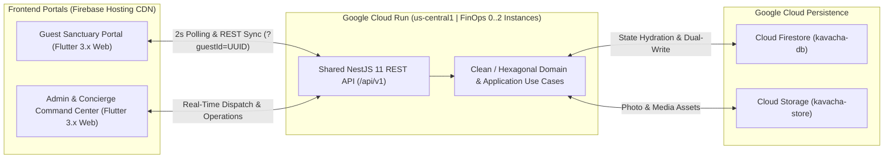

# Kachava Lux — Digital Sanctuary Guest Experience & Operations Command Center

**Kachava Lux** is an ultra-luxury, bilingual (`ES / EN`) digital hospitality ecosystem and architectural sanctuary platform. It connects private villa guests—authenticated seamlessly via passwordless UUID v4 Magic Links—with the Host Admin & Concierge team in real time.

Built with a custom biophilic design system (*Travertine Limestone, Raw Silk, Obsidian Stone, Brushed Gold, and Terracotta Clay*), Kachava Lux orchestrates every touchpoint of the guest journey: from pre-arrival private aviation and airport transfers to bespoke stay personalization, villa larder provisioning, yacht charters, private chef dining, 24/7 concierge dispatch, and non-billing stay activity summaries.

---

## Live Cloud Environments (`kavacha-app` on Google Cloud & Firebase)

| Service / Portal | Platform | Live Production URL |
| :--- | :--- | :--- |
| **Guest Sanctuary Portal** | Firebase Hosting (`web/`) | [https://kavacha-app-guest-portal.web.app](https://kavacha-app-guest-portal.web.app) |
| **Admin & Concierge Command Center** | Firebase Hosting (`admin/`) | [https://kavacha-app-admin-dashboard.web.app](https://kavacha-app-admin-dashboard.web.app) |
| **Backend REST API** | Google Cloud Run (`us-central1`) | [https://kachava-backend-dwapx2x7fa-uc.a.run.app](https://kachava-backend-dwapx2x7fa-uc.a.run.app) |
| **API Health & Base Endpoint** | NestJS 11 (`api/v1`) | [https://kachava-backend-dwapx2x7fa-uc.a.run.app/api/v1/health](https://kachava-backend-dwapx2x7fa-uc.a.run.app/api/v1/health) |

---

## System Architecture



---

## Current Features (`Funcionalidades Actuales`)

### 1. Guest Sanctuary Portal (`web/`)

- **Unified Responsive Mobile & Desktop Experience (`SanctuaryShell`)**:
  - **Mobile-Native Sanctuary (`< 768px`)**: Exact mobile-first experience with tactile bottom navigation bar (`SanctuaryBottomNav`: `Inicio`, `Explorar`, `Concierge`, `Estancia`), quick-access `todas las pantallas` (`All Sanctuary Screens`) modal drawer covering all `1..11` sanctuary modules, and floating action bar.
  - **Widescreen Desktop Sanctuary (`>= 768px`)**: Centered sanctuary container (`maxWidth: 960px`) with proportional typography scaling (`TextScaler.linear(1.18)`), preserving the exact same `1..11` options, bottom navigation bar (`SanctuaryBottomNav`), and `todas las pantallas` drawer without introducing a separate sidebar.
- **Mandatory Passwordless Magic Link Gate & Real-Time Sync**:
  - **Strict `?guestId=<uuid-v4>` Gate**: Accessing the root URL without a valid `?guestId=<uuid>` query parameter displays the **`Acceso Restringido — ID de Huésped Obligatorio`** security screen; valid links bind the guest session immediately with automatic 2-second bi-directional state synchronization and read-only lock upon Host Check-Out (`CHECK-OUT COMPLETADO`).
  - Instant language toggle (`ES / EN`) across all guest screens.
- **Step 1 — Private Aviation & Airport Transfer (`transport`)**:
  - Stay-bounded calendar date picker (`checkInDate .. checkOutDate`), airline, flight number, airport, terminal, estimated arrival time, and transfer notes.
  - Live synchronization of the assigned chauffeur name, vehicle, and airport meeting point dispatched by the Host Admin.
- **Step 2 — Stay Personalization (`personalize`)**:
  - Room climate temperature (`18°C – 26°C`), pillow atelier selection, welcome botanical scent, preferred daily housekeeping schedule (`Horario de Limpieza`), dietary profile, critical allergy alerts, and special occasion notes.
- **Step 3 — Minibar & Villa Larder (`stock-villa`)**:
  - Curated drinks, organic snacks, and gourmet pantry ordering with search and category filtering.
  - **Instant Stepper Reset on Order Confirmation**: Clicking `Confirmar Pedido` (`Confirm Order`) immediately resets all product steppers (`- 0 +`) back to `0` so guests can place additional replenishment orders at any time, while the top status banner tracks the active order (`⏳ Pedido Enviado · Pendiente` → `🛠️ En Preparación` → `✅ Entregado en Villa`) along with the exact ordered item quantities (`2x ...`).
- **Curated Experiences (`explore`), Private Yacht Charter (`yacht`) & In-Villa Chef Dining (`dining`)**:
  - Stay-bounded calendar date validation (`checkInDate .. checkOutDate`) preventing out-of-stay bookings.
  - Preset service time chips plus custom time picker (`⏰ Hora personalizada` via `showTimePicker`).
  - Clean dietary/table preference input fields with non-intrusive placeholder hints (`hintText`).
  - Locked reservation state upon submission with real-time Host Admin approval (`✅ Aprobado / Confirmado`) or cancellation with explicit reason (`❌ Cancelado + Motivo`).
- **24/7 Concierge & Live Chat (`concierge`)**:
  - 4-stage service & maintenance ticket tracker (`Requested → Assigned → In Progress → Completed`) with optional photo attachments.
  - Real-time bi-directional chat with the Host & Concierge team featuring `15px` high-legibility typography and `Enter`-to-send keyboard support.
- **Stay Feedback Survey (`midstay`)**:
  - Interactive 5-star rating (`1–5 ★`), sentiment selector, and open comment box with persistent submitted state.
- **Stay & Departure Summary (`departure`), Biophilic Architecture (`philosophy`) & Guest Profile / Wi-Fi (`profile`)**:
  - Dynamic per-villa/per-stay Wi-Fi SSID and passcode with one-tap copy, emergency contacts, architectural philosophy gallery, and a transparent non-billing summary of acquired stay experiences and minibar orders.

---

### 2. Admin & Concierge Command Center (`admin/`)

- **1. Live Summary & Alerts (`OverviewWorkspace`)**:
  - Real-time operational alert feed with unread badge counters across navigation tabs.
  - **10-Second WebAudio Synthesis Chime**: Triggered exclusively by incoming guest actions (flight updates, stay preferences, minibar orders, experience/yacht/dining bookings, survey submissions, and guest chat messages).
- **2. Villas, Guests, Magic Links & Transfers (`StaysWorkspace`)**:
  - **8-Villa Visual Occupancy Board**: Live status badges (`🟢 LIBRE` / `🔴 OCUPADA`) for Villas 101–108.
  - **Stay Creation & Magic Link Generator**: Create new guest stays on available villas with automatic nights calculation (`checkOut - checkIn`), configurable per-villa/per-stay Wi-Fi credentials, and one-click Magic Link copying.
  - **Guest Preferences & Flight Dispatch Panel**: Framed summary of guest comfort, scent, cleaning schedule, diet, and critical allergies alongside full flight metadata and Chauffeur / Meeting Point assignment.
  - **Host-Only Check-Out Confirmation Modal**: Dedicated confirmation dialog displaying the complete stay summary (stay dates, acquired experiences, minibar orders, and concierge activity) before executing check-out and releasing the villa back to `🟢 LIBRE`.
- **3. Pre-Arrival Minibar & Pantry (`LarderWorkspace`)**:
  - Dynamic product catalog management (create and delete minibar/pantry SKUs with bilingual titles, categories, and prices).
  - Per-stay order fulfillment cards displaying exact requested item quantities (`Cantidad: Nx`) and 3-stage status progression (`Pending → Assigned → Stocked in Villa`).
- **4. Yacht, Private Dining & Tours (`ExperiencesWorkspace`)**:
  - Dynamic experience catalog management (create and delete curated experiences across Yacht, Dining, Wellness, and Excursions).
  - Real-time guest booking management with one-click approval (`Aprobar / Confirmar`) or cancellation with mandatory reason modal (`Cancelar con Motivo`), syncing immediately to the guest's portal.
- **5. 24/7 Chat & Concierge Dispatch (`ConciergeWorkspace`)**:
  - 4-stage ticket lifecycle control (`Requested → Assigned → In Progress → Completed`), staff assignment, maintenance photo attachment lightbox preview, and real-time bi-directional Host chat.
- **6. Stay Summary & Guest Feedback (`FolioWorkspace`)**:
  - Consolidated dashboard of guest feedback surveys (`¿Cómo va tu estancia?` star ratings, sentiment, and comments) and complete per-stay activity summaries without credit card billing or guest self-checkout.

---

## Technology Stack & FinOps Cloud Architecture

| Layer | Technology | Highlights |
| :--- | :--- | :--- |
| **Guest & Admin Frontends** | `Flutter 3.x Web` (`Dart 3`) | Material 3 custom biophilic design system (`Travertine`, `Obsidian`, `Brushed Gold`), custom SVG favicons, responsive mobile & desktop layouts. |
| **Backend API** | `NestJS 11` (`Node.js 22 Alpine`, `TypeScript`) | Clean / Hexagonal Architecture (Ports & Adapters), strict DTO validation, REST `/api/v1` endpoints, and real-time polling state sync. |
| **Database & Storage** | `Google Cloud Firestore` (`kavacha-db`) & `Cloud Storage` (`kavacha-store`) | Automatic cold-start state hydration from Firestore with resilient dual-write persistence and media storage bucket. |
| **Cloud Infrastructure & FinOps** | `Google Cloud Run` + `Cloud Build` + `Firebase Hosting` | Serverless container scaling (`--min-instances=0`, `--max-instances=2`, `1 vCPU`, `512Mi RAM`, `--cpu-throttling`, `--concurrency=80`) achieving **$0 idle compute cost**, paired with global Firebase Hosting multi-site CDN. |
| **Quality Assurance & Testing** | `Jest`, `Flutter Test`, `Playwright` | Backend unit & integration tests (`backend/`), Flutter widget & controller tests (`web/`, `admin/`), and automated Playwright Chromium E2E test suites (`e2e/`). |

---

## Repository Structure

```text
kachava-lux-guest-experience-app/
├── web/                        # Guest Sanctuary Portal (Flutter 3.x Web)
│   ├── config/                 # Environment configs (dev.json, prod.json)
│   ├── lib/
│   │   ├── application/        # SanctuaryController & state orchestration
│   │   ├── core/               # Biophilic theme, typography, i18n, audio
│   │   ├── data/               # Remote API client, wire mapper, seed data
│   │   ├── domain/             # Immutable domain entities & repositories
│   │   └── presentation/       # Responsive SanctuaryShell & 12 sanctuary screens
│   └── test/                   # Unit & widget test suites
├── admin/                      # Admin & Concierge Command Center (Flutter 3.x Web)
│   ├── config/                 # Environment configs (dev.json, prod.json)
│   ├── lib/                    # 6 operational workspaces & WebAudio alert engine
│   └── test/                   # Admin dashboard widget tests
├── backend/                    # Shared NestJS 11 REST API (Clean/Hexagonal)
│   ├── src/
│   │   ├── modules/            # Auth, Stays, Larder, Experiences, Concierge, Folio, Sync
│   │   └── shared/             # Firestore & Storage infrastructure adapters
│   ├── test/                   # Jest unit & E2E API specifications
│   └── Dockerfile              # Multi-stage Node 22 Alpine production container
├── deploy/                     # Cloud Run & Firebase Hosting deployment automation
│   ├── cloudbuild.yaml         # Google Cloud Build pipeline specification
│   ├── deploy-backend.sh       # Cloud Build + Cloud Run deployment & prod.json sync
│   ├── deploy-hosting.sh       # Flutter Web release builds + Firebase multi-site deploy
│   └── deploy-all.sh           # One-command full-stack cloud deployment
├── e2e/                        # Playwright Chromium End-to-End validation suites
├── firebase.json               # Firebase Hosting multi-site & Firestore/Storage rules config
└── run-local.sh                # Unified local full-stack launcher (ports 3000, 3001, 3002)
```

---

## Local Development & Execution (`./run-local.sh`)

### Prerequisites

- **Node.js** `>= 22.x` & **npm**
- **Flutter SDK** `>= 3.x` (with Web support enabled)
- **Python 3** (used by `run-local.sh` to serve prebuilt static bundles rapidly)

### Launch the Full Local Ecosystem

Run the unified launcher from the repository root to start the NestJS Backend, Guest Sanctuary Portal, and Admin Command Center concurrently:

```bash
# Default mode (serves prebuilt web/build/web & admin/build/web if present, or runs flutter)
./run-local.sh

# Live development mode (forces live `flutter run -d web-server` compilation)
./run-local.sh --dev
```

Once started, the local services are available at:

- **Guest Sanctuary Portal (with Demo Magic Link)**: `http://localhost:3000/?guestId=550e8400-e29b-41d4-a716-446655440000`
- **Admin & Concierge Command Center**: `http://localhost:3002`
- **Shared NestJS Backend API**: `http://localhost:3001/api/v1`

---

## Guía Paso a Paso de Prueba End-to-End (Local y Cloud)

Sigue esta guía paso a paso para ejecutar y validar el flujo completo en tiempo real entre el **Host Admin** y el **Huésped** tanto en **Local (`./run-local.sh`)** como en **Cloud**:

### Paso 0 — Levantar el Entorno Local (`./run-local.sh`)

Desde la raíz del repositorio, ejecuta el lanzador unificado para iniciar simultáneamente el Backend NestJS, el Portal del Huésped y el Centro de Comando del Host:

```bash
./run-local.sh
```

- **Consola Host Admin (Local)**: `http://localhost:3002`
- **Portal del Huésped (Local)**: `http://localhost:3000/?guestId=<uuid>` *(generado al crear la estancia en el Admin; abrir `http://localhost:3000` sin `?guestId=` muestra la pantalla de bloqueo **Acceso Restringido — ID de Huésped Obligatorio**)*
- **Backend API (Local)**: `http://localhost:3001/api/v1`
- *(Nota: Si modificas código Dart y deseas recompilar los bundles estáticos locales con `config/dev.json`, ejecuta: `cd web && flutter build web --release --pwa-strategy=none --dart-define-from-file=config/dev.json` y `cd admin && flutter build web --release --pwa-strategy=none --dart-define-from-file=config/dev.json`, o bien inicia en modo compilación en vivo con `./run-local.sh --dev`)*.

### Paso 1 — Crear la Estancia y Generar el Magic Link (Host Admin)

1. Abre la Consola Host Admin en **Local** (`http://localhost:3002`) o **Cloud** ([https://kavacha-app-admin-dashboard.web.app](https://kavacha-app-admin-dashboard.web.app)) y entra en **`2. Villas, Huéspedes, Links y Traslados`** (`2. Villas, Guests, Links & Transfers`).
2. Verifica que las 8 Villas aparezcan en estado **`🟢 LIBRE`** (`🟢 FREE`). Haz clic en **`+ Nueva Estancia / Generar Magic Link`**, ingresa el nombre del huésped (`Familia Gómez`), selecciona **`Villa 102 — Ceiba Suite`**, y elige las fechas de Check-In / Check-Out (`19 Oct` al `22 Oct` → calcula automáticamente `3 noches`).
3. Haz clic en **`Crear y Generar Link`**: `Villa 102` pasa inmediatamente a **`🔴 OCUPADA`** (`🔴 OCCUPIED`). Copia el Magic Link generado:
   - **En Local**: `http://localhost:3000/?guestId=<uuid>`
   - **En Cloud**: `https://kavacha-app-guest-portal.web.app/?guestId=<uuid>`
4. **Validación del Bloqueo de Seguridad**: Abre `http://localhost:3000` (o [https://kavacha-app-guest-portal.web.app](https://kavacha-app-guest-portal.web.app)) *sin* `?guestId=...` y verifica que el portal bloquee el acceso mostrando **`Acceso Restringido — ID de Huésped Obligatorio`**.

### Paso 2 — Pre-Llegada del Huésped: Vuelo, Confort y Minibar (Huésped)

1. Abre el Magic Link copiado (`http://localhost:3000/?guestId=<uuid>` en Local o `https://kavacha-app-guest-portal.web.app/?guestId=<uuid>` en Cloud) en vista Móvil (`< 768px`) o Escritorio (`>= 768px`) y alterna el idioma `EN | ES` en el encabezado según prefieras.
2. **`1. Registrar Vuelo y Transporte`**: Selecciona la fecha de llegada desde el calendario acotado a la estancia, ingresa aerolínea (`Aeroméxico`), número de vuelo (`AM 542`), aeropuerto (`CUN`), terminal (`T2`) y hora de llegada (`2:30 PM`), y pulsa **`Guardar y Sincronizar Vuelo`**.
3. **`2. Confort, Aroma, Dieta y Alergias`**: Elige tipo de almohada, aroma de bienvenida, **`Horario de Limpieza`** (`Mañana (09:00 - 11:00)`), perfil alimenticio y alergias, y pulsa **`Guardar Preferencias`**.
4. **`3. Pedir Bebidas y Minibar`**: Incrementa las cantidades de productos (`+`, por ejemplo `2`) y pulsa **`Confirmar Pedido`**. Verifica que todos los contadores (`- 0 +`) **vuelvan inmediatamente a `0`** para permitir nuevos pedidos en cualquier momento, mientras el banner superior muestra **`⏳ Pedido Enviado · Pendiente`** junto con el desglose de artículos (`2x ...`).

### Paso 3 — Recepción de Alertas en Vivo y Atención (Host Admin)

1. Regresa a la Consola Host Admin (`http://localhost:3002` en Local o [https://kavacha-app-admin-dashboard.web.app](https://kavacha-app-admin-dashboard.web.app) en Cloud): escucha la **alerta sonora WebAudio de 10 segundos** y revisa las notificaciones en **`1. Resumen y Alertas en Vivo`**.
2. En **`2. Villas, Huéspedes, Links y Traslados`**, inspecciona los datos completos del vuelo y el horario de limpieza del huésped; asigna el nombre del chofer y punto de encuentro en el aeropuerto y pulsa **`Guardar y Enviar al Huésped`** (se refleja en vivo en la opción `1` del huésped).
3. En **`3. Minibar y Despensa Pre-Llegada`**, verifica la cantidad exacta (`Cantidad: 2x`), avanza el estado a **`En Preparación`** y luego a **`Entregado en Villa`** (el banner superior del huésped cambia en vivo a **`✅ Entregado en Villa`**).

### Paso 4 — Cena con Chef Privado, Encuesta y Check-Out Final (Ambos Roles)

1. **Huésped** → **`6. Cena con Chef Privado en Villa`**: Selecciona menú de degustación, fecha dentro del rango de la estancia, horario predefinido o personalizado (**`⏰ Hora personalizada`**), nota opcional sobre el placeholder limpio, y envía la solicitud (**`⏳ Pendiente de Aprobación`**).
2. **Host Admin** → **`4. Yate, Cena Privada y Tours`**: Pulsa **`Aprobar / Confirmar`** (o **`Cancelar con Motivo`** para comprobar la sincronización del motivo de cancelación en la pantalla del huésped).
3. **Huésped** → **`8. ¿Cómo va tu estancia?`**: Selecciona **`5 ★`**, etiqueta de sentimiento y comentario, y envía la encuesta.
4. **Host Admin** → Revisa en **`6. Resumen de Estancia y Calificación`** la calificación de 5 estrellas y el resumen de servicios adquiridos; luego entra en **`2. Villas, Huéspedes, Links y Traslados`**, pulsa **`Dar Salida / Liberar Villa`** y confirma en el modal de Resumen de Estancia (**`Confirmar Check-Out y Liberar Villa`**). Verifica que `Villa 102` vuelva a **`🟢 LIBRE`** y que el link del huésped quede bloqueado en modo solo lectura (**`CHECK-OUT COMPLETADO`**).

---

## Running Tests & Static Analysis

```bash
# 1. Guest Sanctuary Portal (web/) — Static Analysis & Widget/Unit Tests
cd web && flutter analyze && flutter test

# 2. Admin Command Center (admin/) — Static Analysis & Widget Tests
cd admin && flutter analyze && flutter test

# 3. Shared NestJS Backend (backend/) — Unit & API Integration Tests
cd backend && npm test

# 4. End-to-End Browser Verification (e2e/) — Playwright Chromium Suite
cd e2e && npx playwright test
```

---

## Cloud Deployment (`./deploy/deploy-all.sh`)

The production environment is hosted on Google Cloud Platform (`PROJECT_ID=kavacha-app`, region `us-central1`) and Firebase Hosting.

```bash
# Full-stack deployment (Cloud Run Backend + Both Firebase Hosting Portals)
./deploy/deploy-all.sh

# Or deploy individual tiers:
./deploy/deploy-backend.sh   # Builds Docker image via Cloud Build, deploys Cloud Run, updates config/prod.json
./deploy/deploy-hosting.sh   # Compiles Flutter Web release bundles and deploys to Firebase Hosting
```
