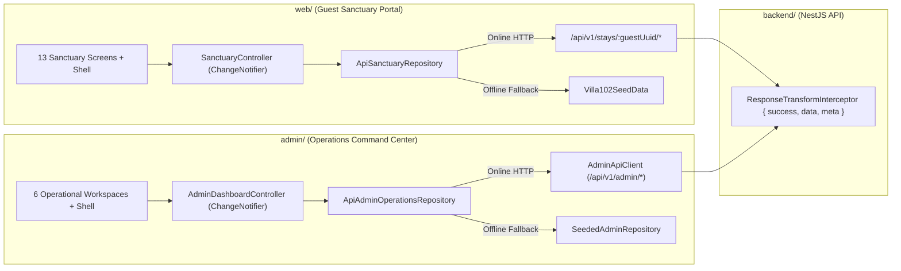

# 001. Flutter Web Dual-App Architecture, REST Envelope Alignment & Offline-Resilient Hybrid Repositories

- **Status**: accepted
- **Date**: 2026-10-16
- **Deciders**: Flutter Systems Architect (`flutter-architect`)

## Context

The Kachava Lux platform comprises two standalone Flutter Web applications (`web/` for the Villa 102 Guest Sanctuary Portal and `admin/` for the Sanctuary Operations & Concierge Command Center) backed by a NestJS modular monolith (`backend/` at `/api/v1/*`). An architectural audit across both Flutter codebases and the NestJS controllers revealed three integration and lifecycle gaps:

1. **Guest Portal API Route & Envelope Drift (`web/` <-> `backend/`)**:
   - `ApiSanctuaryRepository` (`web/lib/data/repositories/api_sanctuary_repository.dart`) currently targets `$baseUrl/guests/$guestUuid` and sends `PATCH` mutations to non-existent sub-routes (`transport`, `preferences`, `larder`, `yacht-charter`, `dining`, `requests`, `checkout`).
   - `GuestStaysController` (`backend/src/modules/guest/guest-stays.controller.ts`) exposes `/api/v1/stays/:guestUuid` with specific HTTP verbs (`GET`, `PATCH /transfer`, `PATCH /personalization`, `PUT /larder`, `POST /bookings`, `POST /concierge-requests`, `POST /concierge-requests/:requestId/messages`, `POST /concierge-requests/upload-url`, `POST /midstay-checkin`, `POST /verify-step-up`, `POST /folio/checkout`), and `CatalogController` (`backend/src/modules/guest/catalog.controller.ts`) exposes `GET /api/v1/catalog/{larder,experiences,yacht}`.
   - All backend responses are wrapped by `ResponseTransformInterceptor` (`backend/src/common/interceptors/response-transform.interceptor.ts`) in `{ "success": true, "data": <payload>, "meta": { "timestamp": "...", "requestId": "..." } }`.
2. **Admin Dashboard Repository Isolation (`admin/` <-> `backend/`)**:
   - `KachavaAdminApp` (`admin/lib/main.dart`) defaults directly to `SeededAdminRepository()` with `apiClient: null`, bypassing `AdminApiClient` (`/api/v1/admin/*`).
   - `AdminController` (`backend/src/modules/admin/admin.controller.ts`) exposes full operational endpoints (`/api/v1/admin/{auth/login,alerts,stays,bookings,larder-orders,concierge-requests,midstay-feedback,staff}`).
3. **Controller Lifecycle & Environment Configuration**:
   - `KachavaGuestPortalApp` (`web/lib/main.dart`) is a `StatelessWidget` that receives an externally instantiated `SanctuaryController` from `main()` without a `StatefulWidget` lifecycle owner to invoke `.dispose()`.
   - Neither `web/` nor `admin/` provides `--dart-define-from-file` configuration files (`config/dev.json` and `config/prod.json`).

## Decision

We adopt a unified **Layered MVVM + Offline-Resilient Hybrid Repository Architecture** across both `web/` and `admin/` using vanilla `ChangeNotifier` (`SanctuaryController` and `AdminDashboardController`) as the single primary state management solution per application, paired with `--dart-define-from-file` environment configuration (`config/dev.json` and `config/prod.json`). Both `ApiSanctuaryRepository` (`web/`) and `ApiAdminOperationsRepository` (`admin/`) will communicate with the canonical `/api/v1/stays/:guestUuid/*` and `/api/v1/admin/*` endpoints, unwrap the `{ success, data, meta }` envelope, and deterministically fall back to Villa 102 seeded state whenever the backend is unreachable or disabled in widget tests.



## Alternatives Considered

- **Migrating to Riverpod or Bloc** — Rejected because both `web/` and `admin/` already have complete, well-tested `ChangeNotifier` controllers (`SanctuaryController` and `AdminDashboardController`) with zero third-party state boilerplate and sub-16ms frame budgets. Introducing a second state library violates the Single State Solution Principle.
- **Extracting a shared Dart package (`packages/kachava_shared`)** — Rejected under the High-Bar Module Boundary criteria because Guest Portal domain entities (e.g., 13-screen `SanctuarySnapshot`, 432Hz soundscape state) and Admin Command Center entities (e.g., RBAC `StaffMember`, `OperationalAlert`, SLA counters, multi-villa filters) change for independent business reasons and have distinct view models.
- **Hard-failing when Backend is Offline** — Rejected because luxury resort demos, local widget tests, and intermittent resort Wi-Fi require deterministic zero-latency fallback to Villa 102 (`Villa102SeedData` and `SeededAdminRepository`).

---

## Detailed Implementation Contracts for `flutter-implementer`

### 1. Guest Portal REST Contract & Envelope Unwrapping (`web/`)

**Owned Files (Track Web)**:
- `web/lib/data/repositories/api_sanctuary_repository.dart`
- `web/lib/domain/repositories/sanctuary_repository.dart` (optional default/non-breaking methods if needed)
- `web/lib/application/sanctuary_controller.dart`
- `web/lib/main.dart`
- `web/config/dev.json`
- `web/config/prod.json`
- `web/test/domain_and_controller_test.dart`
- `web/test/guest_portal_widget_test.dart`

#### 1.1 Environment Base URL & Envelope Helper in `ApiSanctuaryRepository`
- Default `baseUrl` to `const String.fromEnvironment('API_BASE_URL', defaultValue: 'http://localhost:3001/api/v1')`.
- Provide an envelope unwrapping helper that handles both NestJS `{ "success": true, "data": ... }` responses and flat JSON maps:
  ```dart
  Map<String, dynamic>? _unwrapDataMap(String body) {
    if (body.isEmpty) return null;
    final decoded = jsonDecode(body);
    if (decoded is Map<String, dynamic>) {
      final inner = decoded['data'];
      if (inner is Map<String, dynamic>) {
        return inner;
      }
      return decoded;
    }
    return null;
  }
  ```
- Headers built by `_buildHeaders(String guestUuid, {String? stepUpSession})`:
  - `'Content-Type': 'application/json'`
  - `'Accept': 'application/json'`
  - `'Authorization': 'Bearer $guestUuid'`
  - If `stepUpSession != null && stepUpSession.isNotEmpty`: include both `'X-StepUp-Session': stepUpSession` and `'X-StepUp-Token': stepUpSession` (matching `StepUpVerifiedGuard`).

#### 1.2 Exact Endpoint & Payload Mapping (`ApiSanctuaryRepository` <-> `GuestStaysController`)

| Repository Method | HTTP Verb & Route | Request DTO Payload (`backend/src/modules/guest/dto/guest.dto.ts`) | Response Handling & Fallback |
| :--- | :--- | :--- | :--- |
| `loadSanctuary(guestUuid)` | `GET $baseUrl/stays/$guestUuid` | None (Auth header `Bearer $guestUuid`) | Unwrap `data` map. Read `status` or `lifecycleStatus` via `StayLifecycleStatus.fromWire((data['status'] ?? data['lifecycleStatus']) as String?)`. Hydrate `transport` from `data['flightTransfer']` and `preferences` from `data['personalization']` when present, merging cleanly onto `Villa102SeedData.buildDefaultSnapshot(guestUuid)`. Fall back to `Villa102SeedData` on non-200 or network error. |
| `verifyStepUpChallenge(guestUuid, {String? villaNumber, String? lastName})` | `POST $baseUrl/stays/$guestUuid/verify-step-up` | `{'villaNumber': ?villaNumber, 'lastName': ?lastName}` | Unwrap `data` map and return `data['stepUpToken'] as String?`. On offline/exception, return deterministic fallback token `'stepup-verified-102'`. |
| `syncFlightTransport(guestUuid, transport, {stepUpSession})` | `PATCH $baseUrl/stays/$guestUuid/transfer` | `{'arrivalAirport': transport.arrivalAirport, 'airline': transport.airline, 'flightNumber': transport.flightNumber, 'estimatedLanding': transport.estimatedLanding, 'terminal': transport.terminalBay, 'partySize': transport.partySize, 'luggageChecked': transport.luggageChecked, 'luggageCarryOn': transport.luggageCarryOn}` | 900ms timeout; catch network exceptions gracefully. |
| `savePersonalization(guestUuid, preferences, {stepUpSession})` | `PATCH $baseUrl/stays/$guestUuid/personalization` | `{'tripPurpose': preferences.tripPurpose, 'occasionDetails': preferences.occasionNote, 'selectedInterests': preferences.interests, 'pillowType': preferences.pillowType, 'temperatureCurve': '${preferences.ambientTempCelsius}°C', 'scentProfile': preferences.scentProfile, 'lightingRhythm': preferences.circadianLighting, 'dietary': preferences.dietaryRegimen, 'allergies': preferences.allergyAlerts, 'commChannel': preferences.communicationChannel}` | 900ms timeout; catch network exceptions gracefully. |
| `saveLarderOrder(guestUuid, items, {stepUpSession})` | `PUT $baseUrl/stays/$guestUuid/larder` | `{'items': items.where((i) => i.quantity > 0).map((i) => {'itemId': i.id, 'quantity': i.quantity}).toList()}` | Must use HTTP `PUT` and key `'itemId'` (matching `LarderCartLineDto`). |
| `saveYachtCharter(guestUuid, charter, {stepUpSession})` | `POST $baseUrl/stays/$guestUuid/bookings` | `{'bookingType': 'YACHT_CHARTER', 'category': 'Marine & Yacht', 'catalogRefId': charter.selectedPackageId, 'title': charter.vesselModel, 'scheduledDate': charter.selectedDate, 'scheduledTimeSlot': charter.departureWindow, 'partySize': charter.guestCount, 'metadata': {'destinationId': charter.selectedDestinationId, 'selectedAddOns': charter.selectedAddOns}}` | Must use HTTP `POST` to `/bookings` (matching `CreateBookingDto`). |
| `saveDiningReservation(guestUuid, reservation, {stepUpSession})` | `POST $baseUrl/stays/$guestUuid/bookings` | `{'bookingType': 'PRIVATE_DINING', 'category': 'Private Dining', 'catalogRefId': reservation.selectedMenuId, 'title': 'Private Chef Dining (${reservation.selectedMenuId})', 'scheduledDate': reservation.selectedEvening, 'scheduledTimeSlot': reservation.serviceTime, 'partySize': reservation.guestCount, 'metadata': {'tableSetting': reservation.tableSetting, 'dietaryNotes': reservation.dietaryNotes}}` | Must use HTTP `POST` to `/bookings` (matching `CreateBookingDto`). |
| `submitConciergeRequest(guestUuid, request, {stepUpSession})` | `POST $baseUrl/stays/$guestUuid/concierge-requests` | `{'type': 'request', 'category': request.category, 'title': request.title, 'details': request.details, if (request.photoUrl != null) 'photoStoragePath': request.photoUrl}` | Must use HTTP `POST` to `/concierge-requests` (matching `CreateConciergeRequestDto`). |
| `appendConciergeMessage(guestUuid, requestId, text, {senderName, stepUpSession})` | `POST $baseUrl/stays/$guestUuid/concierge-requests/$requestId/messages` | `{'text': text, if (senderName != null) 'senderName': senderName}` | Dispatches guest chat message (`CreateConciergeMessageDto`). |
| `generateConciergeUploadUrl(guestUuid, {required fileName, required contentType, required fileSizeBytes, requestId, stepUpSession})` | `POST $baseUrl/stays/$guestUuid/concierge-requests/upload-url` | `{'fileName': fileName, 'contentType': contentType, 'fileSizeBytes': fileSizeBytes, if (requestId != null) 'requestId': requestId}` | Unwraps `data` and returns `data['uploadUrl'] as String?`. |
| `submitMidStayCheckIn(guestUuid, checkIn, {stepUpSession})` | `POST $baseUrl/stays/$guestUuid/midstay-checkin` | `{'rating': checkIn.rating, 'selectedSentiment': checkIn.sentimentId, 'selectedAspects': checkIn.focusAreas, 'housekeepingPreferences': [checkIn.housekeepingWindow], 'note': checkIn.notes}` | Must use HTTP `POST` to `/midstay-checkin` (matching `CreateMidStayCheckInDto`). |
| `completeCheckout(guestUuid, {required stepUpToken})` | `POST $baseUrl/stays/$guestUuid/folio/checkout` | `{'lateCheckoutRequested': false}` | Must use HTTP `POST` to `/folio/checkout` with `X-StepUp-Session: $stepUpToken` header. |

> **Backward Compatibility Note for `SanctuaryController.verifyStepUp`**:
> Existing unit tests (`web/test/domain_and_controller_test.dart`) assert `expect(controller.verifyStepUp('Miller'), isTrue)` synchronously. Therefore, `SanctuaryController.verifyStepUp(String challengeInput)` **MUST** remain synchronous (`bool`), set `_isStepUpVerified = true` and `_stepUpSessionToken = 'stepup-verified-${_stay.villaNumber}'` immediately upon local match, and optionally trigger an unawaited `_repository.verifyStepUpChallenge(...)` in the background to upgrade `_stepUpSessionToken` if the backend responds with a signed `stepUpToken`.

#### 1.3 `KachavaGuestPortalApp` Lifecycle & Disposal (`web/lib/main.dart`)
- Convert `KachavaGuestPortalApp` from `StatelessWidget` to `StatefulWidget`:
  ```dart
  class KachavaGuestPortalApp extends StatefulWidget {
    const KachavaGuestPortalApp({
      super.key,
      this.controller,
      this.repository,
    });

    final SanctuaryController? controller;
    final SanctuaryRepository? repository;

    @override
    State<KachavaGuestPortalApp> createState() => _KachavaGuestPortalAppState();
  }
  ```
- In `_KachavaGuestPortalAppState`:
  - Track `late SanctuaryController _controller;` and `late bool _ownsController;`.
  - In `initState()`:
    - If `widget.controller != null`, set `_controller = widget.controller!; _ownsController = false;`.
    - Otherwise, set `_ownsController = true; _controller = SanctuaryController(repository: widget.repository ?? ApiSanctuaryRepository(), soundscape: SanctuarySoundscapeSynthesizer()); _controller.initialize();`.
  - In `didUpdateWidget(covariant KachavaGuestPortalApp oldWidget)`:
    - If `widget.controller != oldWidget.controller`, dispose the owned controller if `_ownsController` was true, and bind the new controller.
  - In `dispose()`:
    - If `_ownsController` is `true`, call `_controller.dispose()`.
- In `main()`:
  ```dart
  void main() {
    WidgetsFlutterBinding.ensureInitialized();
    runApp(const KachavaGuestPortalApp());
  }
  ```

---

### 2. Admin Hybrid Repository & REST Integration (`admin/`)

**Owned Files (Track Admin)**:
- `admin/lib/data/admin_api_client.dart`
- `admin/lib/data/api_admin_operations_repository.dart` (new file)
- `admin/lib/data/seeded_admin_repository.dart`
- `admin/lib/main.dart`
- `admin/config/dev.json`
- `admin/config/prod.json`
- `admin/test/domain_and_controller_test.dart`
- `admin/test/admin_dashboard_widget_test.dart`

#### 2.1 `AdminApiClient` Base URL Normalization & Envelope Unwrapping (`admin/lib/data/admin_api_client.dart`)
- Read `static const String defaultBaseUrl = String.fromEnvironment('API_BASE_URL', defaultValue: 'http://localhost:3001/api/v1/admin');`.
- Normalize `_resolvedAdminBaseUrl` in `AdminApiClient` so that whether `baseUrl` is passed as `'http://localhost:3001/api/v1'` (from `config/*.json`) or `'http://localhost:3001/api/v1/admin'` (default in existing tests), all relative paths (`'/alerts'`, `'/stays'`, etc.) resolve to `/api/v1/admin/...`:
  ```dart
  String get _adminBaseUrl {
    final trimmed = baseUrl.endsWith('/')
        ? baseUrl.substring(0, baseUrl.length - 1)
        : baseUrl;
    return trimmed.endsWith('/admin') ? trimmed : '$trimmed/admin';
  }
  ```
- Ensure `getJson`, `postJson`, and `patchJson` apply a bounded timeout (`const Duration(milliseconds: 900)`) and return the decoded JSON map (preserving `response['success']` and `response['data']` so existing `AdminApiClient` unit tests continue to pass).

#### 2.2 Hybrid `ApiAdminOperationsRepository` (`admin/lib/data/api_admin_operations_repository.dart`)
- Create `ApiAdminOperationsRepository implements AdminOperationsRepository` that composes `AdminApiClient` and `SeededAdminRepository`:
  ```dart
  class ApiAdminOperationsRepository implements AdminOperationsRepository {
    ApiAdminOperationsRepository({
      AdminApiClient? apiClient,
      SeededAdminRepository? fallbackRepository,
      this.enableNetwork = true,
    })  : _apiClient = apiClient ?? AdminApiClient(),
          _fallback = fallbackRepository ?? SeededAdminRepository();

    final AdminApiClient _apiClient;
    final SeededAdminRepository _fallback;
    final bool enableNetwork;
  ```
- **Read Operations (`fetch*`)**:
  - When `enableNetwork` is `true`, attempt the corresponding `GET` call on `_apiClient` (`GET /staff`, `GET /alerts`, `GET /stays`, `GET /bookings`, `GET /larder-orders`, `GET /concierge-requests`, `GET /midstay-feedback`).
  - Extract `final data = response['data'];`. If `data is List` and non-empty, map wire items onto the domain models (merging with seeded defaults for any UI-specific fields) or synchronize state; if the request throws any exception (`AdminApiException`, `ClientException`, `TimeoutException`, or Flutter test `HttpOverrides` 400 error) or returns empty/invalid data, deterministically return `_fallback.fetch*()`.
- **Mutation Operations**:
  - Attempt the live REST mutation against `_apiClient` when `enableNetwork` is `true` (catching network/offline errors so offline mutations never crash the UI), and apply the state update on `_fallback` so local state remains immediately consistent:
    - `acknowledgeAlert`: `PATCH /alerts/$alertId/acknowledge` with `{'staffId': staffId}`
    - `createStay`: `POST /stays` with `{'guestName': guestNames, 'villaId': villaName, 'stayDatesLabel': '$checkInDate - $checkOutDate', 'celebration': occasion}` (if response contains `data['stay']['guestTokenUuid']`, use it)
    - `regenerateGuestUuid`: `POST /stays/$stayId/regenerate-token` with `{}` (if response contains `data['guestTokenUuid']`, update stay with that UUID)
    - `updateStayLifecycle`: `PATCH /stays/$stayId/transfer` or local lifecycle update
    - `updateTransferDispatch`: `PATCH /stays/$stayId/transfer` with `{'assignedStaffId': chauffeurId, 'assignedDriver': chauffeurName, 'status': transferStatus}`
    - `assignAndUpdateBooking`: `PATCH /bookings/$bookingId/assign` with `{'assignedStaffId': staffId, 'status': status}`
    - `updateLarderOrder`: `PATCH /larder-orders/$orderId/status` with `{'provisioningStatus': status, 'assignedStaffId': staffId}`
    - `updateConciergeTicket`: `PATCH /concierge-requests/$requestId` with `{'status': stage.label, 'currentStep': stage.step, if (staffId != null) 'assignedStaffId': staffId}`
    - `appendConciergeReply`: `PATCH /concierge-requests/$requestId` with `{'replyMessage': messageText, 'message': messageText}`
    - `attendMidStayPulse`: `GET /midstay-feedback` / local SLA update via `_fallback.attendMidStayPulse(...)`
    - `approveExpressCheckout`: `PATCH /stays/$stayId/folio/approve-checkout` with `{'approveLateCheckout': approveLateCheckout}`
- Wire `KachavaAdminApp` (`admin/lib/main.dart`) to default to `ApiAdminOperationsRepository()`:
  ```dart
  _controller = AdminDashboardController(
    repository: widget.repository ?? ApiAdminOperationsRepository(),
  );
  ```

---

### 3. `--dart-define-from-file` Configuration (`web/config/` & `admin/config/`)

Create identical environment configuration files in both Flutter projects so builds and runs use `--dart-define-from-file=config/dev.json` or `--dart-define-from-file=config/prod.json`:

1. `web/config/dev.json` & `admin/config/dev.json`:
   ```json
   {
     "APP_ENV": "development",
     "API_BASE_URL": "http://localhost:3001/api/v1",
     "GUEST_PORTAL_URL": "http://localhost:8080"
   }
   ```
2. `web/config/prod.json` & `admin/config/prod.json`:
   ```json
   {
     "APP_ENV": "production",
     "API_BASE_URL": "https://api.kachavalux.com/api/v1",
     "GUEST_PORTAL_URL": "https://sanctuary.kachavalux.com"
   }
   ```

---

## Consequences

- **Positive**:
  - Guest Portal (`web/`) and Admin Command Center (`admin/`) communicate with the exact NestJS `/api/v1/stays/:guestUuid/*` and `/api/v1/admin/*` routes and DTO schemas, properly unwrapping `{ success, data, meta }`.
  - Offline demo resilience and deterministic widget testing (`flutter test`) are preserved via automatic fallback to `Villa102SeedData` and `SeededAdminRepository`.
  - `SanctuaryController` is properly owned and disposed by `KachavaGuestPortalApp` when not externally injected by tests, eliminating `ChangeNotifier` lifecycle leaks.
  - Environment configuration is standardized via `--dart-define-from-file` across both web applications with zero hardcoded production secrets.
- **Trade-offs / Maintenance**:
  - Changes to NestJS DTO contracts in `backend/src/modules/guest/dto/guest.dto.ts` or `backend/src/modules/admin/dto/admin.dto.ts` must be kept in sync with `ApiSanctuaryRepository` and `ApiAdminOperationsRepository`.

## Compliance Checklist for `flutter-reviewer`

1. **Zero Conflicting State Libraries**: Verify neither `web/` nor `admin/` introduces Riverpod, Bloc, or Signals; `ChangeNotifier` + `ListenableBuilder` remains the sole state management pattern.
2. **Route & Verb Conformance**:
   - `ApiSanctuaryRepository` (`web/`) **MUST** target `$baseUrl/stays/$guestUuid` (never `/guests/$guestUuid`), use `PUT` for `/larder`, `POST` for `/bookings`, `/concierge-requests`, `/midstay-checkin`, and `/folio/checkout`, and `PATCH` for `/transfer` and `/personalization`.
   - `AdminApiClient` and `ApiAdminOperationsRepository` (`admin/`) **MUST** resolve all admin calls under `/api/v1/admin/*` and unwrap `{ data }`.
3. **Controller Disposal**: Verify `KachavaGuestPortalApp` in `web/lib/main.dart` is a `StatefulWidget` that disposes its internally created `SanctuaryController` in `dispose()`.
4. **Configuration & Secrets**: Verify `config/dev.json` and `config/prod.json` exist in both `web/` and `admin/`, contain no raw credentials/private keys, and `String.fromEnvironment('API_BASE_URL', ...)` is used in both data layers.
5. **Static Analysis & Tests**: Both `web/` and `admin/` must pass `flutter analyze` with 0 issues and `flutter test` with 100% passing unit and widget tests.
