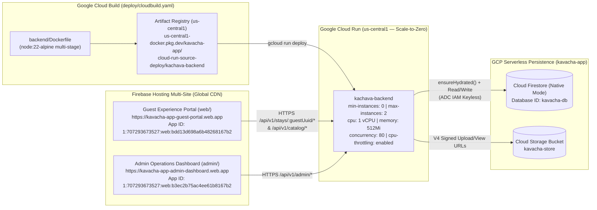
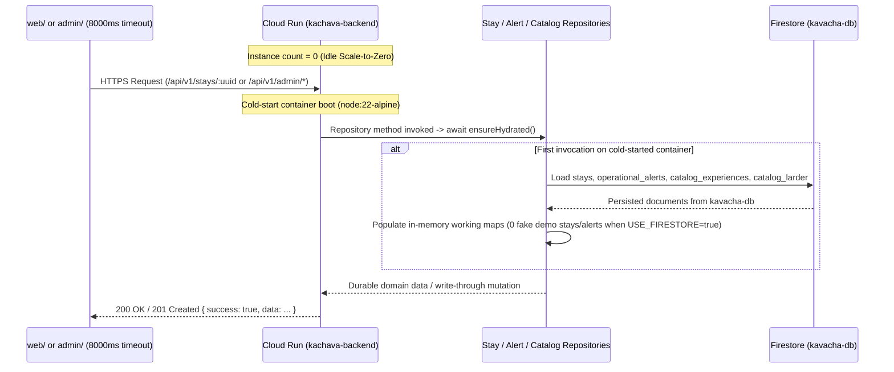

# ADR-003: Ultra-Low-Cost GCP Cloud Build, Scale-to-Zero Cloud Run (`min-instances=0`), Cold-Start Firestore Hydration & Multi-Site Firebase Hosting Architecture (`kavacha-app`)

- **Status**: Accepted
- **Date**: 2026-10-19
- **Deciders**: Software Architect & Principal Technical Director (`architect-engineer`)
- **Supersedes / Extends**: [ADR-001](./001-flutter-web-dual-app-architecture.md) · [ADR-002](./ADR-002-veridical-realtime-architecture.md)

---

## 1. Context & Problem Statement

The Kachava Lux Digital Hospitality Platform (`web/` Guest Experience Portal, `admin/` Administrative & Concierge Operations Dashboard, and `backend/` NestJS API) is deployed to production on Google Cloud Platform (GCP) and Firebase under project **`kavacha-app`** (`projectNumber: 707293673527`, primary region **`us-central1`**, Firestore Native Mode database **`kavacha-db`**, and Cloud Storage bucket **`kavacha-store`**).

Four architectural and FinOps requirements govern this production release:

1. **FinOps Imperative (Zero Idle Compute Cost)**:
   - As an ultra-luxury boutique sanctuary (`<= 50` concurrent users across guests and staff), workload traffic is bursty with prolonged idle windows overnight and between check-ins.
   - Running Google Cloud Run with `min-instances: 1` incurs continuous 24/7 compute billing even when zero requests are served. To achieve maximum cost efficiency (`$0.00/month` idle compute cost and maximum utilization of the Google Cloud Run Free Tier), `kachava-backend` must operate in scale-to-zero mode (`--min-instances=0`) with request-scoped CPU billing (`--cpu-throttling`), right-sized resources (`--cpu=1`, `--memory=512Mi`, `--concurrency=80`), and a strict upper scaling bound (`--max-instances=2`).
2. **Reproducible Cloud-Native CI/CD (`deploy/cloudbuild.yaml`)**:
   - Container builds and Cloud Run rollouts must execute deterministically inside Google Cloud Build using the multi-stage `backend/Dockerfile` (`node:22-alpine`), pushing immutable artifacts to Artifact Registry (`us-central1-docker.pkg.dev/kavacha-app/cloud-run-source-deploy/kachava-backend`) before deploying to Cloud Run.
3. **Cold-Start State Durability under `min-instances=0`**:
   - Because `--min-instances=0` terminates idle container instances, any state kept solely in Node.js process memory is lost across scale-to-zero cycles.
   - All backend repositories—specifically `FirestoreStayRepositoryAdapter`, `InMemorySeededAlertRepository`, and `InMemorySeededCatalogRepository`—must durably persist mutations to Firestore (`kavacha-db`), hydrate their working state from Firestore on container startup (`ensureHydrated()`), and suppress fake Villa 102 demo seed data when `USE_FIRESTORE=true`.
   - In addition, `AdminService.createReservation` must generate guest Magic Links using the production `GUEST_PORTAL_URL` environment variable (`https://kavacha-app-guest-portal.web.app`) instead of hardcoded `http://localhost:3000`.
4. **Firebase Hosting Multi-Site Isolation**:
   - Both Flutter Web applications must be served via Firebase Hosting global CDN from independent sites within project `kavacha-app`:
     - **`kavacha-app-guest-portal`** (`https://kavacha-app-guest-portal.web.app`) linked to Firebase Web App `1:707293673527:web:bdd13d698a6b48268167b2`.
     - **`kavacha-app-admin-dashboard`** (`https://kavacha-app-admin-dashboard.web.app`) linked to Firebase Web App `1:707293673527:web:b3ec2b75ac4ee61b8167b2`.

---

## 2. Quality Attribute Drivers (SEI 6-Part Scenarios)

| ID | Quality Attribute | Source | Stimulus | Artifact | Environment | Response | Response Measure |
| :--- | :--- | :--- | :--- | :--- | :--- | :--- | :--- |
| **QAD-1** | **FinOps Cost Efficiency (Scale-to-Zero)** | GCP Billing Engine / Sanctuary Ownership | Zero incoming HTTP requests for `> 15 minutes` during off-peak hours | Cloud Run service `kachava-backend` (`us-central1`) | Production (`kavacha-app`, `707293673527`) | Scales active container instances down to `0` and releases CPU allocation outside active HTTP request lifecycles | **`$0.00/month` idle compute cost** (`--min-instances=0`, `--cpu-throttling`); hard ceiling of `max-instances=2` (`1 vCPU`, `512Mi` RAM, `concurrency=80`) staying within GCP monthly Free Tier allowances |
| **QAD-2** | **Cold-Start State Durability & Veridical Hydration** | Guest (`web/`) or `HOST ADMIN` (`admin/`) | Issues API read/write request immediately after Cloud Run scales from `0 -> 1` instance | `FirestoreStayRepositoryAdapter`, `InMemorySeededAlertRepository`, `InMemorySeededCatalogRepository`, Firestore (`kavacha-db`) | Production cold start (`USE_FIRESTORE=true`, `FIRESTORE_DATABASE_ID=kavacha-db`) | Executes idempotent `ensureHydrated()` against Firestore (`kavacha-db`) before serving traffic; omits demo seed stays and demo alerts | **`100%` data retention** across container scale-to-zero cycles; **`0` fake demo stays/alerts** when `USE_FIRESTORE=true`; cold-start request completes within the `8000ms` client timeout (`< 2500ms` P95 cold start) |
| **QAD-3** | **Automated Cloud Build & Multi-Site Delivery** | Release Engineer / CI Pipeline | Invokes `deploy/cloudbuild.yaml` and Firebase Hosting multi-site deployment | `backend/Dockerfile`, Artifact Registry, Cloud Run `kachava-backend`, Firebase Hosting (`guest-portal`, `admin-dashboard`) | GCP Project `kavacha-app` (`us-central1`) | Builds multi-stage `node:22-alpine` image, pushes to Artifact Registry, deploys Cloud Run revision, and publishes isolated Flutter Web bundles to global CDN | **`HTTP 200 OK`** on live Cloud Run endpoints and both `.web.app` sites; **`0` hardcoded secrets** in repository or container layers |

---

## 3. Architectural Decisions & Technical Contracts

### 3.1 Target Cloud Topology (`kavacha-app`)

### 3.2 Contract 1: Ultra-Low-Cost Cloud Run Compute Specification (`kachava-backend`)

The shared NestJS backend is deployed as a stateless container service named **`kachava-backend`** in region **`us-central1`** under project **`kavacha-app`** (`707293673527`) with the following resource and FinOps constraints:

| Parameter / Flag | Value | FinOps & Architectural Rationale |
| :--- | :--- | :--- |
| **`--min-instances`** | `0` | Scales down to zero instances after idle window; eliminates 24/7 idle compute billing (`$0.00/month` when idle). |
| **`--max-instances`** | `2` | Caps horizontal auto-scaling to prevent unexpected billing spikes while effortlessly handling `160` concurrent requests (`2 * 80`). |
| **`--cpu`** | `1` (`1 vCPU`) | Provides full single-vCPU burst speed for fast NestJS module initialization (`~1.2s–2.0s` cold start) and JSON serialization. |
| **`--memory`** | `512Mi` | `node:22-alpine` NestJS footprint is `~85–110 MiB` RSS; `512Mi` provides >4x headroom while minimizing GiB-second consumption. |
| **`--concurrency`** | `80` | Multiplexes up to 80 concurrent I/O-bound Firestore/Storage HTTP requests on a single container before spawning a second instance. |
| **`--cpu-throttling`** | Enabled (Request-Based Billing) | CPU is only allocated and billed while actively processing an HTTP request or container startup. |
| **`--port`** | `8080` | Standard Cloud Run ingress container port bound by `backend/src/main.ts` (`process.env.PORT \|\| 8080`). |

#### Required Runtime Environment Variables (`kachava-backend`)

| Variable | Production Value | Purpose |
| :--- | :--- | :--- |
| `NODE_ENV` | `production` | Enables production logging and disables verbose stack traces. |
| `USE_FIRESTORE` | `true` | Activates Firestore persistence (`kavacha-db`) and suppresses fake Villa 102 demo stays/alerts. |
| `GCP_PROJECT_ID` | `kavacha-app` | Binds `firebase-admin` to GCP project `kavacha-app` via Application Default Credentials (ADC). |
| `FIRESTORE_DATABASE_ID` | `kavacha-db` | Targets the named Firestore Native Mode database `kavacha-db`. |
| `GCS_BUCKET_NAME` | `kavacha-store` | Targets the Cloud Storage bucket for concierge photo uploads and media assets. |
| `GUEST_PORTAL_URL` | `https://kavacha-app-guest-portal.web.app` | Used by `AdminService.createReservation` to construct veridical production Magic Links (`https://kavacha-app-guest-portal.web.app/?guestId=<uuid>`). |
| `CORS_ALLOWED_ORIGINS` | `https://kavacha-app-guest-portal.web.app,https://kavacha-app-admin-dashboard.web.app` | Restricts browser cross-origin access to the two official Firebase Hosting domains. |

### 3.3 Contract 2: Google Cloud Build Pipeline (`deploy/cloudbuild.yaml`)

All backend container builds and Cloud Run deployments are codified in `deploy/cloudbuild.yaml` (complemented by declarative Knative manifest `deploy/cloudrun-service.yaml` and helper scripts `deploy/deploy-backend.sh`, `deploy/deploy-hosting.sh`, and `deploy/deploy-all.sh`):

1. **Step 1 — Multi-Stage Container Build (`gcr.io/cloud-builders/docker`)**:
   - Builds `backend/Dockerfile` (`node:22-alpine` builder + slim production runtime stage running as non-root `node` user) tagged with both `$COMMIT_SHA` (or timestamp tag) and `:latest` under `us-central1-docker.pkg.dev/kavacha-app/cloud-run-source-deploy/kachava-backend`.
2. **Step 2 — Artifact Registry Push (`gcr.io/cloud-builders/docker`)**:
   - Pushes the built image layers to `us-central1-docker.pkg.dev/kavacha-app/cloud-run-source-deploy/kachava-backend`.
3. **Step 3 — Cloud Run Scale-to-Zero Rollout (`gcr.io/google.com/cloudsdktool/cloud-sdk`)**:
   - Executes `gcloud run deploy kachava-backend` in `us-central1` enforcing `--min-instances=0`, `--max-instances=2`, `--cpu=1`, `--memory=512Mi`, `--concurrency=80`, `--cpu-throttling`, `--allow-unauthenticated`, and the production environment variables.

### 3.4 Contract 3: Cold-Start State Durability (`ensureHydrated()`) under `min-instances=0`

To guarantee zero data loss when Cloud Run recycles containers under `min-instances=0`:

1. **`FirestoreStayRepositoryAdapter` (`backend/src/infrastructure/repositories/firestore-stay.repository.ts`)**:
   - When `USE_FIRESTORE=true`, initializes the in-memory fallback cache **without** Villa 102 demo seed stays (`InMemorySeededStayRepository({ seedDemoData: false })`).
   - Implements idempotent `ensureHydrated()` (guarded by a shared in-flight Promise) that reads all existing stay aggregates from the `stays` collection in `kavacha-db` on first access and writes through every `createStay` and `saveStay` mutation directly to Firestore.
2. **`InMemorySeededAlertRepository` (`backend/src/infrastructure/repositories/in-memory-alert.repository.ts`)**:
   - When `USE_FIRESTORE=true`, suppresses fake initial demo alerts (`seedDemoData: false`), hydrates persisted alerts from the `operational_alerts` collection in `kavacha-db` via `ensureHydrated()`, and writes through new and acknowledged alerts to Firestore.
3. **`InMemorySeededCatalogRepository` (`backend/src/infrastructure/repositories/in-memory-catalog.repository.ts`)**:
   - Hydrates `catalog_experiences` and `catalog_larder` collections from `kavacha-db` via `ensureHydrated()`. If the Firestore catalog collections are initially empty on first project bootstrap, seeds the baseline sanctuary catalog into Firestore once and persists all subsequent `HOST ADMIN` catalog additions and deletions durably across cold starts.
4. **Dynamic Production Magic Link Generation (`backend/src/modules/admin/admin.service.ts`)**:
   - `AdminService.createReservation` reads `process.env.GUEST_PORTAL_URL || 'http://localhost:3000'` (stripping trailing slashes) so that reservations created in production emit `https://kavacha-app-guest-portal.web.app/?guestId=<guestTokenUuid>`.

### 3.5 Contract 4: Firebase Hosting Multi-Site Configuration (`kavacha-app`)

Two Firebase Hosting sites are provisioned in project `kavacha-app` (`707293673527`) and mapped via `.firebaserc` and `firebase.json`:

| Hosting Target (`firebase.json`) | Firebase Hosting Site ID | Production URL | Linked Firebase Web App ID | Source Build Directory & Config |
| :--- | :--- | :--- | :--- | :--- |
| **`guest-portal`** | `kavacha-app-guest-portal` | `https://kavacha-app-guest-portal.web.app` | `1:707293673527:web:bdd13d698a6b48268167b2` | `web/build/web` built with `--dart-define-from-file=config/prod.json` |
| **`admin-dashboard`** | `kavacha-app-admin-dashboard` | `https://kavacha-app-admin-dashboard.web.app` | `1:707293673527:web:b3ec2b75ac4ee61b8167b2` | `admin/build/web` built with `--dart-define-from-file=config/prod.json` |

Both `web/config/prod.json` and `admin/config/prod.json` set `API_BASE_URL` to the live Cloud Run service endpoint (`https://kachava-backend-707293673527.us-central1.run.app/api/v1`) and retain the `8000ms` HTTP timeout established in [ADR-002](./ADR-002-veridical-realtime-architecture.md) so any `1.2s–2.0s` Cloud Run cold start is absorbed transparently without triggering client fallbacks.

---

## 4. Alternatives Considered (ATAM Trade-Off Analysis)

1. **Always-Warm Cloud Run (`min-instances: 1`, `--no-cpu-throttling`)**:
   - *Pros*: Eliminates the `1.2s–2.0s` cold-start latency on the first request after an idle period.
   - *Cons*: Incurs continuous 24/7 vCPU and memory allocation charges (~$25–$40+/month) even when zero guests or staff are active.
   - *Decision*: **Rejected**. Violates the user's explicit FinOps requirement for ultra-low-cost operation. With `node:22-alpine` (`< 2s` cold start) and the `8000ms` client timeout from ADR-002, `--min-instances=0` achieves `$0.00/month` idle cost with negligible user impact.
2. **Purely In-Memory Repositories without Firestore Startup Hydration**:
   - *Pros*: Simpler repository constructor logic with zero Firestore read calls on startup.
   - *Cons*: Under `min-instances=0`, every scale-to-zero cycle wipes newly created reservations, operational alerts, and custom catalog items, or re-injects fake Villa 102 demo data.
   - *Decision*: **Rejected**. Violates data durability and veridical zero-mock guarantees (QAD-2).
3. **Single Firebase Hosting Site with Path Prefix Routing (`/admin/*`)**:
   - *Pros*: Single hosting target to deploy.
   - *Cons*: Couples guest and admin deployment lifecycles, complicates SPA rewrite rules, and weakens origin-level CORS and security header isolation.
   - *Decision*: **Rejected**. Multi-site hosting (`kavacha-app-guest-portal` and `kavacha-app-admin-dashboard`) enforces clean bundle and origin separation at zero additional cost on Firebase Hosting.

---

## 5. Consequences & Architectural Invariants for Verification

### Positive Consequences
- **Zero Idle Cloud Bill**: When no guests or staff are actively interacting with the sanctuary platform, Cloud Run scales to `0` instances and costs `$0.00`.
- **Cold-Start Resilience**: Reservations, operational alerts, and catalog changes survive container recycling without data loss or demo-data pollution.
- **Repeatable Cloud Deployment**: `deploy/cloudbuild.yaml` and `deploy/deploy-*.sh` provide a deterministic, scriptable deployment pipeline with zero hardcoded secrets.

### Trade-Offs & Mitigations
- **First-Request Cold-Start Latency (`~1.2s–2.0s`)**: The very first request after a `> 15 minute` idle period experiences container startup + Firestore `ensureHydrated()` latency. This is mitigated by the lightweight `node:22-alpine` runtime, single-query collection hydration, and the `8000ms` HTTP client timeout configured in both Flutter Web apps.

### Mandatory Invariants for `qa-tester` and `compliance-verifier`
1. **FinOps Configuration Invariant**: Both `deploy/cloudbuild.yaml` and `deploy/cloudrun-service.yaml` **MUST** specify `min-instances=0` (`autoscaling.knative.dev/minScale: "0"`), `max-instances=2` (`maxScale: "2"`), `cpu=1`, `memory=512Mi`, `concurrency=80`, and `cpu-throttling` enabled.
2. **Cold-Start Durability Invariant**: Unit tests (`backend/test/unit/firestore-hydration.spec.ts`) **MUST** empirically prove that when `USE_FIRESTORE=true`, cold-started repository instances hydrate stays, alerts, and catalogs from Firestore (`kavacha-db`) with zero fake demo stays/alerts and generate Magic Links using `GUEST_PORTAL_URL`.
3. **Zero Hardcoded Secrets Invariant**: No service account JSON keys, private tokens, or credentials may exist in `deploy/`, `backend/`, `web/`, or `admin/`. Authentication to Firestore (`kavacha-db`) and Cloud Storage (`kavacha-store`) **MUST** rely exclusively on Cloud Run IAM Application Default Credentials (ADC).
