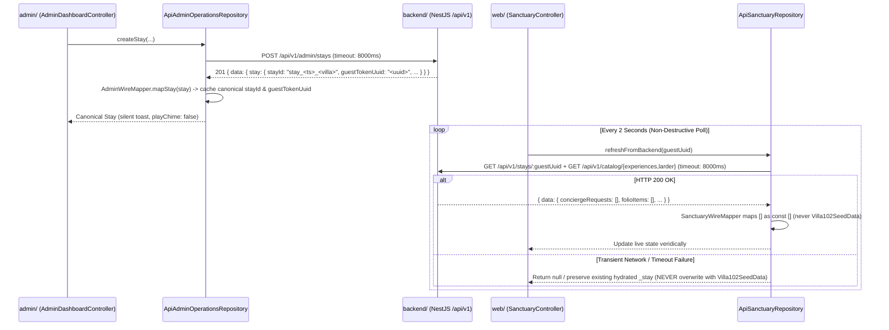

# ADR-002: Veridical Zero-Mock Stay Aggregates, Non-Destructive Real-Time Polling, Configurable Catalogs & Bilateral Transfer Architecture

- **Status**: Accepted
- **Date**: 2026-10-19
- **Deciders**: Software Architect & Principal Technical Director (`architect-engineer`)
- **Supersedes / Extends**: [ADR-001](./001-flutter-web-dual-app-architecture.md)

---

## 1. Context & Problem Statement

Following the initial dual-app deployment (`web/` Guest Experience Portal, `admin/` Administrative & Concierge Operations Dashboard, and `backend/` NestJS API), end-to-end operational testing exposed five architectural defects affecting data veridicality, real-time synchronization, and operator ergonomics:

1. **Mock Data Bleed on New Stays (`POST /api/v1/admin/stays`)**:
   - When `HOST ADMIN` created a new reservation (e.g., for Villa 104), `AdminService` and client-side mappers inherited or spread Villa 102's seeded flight details (`AA 1482` / `AA 172`), personalization preferences (`Goose Down`, `Copal & Amber`, `Shellfish`), concierge tickets, and `$985.00` folio items onto the new stay.
2. **Disappearing Stays in `admin/` & Flickering Request Status Tracker in `web/`**:
   - **Root Cause in `admin/`**: `AdminApiClient` enforced a `900ms` timeout, and `ApiAdminOperationsRepository.createStay` delegated local cache insertion to `SeededAdminRepository.createStay`, which synthesized a local ID (`stay_101`) while ignoring or timing out on the backend's canonical `stayId` (`stay_<timestamp>_<villaId>`). On the next 2-second `GET /api/v1/admin/stays` poll, the cache was overwritten or desynchronized.
   - **Root Cause in `web/`**: When a background 2-second poll (`SanctuaryController.refreshFromBackend`) encountered a transient network failure or 404, `ApiSanctuaryRepository.loadSanctuary` returned `Villa102SeedData.buildDefaultSnapshot`. Furthermore, `SanctuaryWireMapper` fell back to Villa 102 seed data whenever backend arrays (`conciergeRequests`, `folioItems`, `experienceBookings`, `larderOrders`) were empty (`[]`), causing a new guest's empty Request Status Tracker to flicker with Villa 102's 3 seed tickets.
3. **Static Hardcoded Catalogs**:
   - `HOST ADMIN` had no REST endpoints or UI controls to dynamically add or delete Experiences or Villa Larder items and have those changes immediately reflected in the Guest Portal (`web/`).
4. **Unilateral Airport Transfer Model**:
   - Airport transfer lacked a clear bilateral separation between **Guest Flight Input** (`arrivalDate`, `arrivalAirport`, `airline`, `flightNumber`, `terminal`, `estimatedLanding`, `partySize`, `luggageChecked`, `luggageCarryOn`, `notes`) and **Host Admin Chauffeur & Meeting Point Assignment** (`assignedDriver`, `vehicleModel`, `meetingPoint`, `status`).
5. **UI/UX Form Friction, Fake IoT Telemetry & Self-Triggered Chime Alerts**:
   - Forms pre-filled editable `TextEditingController` values instead of using empty controllers with `InputDecoration(hintText: ...)` placeholders; date fields required manual text entry instead of `showDatePicker`; screens displayed unverifiable fake IoT controls (`23°C` climate and NFC door lock); and `AdminDashboardController.showToast` played the 10-second acoustic chime even on `HOST ADMIN`'s own mutations.

---

## 2. Quality Attribute Drivers (SEI 6-Part Scenarios)

| ID | Quality Attribute | Source | Stimulus | Artifact | Environment | Response | Response Measure |
| :--- | :--- | :--- | :--- | :--- | :--- | :--- | :--- |
| **QAD-1** | **Data Integrity (Veridical Zero-Mock)** | `HOST ADMIN` | Submits `POST /api/v1/admin/stays` to create a new reservation | `backend/` (`AdminService`) & `web/` (`SanctuaryWireMapper`) | Normal operation | Persists and renders a clean, empty initial stay aggregate with zero data bled from Villa 102 | `0` pre-populated flight strings, `0` personalization selections, `0` concierge requests, and `$0.00` (`[]`) folio items on new stays |
| **QAD-2** | **Real-Time Sync & Polling Resilience** | `web/` & `admin/` 2-second poll timers | Executes `POST /api/v1/admin/stays` or background `refreshFromBackend()` under variable Cloud Run / Firestore latency | `AdminApiClient`, `ApiAdminOperationsRepository`, `ApiSanctuaryRepository`, `SanctuaryController` | Live network with up to `3000ms` cold-start or transient poll failure | Retains canonical `stayId` & `guestTokenUuid` and preserves hydrated guest state without reverting to `Villa102SeedData` | `8000ms` live HTTP timeout; `0` disappearing stays across polls; `0` seed-data overwrites during transient poll failures |
| **QAD-3** | **Operational Signal-to-Noise (Acoustics)** | `HOST ADMIN` vs. Guest (`web/`) | Performs an admin mutation vs. guest submits a request/booking/transfer | `AdminDashboardController.showToast` & alert poller | Active `admin/` session | Displays visual toast silently for admin mutations; triggers 10-second chime exclusively for new unread guest alerts | `playChime == false` (`0 dB`) on `100%` of `HOST ADMIN` mutations; `playChime == true` (`10s` chime) on new unread `GET /api/v1/admin/alerts` |

---

## 3. Architectural Decisions & Technical Contracts

### 3.1 Contract 1: Zero-Mock Initial Stay Aggregate (`stays/{stayId}`)

When `POST /api/v1/admin/stays` creates a reservation, `AdminService.buildNewStayAggregate` **MUST** construct a clean, empty initial aggregate with zero spreading of Villa 102's flight, personalization, or folio items:

- **`flightTransfer`**:
  ```json
  {
    "arrivalDate": "",
    "arrivalAirport": "",
    "airline": "",
    "flightNumber": "",
    "terminal": "",
    "estimatedLanding": "",
    "partySize": 2,
    "luggageChecked": 0,
    "luggageCarryOn": 0,
    "status": "Not Requested",
    "assignedDriver": "",
    "vehicleModel": "",
    "meetingPoint": "",
    "adminDispatchNotes": ""
  }
  ```
- **`personalization`**:
  ```json
  {
    "pillowType": "",
    "scentProfile": "",
    "dietary": "",
    "dietaryAllergies": [],
    "allergies": "",
    "occasionDetails": "",
    "selectedInterests": []
  }
  ```
- **`folioItems`**: `[]` (`incidentalsSubtotalUSD: 0`, `finalSettledTotalUSD: 0`)
- **Subcollections / Embedded Lists**: `larderOrders: []`, `experienceBookings: []`, `conciergeRequests: []`, `midstayFeedback: []`.

### 3.2 Contract 2: Real-Time Persistence & Non-Destructive Polling Architecture



1. **HTTP Client Timeout Contract (`8000ms`)**:
   - Both `AdminApiClient` (`admin/lib/data/admin_api_client.dart`) and `ApiSanctuaryRepository` (`web/lib/data/repositories/api_sanctuary_repository.dart`) **MUST** use an `8000ms` timeout (`const Duration(milliseconds: 8000)`) when operating with a default/real `http.Client`, while preserving fast fallback when a mock client is injected in unit tests.
2. **Canonical `createStay` Mapping (`admin/`)**:
   - `ApiAdminOperationsRepository.createStay` **MUST** await `POST /api/v1/admin/stays`, map the returned canonical `data['stay']` object via `AdminWireMapper.mapStay`, and synchronize the local cache with the backend's exact `stayId` and `guestTokenUuid`.
3. **Veridical Empty Array Mapping & Non-Destructive Polling (`web/`)**:
   - `SanctuaryWireMapper` **MUST** map explicit empty `[]` lists from the backend (`conciergeRequests`, `folioItems`, `experienceBookings`, `larderOrders`) as `const []` and never fall back to `Villa102SeedData` when a real stay payload is received.
   - `SanctuaryController.refreshFromBackend` **MUST** use a non-destructive fetch that **NEVER** overwrites an already-hydrated stay with `Villa102SeedData` if a background poll fails.

### 3.3 Contract 3: Configurable Catalogs REST Contract (`/api/v1/catalog/*` & `/api/v1/admin/catalog/*`)

| HTTP Verb & Route | Auth Guard | Request / Response Contract | Architectural Role |
| :--- | :--- | :--- | :--- |
| `GET /api/v1/catalog/experiences` | Public / Guest | Returns `{ data: ExperienceCatalogItem[] }` | Consumed by `web/` during `loadSanctuary` / `refreshFromBackend` so Guest Portal always renders the live Experiences catalog. |
| `GET /api/v1/catalog/larder` | Public / Guest | Returns `{ data: LarderCatalogItem[] }` | Consumed by `web/` during `loadSanctuary` / `refreshFromBackend` so Guest Portal always renders the live Villa Larder catalog. |
| `GET /api/v1/admin/catalog/experiences` | `AdminAuthGuard` | Returns `{ data: ExperienceCatalogItem[] }` | Hydrates the Admin Experiences catalog manager. |
| `POST /api/v1/admin/catalog/experiences` | `AdminAuthGuard` | Body: `{ id?, title, category, duration, location, priceText, basePriceUSD, isIncluded, description, image }` | Persists new experience item in `catalog_experiences` and returns the created item. |
| `DELETE /api/v1/admin/catalog/experiences/:id` | `AdminAuthGuard` | Deletes `:id` from `catalog_experiences` | Immediately removes the experience from both Admin and Guest catalogs. |
| `GET /api/v1/admin/catalog/larder` | `AdminAuthGuard` | Returns `{ data: LarderCatalogItem[] }` | Hydrates the Admin Larder catalog manager. |
| `POST /api/v1/admin/catalog/larder` | `AdminAuthGuard` | Body: `{ id?, name, origin, description, price, category, storageType, dietary, image }` | Persists new larder item in `catalog_larder` and returns the created item. |
| `DELETE /api/v1/admin/catalog/larder/:id` | `AdminAuthGuard` | Deletes `:id` from `catalog_larder` | Immediately removes the larder item from both Admin and Guest catalogs. |

### 3.4 Contract 4: Bilateral Transfer Coordination Contract

1. **Guest Flight Input (`PATCH /api/v1/stays/:guestUuid/transfer`)**:
   - **Payload**: `{ arrivalDate, arrivalAirport, airline, flightNumber, terminal, estimatedLanding, partySize, luggageChecked, luggageCarryOn, notes }`.
   - **State Transition & Alerting**: Sets `flightTransfer.status = 'Pending'` (if previously `'Not Requested'`) and emits an unacknowledged `TRANSFER` alert (`operational_alerts`) to `HOST ADMIN`.
2. **Host Admin Chauffeur & Meeting Point Assignment (`PATCH /api/v1/admin/stays/:stayId/transfer`)**:
   - **Payload**: `{ assignedDriver, vehicleModel, meetingPoint, status, adminDispatchNotes }` where `status` is in `['Pending', 'Confirmed', 'En Route', 'Completed']`.
   - **State Transition & Silence**: Updates `stays/{stayId}.flightTransfer` for immediate Guest Portal visibility without emitting a self-alert to `operational_alerts`.

### 3.5 Contract 5: UI/UX Form, Calendar, Zero-Fake-IoT & Alert Chime Rules

1. **Empty Controllers + Placeholder Hints**: All text inputs across `web/` and `admin/` use empty `TextEditingController()` instances paired with `InputDecoration(hintText: ...)` placeholders (zero pre-filled sample text that users must delete).
2. **Calendar Date Pickers**: All date inputs across `web/` and `admin/` use Flutter's `showDatePicker` modal control.
3. **Removal of Fake IoT & NFC Controls**: Remove fake IoT climate (`23°C`) and fake NFC digital door lock controls from all UI screens and specifications.
4. **Silent Admin Mutations (`playChime: false`)**: `AdminDashboardController.showToast(msg, {bool playChime = false})` defaults to `playChime: false` for all `HOST ADMIN` mutations, and only plays the 10-second chime (`playChime: true`) when new unread guest alerts arrive from `GET /api/v1/admin/alerts` or when explicitly testing the chime.

---

## 4. Consequences & Verification Invariants

### Positive Consequences
- New stays created in `admin/` start with a 100% veridical zero-mock state and never disappear after the 2-second poll cycle.
- Guest Portal (`web/`) never flickers or overwrites live guest state with Villa 102 seed data during background polling.
- `HOST ADMIN` can curate Experiences and Larder items live, coordinate airport transfers bilaterally, and operate without self-triggered chime fatigue.

### Verification Invariants for `qa-tester` & `compliance-verifier`
1. `AdminService.buildNewStayAggregate` returns empty `flightTransfer` (`status: 'Not Requested'`), empty `personalization`, and empty `[]` collections (`folioItems`, `larderOrders`, `experienceBookings`, `conciergeRequests`, `midstayFeedback`).
2. `AdminApiClient` and `ApiSanctuaryRepository` default to an `8000ms` timeout for live HTTP clients.
3. `SanctuaryController.refreshFromBackend` never overwrites a hydrated stay with `Villa102SeedData` on network error, and `SanctuaryWireMapper` maps `[]` from the backend as `const []`.
4. `AdminDashboardController.showToast` defaults to `playChime: false` on all admin mutations.
