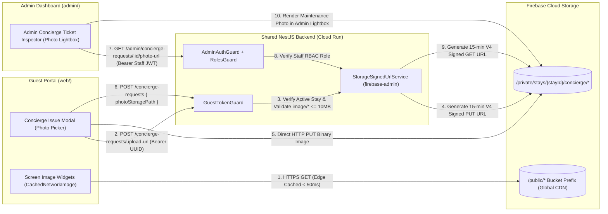

# Kachava Lux — GCP Firestore Data Model & Firebase Cloud Storage Architecture

> **Document Type**: Data & Storage Architecture Specification (Diátaxis: Reference & Explanation)
> **System Scope**: GCP Firestore (Native Mode) Collections, Subcollections, Cross-Stay Collection Group Indexes & Firebase Cloud Storage Hierarchy for Guest Portal (`web/`) and Admin Dashboard (`admin/`)
> **Related Specifications**: [TECH_STACK.md](./TECH_STACK.md) · [SPECIFICATION.md](./SPECIFICATION.md) · [USER_STORIES.md](./USER_STORIES.md) · [UI_UX_DESIGN.md](./UI_UX_DESIGN.md)

---

## 1. Data Architecture Overview & Design Principles

The **Kachava Lux Digital Hospitality Platform** uses **Google Cloud Firestore (Native Mode)** as its primary operational datastore and **Firebase Cloud Storage** for static luxury photography and guest-generated concierge attachments, serving both the **Guest Experience Portal (`web/`)** and the **Administrative & Concierge Operations Dashboard (`admin/`)**.

### 1.1 Core Data Modeling Principles

1. **Single-Read Guest Dashboard Hydration (`< 200ms` DB Target)**:
   - To satisfy the strict **`< 2 seconds` end-to-end response time SLA** defined in [TECH_STACK.md](./TECH_STACK.md), the root `stays/{stayId}` document is designed as a **read-optimized aggregate root**.
   - High-frequency summary data required by the **Residency Home (`home`)**, **Private Aviation & Transfer (`transport`)**, **Stay Personalization (`personalize`)**, and **Guest Profile (`profile`)** screens is embedded directly as structured sub-maps within `stays/{stayId}`. Loading the initial guest portal requires **1 single indexed query** (`stays` where `guestTokenUuid == :uuid`), completing in `15–40ms`.
2. **Subcollections with Denormalized Context for Cross-Stay Admin Queries**:
   - Entities that grow dynamically or require independent lifecycle tracking—**Larder Orders (`larder_orders`)**, **Experience & Yacht Bookings (`experience_bookings`)**, **Concierge Service Tickets (`concierge_requests`)**, **Mid-Stay Feedback (`midstay_feedback`)**, and **Itemized Folio Ledger Entries (`folio_items`)**—are modeled as hierarchical subcollections under `stays/{stayId}`.
   - To enable the **Admin Operations Dashboard (`admin/`)** to filter across all active stays simultaneously without executing N+1 parent lookups, each subcollection document embeds denormalized header attributes (`stayId`, `villaId`, `villaName`, `guestNames`) alongside staff assignment metadata (`assignedStaffId`, `assignedStaffName`, `assignedDepartment`, `assignedAt`, `notifiedAt`, `adminNotes`). A single Firestore **`COLLECTION_GROUP` query** hydrates any Admin operational board in `< 60ms`.
3. **Real-Time Operational Alert Feed (`operational_alerts`) & Staff Registry (`staff_members`)**:
   - Whenever a guest submits a request, updates dietary/allergy preferences, modifies flight arrival details, books an experience/yacht, stocks their villa larder, completes a mid-stay check-in, or triggers Express Checkout, the NestJS service executes an **Atomic WriteBatch** that simultaneously writes the domain document and creates an unacknowledged `operational_alerts/{alertId}` document for immediate triage in `admin/`.
4. **Separation of Master Catalogs from Guest State**:
   - Property-wide offerings (`catalog_villas`, `catalog_larder`, `catalog_experiences`, `catalog_yacht`) live in root-level catalog collections. Hotel management can update seasonal pricing, larder origins, or yacht packages in Firestore without mutating active guest stay documents.

---

## 2. Firestore Entity-Relationship Diagram

```mermaid
erDiagram
    CATALOG_VILLAS ||--o{ STAYS : "hosts residency"
    CATALOG_LARDER ||--o{ LARDER_ORDERS : "provisions"
    CATALOG_EXPERIENCES ||--o{ EXPERIENCE_BOOKINGS : "curates"
    CATALOG_YACHT ||--o{ EXPERIENCE_BOOKINGS : "charters"

    STAFF_MEMBERS ||--o{ STAYS : "manages as host or chauffeur"
    STAFF_MEMBERS ||--o{ EXPERIENCE_BOOKINGS : "assigned to fulfill"
    STAFF_MEMBERS ||--o{ LARDER_ORDERS : "assigned to stock"
    STAFF_MEMBERS ||--o{ CONCIERGE_REQUESTS : "assigned to resolve"
    STAFF_MEMBERS ||--o{ OPERATIONAL_ALERTS : "acknowledges"

    STAYS ||--|| PERSONALIZATION : "embeds"
    STAYS ||--|| FLIGHT_TRANSFER : "embeds"
    STAYS ||--o{ LARDER_ORDERS : "contains subcollection"
    STAYS ||--o{ EXPERIENCE_BOOKINGS : "contains subcollection"
    STAYS ||--o{ CONCIERGE_REQUESTS : "contains subcollection"
    STAYS ||--o{ MIDSTAY_FEEDBACK : "contains subcollection"
    STAYS ||--o{ FOLIO_ITEMS : "contains subcollection"
    STAYS ||--o{ OPERATIONAL_ALERTS : "emits to admin feed"

    STAYS {
        string stayId PK
        string guestTokenUuid UK "UUID v4 Magic Link Token"
        string villaId FK "villa-102"
        string status "PRE_ARRIVAL | ACTIVE_STAY | CHECKED_OUT"
        timestamp checkInTimestamp
        timestamp checkOutTimestamp
        map guestProfile
        map hostInfo
        map villaAccess
        map flightTransfer
        map personalization
        map folioSummary
    }

    STAFF_MEMBERS {
        string staffId PK
        string fullName
        string role
        string department "CONCIERGE | CULINARY | MARINE | TRANSPORT | HOUSEKEEPING | ENGINEERING | WELLNESS"
        string rbacRole "HOST_ADMIN | CONCIERGE_STAFF | DEPARTMENT_COORDINATOR"
        string email UK
        string phone
        boolean isActive
    }

    OPERATIONAL_ALERTS {
        string alertId PK
        string stayId FK
        string villaId
        string guestNames
        string category "CONCIERGE | BOOKING | LARDER | TRANSFER | MIDSTAY | CHECKOUT | DIETARY"
        string severity "NORMAL | HIGH | URGENT"
        string title
        string sourceDocumentPath
        string assignedDepartment
        boolean isAcknowledged
        string acknowledgedByStaffId FK
        timestamp createdAt
    }

    LARDER_ORDERS {
        string orderItemId PK
        string stayId FK
        string villaId
        string catalogItemId FK
        string category
        number quantity
        number lineTotalUSD
        string provisioningStatus "REQUESTED | STOCKED_IN_VILLA | REPLENISHED"
        string assignedStaffId FK
        string assignedDepartment
    }

    EXPERIENCE_BOOKINGS {
        string bookingId PK
        string stayId FK
        string villaId
        string bookingType "EXCURSION | YACHT_CHARTER | PRIVATE_DINING | INCLUDED_PRIVILEGE"
        string catalogRefId FK
        string scheduledDate
        string status "CONFIRMED | IN_PREPARATION | COMPLETED | CANCELLED"
        string assignedStaffId FK
        string assignedDepartment
        timestamp notifiedAt
    }

    CONCIERGE_REQUESTS {
        string requestId PK
        string stayId FK
        string villaId
        string category
        string priority "NORMAL | HIGH | URGENT"
        string status "Requested | Assigned | In Progress | Completed"
        number currentStep "1 | 2 | 3 | 4"
        string assignedStaffId FK
        string assignedDepartment
        string photoStoragePath
        boolean isCompleted
        array messages
    }

    MIDSTAY_FEEDBACK {
        string feedbackId PK
        string stayId FK
        string villaId
        number dayOfStay
        string selectedSentiment "transcendent | serene | tuned | direct"
        array selectedAspects
        string status "SUBMITTED | DISPATCHED_TO_HOST | RECALIBRATED"
    }

    FOLIO_ITEMS {
        string folioItemId PK
        string category
        string title
        number originalValuationUSD
        number chargedAmountUSD
        string status "PRE_AUTHORIZED | SETTLED | WAIVED"
    }

    CATALOG_VILLAS {
        string villaId PK
        string villaName
        string suiteName
    }

    CATALOG_LARDER {
        string itemId PK
        string name
        string category
        number priceUSD
    }

    CATALOG_EXPERIENCES {
        string experienceId PK
        string title
        string category
    }

    CATALOG_YACHT {
        string vesselId PK
        map vesselSpecs
        map captainInfo
    }
```



---

## 3. Complete Firestore Collections & Subcollections Schema

### 3.1 Root Collection: `stays/{stayId}`

The `stays` collection represents an individual guest reservation at Kachava Lux. Each document is uniquely addressed by its internal `stayId` (e.g., `stay_2026_11_villa102_miller`), indexed on `guestTokenUuid` for O(1) lookup by `GuestTokenGuard`, and indexed on `villaId` + `status` + `checkInTimestamp` for filtering in the Admin Dashboard (`admin-stays`).

#### Schema Definition (`stays/{stayId}`)

| Field Path | Firestore Type | Constraints & Validation | Description |
| :--- | :--- | :--- | :--- |
| `stayId` | `string` | Primary Key, immutable | Unique reservation identifier. |
| `guestTokenUuid` | `string` | RFC 4122 `UUID v4`, unique index | Capability token embedded in the welcome email URL (`?guestId=<uuid>`). Rotatable by `HOST_ADMIN`. |
| `status` | `string` | Enum: `PRE_ARRIVAL`, `ACTIVE_STAY`, `CHECKED_OUT`, `CANCELLED` | Controls lifecycle permissions enforced by `GuestTokenGuard` and filters in `admin-stays`. |
| `villaId` | `string` | Foreign Key -> `catalog_villas` | Assigned sanctuary residence ID (`"villa-102"`). |
| `villaName` | `string` | Non-empty string | Display name (`"Villa 102"`). |
| `suiteName` | `string` | Non-empty string | Architectural title (`"Ceiba Suite"`). |
| `sqft` | `string` | Display string | Residence area (`"3,400 sq ft"`). |
| `stayDatesLabel` | `string` | Display string | Formatted stay range (`"Nov 12–16, 2026"`). |
| `checkInTimestamp` | `timestamp` | ISO-8601 / Firestore Timestamp | Official check-in timestamp (`2026-11-12T17:00:00Z`). |
| `checkOutTimestamp` | `timestamp` | ISO-8601 / Firestore Timestamp | Official check-out timestamp (`2026-11-16T19:00:00Z`). |
| `nights` | `number` | Integer `>= 1` | Total reservation nights (`4`). |
| `guestsCount` | `number` | Integer `1..12` | Party size (`2`). |
| `selectedSignaturePrivilege` | `string` | Enum: `"massage"` \| `"golf"` | Switchable complimentary benefit from the `included` screen. |
| `guestProfile` | `map` | Nested Object | Guest identity, celebration, dietary alerts, and masked card info. |
| `guestProfile.lastNameNormalized` | `string` | Lowercase trimmed string | Used by `StepUpVerifiedGuard` for zero-password verification (`"miller"`). |
| `hostInfo` | `map` | Nested Object | Assigned Majordomo / Concierge metadata (`staffId: "staff_eduardo"`, `name: "Eduardo Rivera"`). |
| `villaAccess` | `map` | Nested Object | Wi-Fi SSID/passcode and emergency security contact (no fake NFC door locks or fake IoT climate telemetry). |
| `flightTransfer` | `map` | Nested Object (`FlightDetails` + Chauffeur & Meeting Point Assignment) | Guest flight inputs (`arrivalDate`, `arrivalAirport`, `airline`, `flightNumber`, `terminal`, `estimatedLanding`, `partySize`, `luggageChecked`, `luggageCarryOn`, `notes`) + Host Admin dispatch (`assignedDriver`, `vehicleModel`, `meetingPoint`, `adminDispatchNotes`) and `status` (`'Not Requested' \| 'Pending' \| 'Confirmed' \| 'En Route' \| 'Completed'`). |
| `personalization` | `map` | Nested Object | Pre-arrival preferences (`pillowType`, `scentProfile`, `dietary`, `dietaryAllergies`, `allergies`, `occasionDetails`, `selectedInterests`). |
| `folioSummary` | `map` | Nested Object | Real-time aggregated totals (`incidentalsSubtotalUSD`, `finalSettledTotalUSD`, `complimentarySavingsUSD`, checkout approval status). |
| `createdAt` | `timestamp` | Server timestamp | Record creation timestamp. |
| `updatedAt` | `timestamp` | Server timestamp | Last modification timestamp. |

#### Zero-Mock Initial Stay Aggregate Contract (`POST /api/v1/admin/stays`)

When `POST /api/v1/admin/stays` creates a new reservation, `AdminService.buildNewStayAggregate` **MUST** construct a clean, zero-mock initial aggregate. It **MUST NEVER** clone or spread Villa 102's seeded flight details, personalization preferences, folio items, bookings, larder orders, or concierge requests:

```json
{
  "stayId": "stay_1760849802000_villa-104",
  "guestTokenUuid": "c9a45c00-432b-4700-9a10-001122334455",
  "status": "PRE_ARRIVAL",
  "villaId": "villa-104",
  "villaName": "Villa 104",
  "flightTransfer": {
    "arrivalDate": "",
    "arrivalAirport": "",
    "airline": "",
    "flightNumber": "",
    "terminal": "",
    "estimatedLanding": "",
    "partySize": 2,
    "luggageChecked": 0,
    "luggageCarryOn": 0,
    "status": "Not Requested",
    "assignedDriver": "",
    "vehicleModel": "",
    "meetingPoint": "",
    "adminDispatchNotes": ""
  },
  "personalization": {
    "pillowType": "",
    "scentProfile": "",
    "dietary": "",
    "dietaryAllergies": [],
    "allergies": "",
    "occasionDetails": "",
    "selectedInterests": []
  },
  "folioSummary": {
    "complimentarySavingsUSD": 2420.00,
    "incidentalsSubtotalUSD": 0.00,
    "ecologicalLevyUSD": 0.00,
    "finalSettledTotalUSD": 0.00,
    "paymentStatus": "PRE_AUTHORIZED",
    "isCheckedOut": false
  },
  "folioItems": [],
  "larderOrders": [],
  "experienceBookings": [],
  "conciergeRequests": [],
  "midstayFeedback": []
}
```

#### Seeded Reference Document Example (`stays/stay_2026_11_villa102_miller`)

```json
{
  "stayId": "stay_2026_11_villa102_miller",
  "guestTokenUuid": "f47ac10b-58cc-4372-a567-0e02b2c3d479",
  "status": "ACTIVE_STAY",
  "villaId": "villa-102",
  "villaName": "Villa 102",
  "suiteName": "Ceiba Suite",
  "sqft": "3,400 sq ft",
  "stayDatesLabel": "Nov 12–16, 2026",
  "checkInTimestamp": "2026-11-12T17:00:00.000Z",
  "checkOutTimestamp": "2026-11-16T19:00:00.000Z",
  "nights": 4,
  "guestsCount": 2,
  "selectedSignaturePrivilege": "massage",
  "guestProfile": {
    "name": "Sarah Miller",
    "lastNameNormalized": "miller",
    "partner": "Mark",
    "celebration": "4th Wedding Anniversary",
    "folioCard": "Visa ending in 8412",
    "dietaryProfile": "Pescatarian & Gluten-Sensitive",
    "allergies": "Shellfish (Mild) - Chef Alerted",
    "inVillaBar": "Mezcal & Fresh Lime, Sparkling Mineral",
    "communicationPref": "WhatsApp",
    "phone": "+1 (415) 890-4412",
    "email": "sarah.miller@voyage.co",
    "avatarUrl": "https://storage.googleapis.com/kachava-lux-prod.appspot.com/public/brand/guest-avatar-sarah.jpg"
  },
  "hostInfo": {
    "staffId": "staff_eduardo",
    "name": "Eduardo Rivera",
    "shortName": "Eduardo",
    "role": "Kachava Concierge & Majordomo",
    "avatarUrl": "https://storage.googleapis.com/kachava-lux-prod.appspot.com/public/brand/staff-eduardo.jpg",
    "whatsappPhone": "+529841020001",
    "isOnline": true
  },
  "villaAccess": {
    "wifiSsid": "Kachava_Sanctuary_102",
    "wifiPasscode": "Ceiba432Hz",
    "emergencyContact": "+52 984 102 9911"
  },
  "flightTransfer": {
    "arrivalDate": "2026-11-12",
    "arrivalAirport": "Cancun International (CUN)",
    "terminal": "Terminal 3",
    "airline": "American Airlines",
    "flightNumber": "AA 172",
    "estimatedLanding": "11:35 AM CST",
    "partySize": 2,
    "luggageChecked": 3,
    "luggageCarryOn": 2,
    "status": "Confirmed",
    "assignedStaffId": "staff_carlos",
    "assignedDriver": "Carlos M.",
    "assignedDepartment": "TRANSPORT",
    "notifiedAt": "2026-11-11T16:15:00.000Z",
    "driverRole": "Private Chauffeur · 7-Year Sanctuary Veteran",
    "driverPhone": "+529841020000",
    "driverAvatarUrl": "https://storage.googleapis.com/kachava-lux-prod.appspot.com/public/brand/staff-carlos.jpg",
    "vehicleModel": "Mercedes-Benz EQS SUV",
    "meetingPoint": "Terminal 3 FBO Private Lounge Exit · Bay 4",
    "fleetNumber": "Fleet #04",
    "departureFlightNumber": "AA 172",
    "departureRoute": "CUN → MIA",
    "departureTimeLabel": "Sunday, Nov 16 · 3:45 PM · Term 3",
    "lateCheckoutRequested": false,
    "adminDispatchNotes": "Stock chilled eucalyptus towels and sparkling mineral water."
  },
  "personalization": {
    "currentStep": 4,
    "tripPurpose": "Anniversary",
    "occasionDetails": "4th Wedding Anniversary",
    "selectedInterests": [
      "Wellness & Spa",
      "Private Yacht",
      "Gastronomy",
      "Privacy & Relaxation"
    ],
    "dietary": "Pescatarian",
    "dietaryAllergies": ["Shellfish"],
    "allergies": "Shellfish (mild)",
    "scentProfile": "Copal & Amber",
    "villaScent": "Copal & Amber",
    "pillowType": "Goose Down",
    "commChannel": "WhatsApp",
    "updatedAt": "2026-11-10T19:20:00.000Z"
  },
  "folioSummary": {
    "complimentarySavingsUSD": 2420.00,
    "incidentalsSubtotalUSD": 953.00,
    "ecologicalLevyUSD": 32.00,
    "finalSettledTotalUSD": 985.00,
    "paymentStatus": "PRE_AUTHORIZED",
    "isCheckedOut": false,
    "checkedOutAt": null,
    "approvedByStaffId": null
  },
  "createdAt": "2026-10-15T12:00:00.000Z",
  "updatedAt": "2026-11-12T18:10:00.000Z"
}
```

---

### 3.2 Subcollection: `stays/{stayId}/larder_orders/{orderItemId}`

Stores the guest's selected quantities from the **Villa Stocking & Larder (`stock-villa`)** screen (`src/types.ts` -> `LarderItem`) and tracks back-of-house provisioning in the Admin Dashboard (`admin-larder`).

#### Schema Definition (`larder_orders`)

| Field Name | Firestore Type | Constraints & Validation | Description |
| :--- | :--- | :--- | :--- |
| `orderItemId` | `string` | Primary Key (matches `catalogItemId`) | Deterministic ID (`"larder-1"`..`"larder-7"`). |
| `stayId` | `string` | Denormalized Foreign Key -> `stays` | Enables zero-join `COLLECTION_GROUP` queries in `admin-larder`. |
| `villaId` | `string` | Denormalized string (`"villa-102"`) | Enables filtering larder orders by villa in `admin-larder`. |
| `villaName` | `string` | Denormalized string (`"Villa 102"`) | Display label for Admin table rows. |
| `guestNames` | `string` | Denormalized string (`"Sarah Miller & Mark"`) | Guest identification for culinary/provisioning staff. |
| `catalogItemId` | `string` | Foreign Key -> `catalog_larder` | Reference to master catalog item. |
| `name` | `string` | Non-empty string | Snapshot of item name at time of order. |
| `category` | `string` | Enum: `'fruit' \| 'elixirs' \| 'cellar' \| 'bakery' \| 'snacks' \| 'recovery'` | Larder tab filter category. |
| `unitPriceUSD` | `number` | Number `>= 0` | Unit price in USD (`38`, `45`, `285`, `28`, `42`, `120`, `65`). |
| `quantity` | `number` | Integer `1..20` | Ordered quantity (`0` removes the document from active order). |
| `lineTotalUSD` | `number` | `unitPriceUSD * quantity` | Calculated line total in USD. |
| `storageType` | `string` | Optional string | Preparation note (e.g., `"CHILLED IN LARDER"`, `"SUB-ZERO CHILLED"`). |
| `provisioningStatus` | `string` | Enum: `REQUESTED`, `STOCKED_IN_VILLA`, `REPLENISHED` | Majordomo / Culinary fulfillment state. |
| `assignedStaffId` | `string` | Nullable Foreign Key -> `staff_members` | Staff member assigned to stock the item (`"staff_eduardo"`). |
| `assignedStaffName` | `string` | Nullable string | Display name of assigned staff. |
| `assignedDepartment` | `string` | Enum: `CULINARY`, `CONCIERGE`, `HOUSEKEEPING` | Responsible department filter in `admin-larder`. |
| `assignedAt` | `timestamp` | Nullable timestamp | When staff assignment occurred. |
| `updatedAt` | `timestamp` | Server timestamp | Last modification timestamp. |

#### Realistic Document Example (`stays/stay_2026_11_villa102_miller/larder_orders/larder-2`)

```json
{
  "orderItemId": "larder-2",
  "stayId": "stay_2026_11_villa102_miller",
  "villaId": "villa-102",
  "villaName": "Villa 102",
  "guestNames": "Sarah Miller & Mark",
  "catalogItemId": "larder-2",
  "name": "Chilled Cold-Pressed Elixirs (Set of 4)",
  "category": "elixirs",
  "unitPriceUSD": 45,
  "quantity": 2,
  "lineTotalUSD": 90,
  "storageType": "SUB-ZERO CHILLED",
  "provisioningStatus": "STOCKED_IN_VILLA",
  "assignedStaffId": "staff_eduardo",
  "assignedStaffName": "Eduardo Rivera",
  "assignedDepartment": "CULINARY",
  "assignedAt": "2026-11-11T13:30:00.000Z",
  "updatedAt": "2026-11-11T14:00:00.000Z"
}
```

---

### 3.3 Subcollection: `stays/{stayId}/experience_bookings/{bookingId}`

Stores reservations created across **Curated Excursions (`explore`)**, **Private Yacht Charter (`yacht`)**, **In-Villa Private Dining (`dining`)**, and **Included Privileges (`included`)**, along with staff assignment and department coordination fields for the Admin Dashboard (`admin-experiences`).

#### Schema Definition (`experience_bookings`)

| Field Name | Firestore Type | Constraints & Validation | Description |
| :--- | :--- | :--- | :--- |
| `bookingId` | `string` | Auto-generated or deterministic ID | Unique booking identifier. |
| `stayId` | `string` | Denormalized Foreign Key -> `stays` | Parent stay reference for `COLLECTION_GROUP` queries. |
| `villaId` | `string` | Denormalized string (`"villa-102"`) | Residence filter in `admin-experiences`. |
| `villaName` | `string` | Denormalized string (`"Villa 102"`) | Display residence name. |
| `guestNames` | `string` | Denormalized string (`"Sarah Miller & Mark"`) | Guest identification for Chef, Captain, or Guide. |
| `bookingType` | `string` | Enum: `EXCURSION`, `YACHT_CHARTER`, `PRIVATE_DINING`, `INCLUDED_PRIVILEGE` | Discriminator for screen rendering and admin filtering. |
| `catalogRefId` | `string` | Foreign Key -> `catalog_experiences` or `catalog_yacht` | E.g., `"exp-2"`, `"half-day"`, `"extended"`, `"exp-6"`. |
| `title` | `string` | Non-empty string | Experience or charter package title. |
| `scheduledDate` | `string` | Date string (`YYYY-MM-DD`) | Selected date (e.g., `"2026-11-14"`). |
| `scheduledTimeSlot` | `string` | Non-empty string | Selected slot (e.g., `"Degustation 8:00 PM"`, `"09:30 AM – 1:30 PM"`). |
| `partySize` | `number` | Integer `1..12` | Number of guests attending (`2`). |
| `isIncludedWithStay` | `boolean` | Boolean | `true` for complimentary entitlements (`$0` charged to folio). |
| `originalValuationUSD` | `number` | Number `>= 0` | Retail value for transparent folio display (`2000`, `650`). |
| `priceChargedUSD` | `number` | Number `>= 0` | Net amount added to guest folio (`0`, `760`, `1000`). |
| `metadata` | `map` | Type-specific options | Menu selection (`fuego`), table setting (`terrace`), yacht destination (`isla-mujeres`), and dietary alerts. |
| `status` | `string` | Enum: `CONFIRMED`, `IN_PREPARATION`, `MODIFICATION_REQUESTED`, `COMPLETED`, `CANCELLED` | Booking lifecycle status. |
| `assignedStaffId` | `string` | Nullable Foreign Key -> `staff_members` | E.g., `"staff_mateo"` (Chef), `"staff_velasco"` (Yacht Captain), `"staff_sofia"` (Spa). |
| `assignedStaffName` | `string` | Nullable string | E.g., `"Chef Mateo"`, `"Captain Eduardo Velasco Tadeo"`. |
| `assignedDepartment` | `string` | Enum: `CULINARY`, `MARINE`, `WELLNESS`, `CONCIERGE`, `TRANSPORT` | Department queue filter in `admin-experiences`. |
| `assignedAt` | `timestamp` | Nullable timestamp | Timestamp of staff assignment. |
| `notifiedAt` | `timestamp` | Nullable timestamp | Timestamp when responsible staff/department was notified. |
| `adminNotes` | `string` | Optional string, max `1000` chars | Internal coordination notes (e.g., `"Strict shellfish allergy — prep separate grill"`). |
| `createdAt` | `timestamp` | Server timestamp | Booking creation timestamp. |

#### Realistic Document Examples (`experience_bookings`)

**Example A — Private Chef Dining Booking (`dining` -> `admin-experiences`)**:
```json
{
  "bookingId": "bk_dining_nov14",
  "stayId": "stay_2026_11_villa102_miller",
  "villaId": "villa-102",
  "villaName": "Villa 102",
  "guestNames": "Sarah Miller & Mark",
  "bookingType": "PRIVATE_DINING",
  "catalogRefId": "exp-6",
  "title": "Chef Mateo's Fire & Copal Table",
  "scheduledDate": "2026-11-14",
  "scheduledTimeSlot": "Degustation 8:00 PM",
  "partySize": 2,
  "isIncludedWithStay": true,
  "originalValuationUSD": 650,
  "priceChargedUSD": 0,
  "metadata": {
    "selectedEveningLabel": "Fri 14",
    "selectedMenu": "fuego",
    "tableSetting": "terrace",
    "chefAssigned": "Executive Chef Mateo & Sommelier Elena",
    "dietaryApplied": "Pescatarian & Gluten-Sensitive (Shellfish Mild Alert)"
  },
  "status": "CONFIRMED",
  "assignedStaffId": "staff_mateo",
  "assignedStaffName": "Executive Chef Mateo",
  "assignedDepartment": "CULINARY",
  "assignedAt": "2026-11-12T16:41:00.000Z",
  "notifiedAt": "2026-11-12T16:41:05.000Z",
  "adminNotes": "4th Anniversary table setup on pool terrace; Sommelier Elena pairing biodynamic Valle de Guadalupe wines.",
  "createdAt": "2026-11-12T16:40:00.000Z"
}
```

**Example B — Private Yacht Charter Booking (`yacht` -> `admin-experiences`)**:
```json
{
  "bookingId": "bk_yacht_nov14",
  "stayId": "stay_2026_11_villa102_miller",
  "villaId": "villa-102",
  "villaName": "Villa 102",
  "guestNames": "Sarah Miller & Mark",
  "bookingType": "YACHT_CHARTER",
  "catalogRefId": "half-day",
  "title": "Kachava Caribe · Galeon 470 Sky Half-Day Experience",
  "scheduledDate": "2026-11-14",
  "scheduledTimeSlot": "09:30 AM – 1:30 PM",
  "partySize": 2,
  "isIncludedWithStay": true,
  "originalValuationUSD": 2000,
  "priceChargedUSD": 0,
  "metadata": {
    "vesselModel": "Galeon 470 Sky",
    "destinationId": "isla-mujeres",
    "destinationTitle": "Cancún & Isla Mujeres",
    "captainName": "Eduardo Velasco Tadeo",
    "durationHours": 4
  },
  "status": "CONFIRMED",
  "assignedStaffId": "staff_velasco",
  "assignedStaffName": "Captain Eduardo Velasco Tadeo",
  "assignedDepartment": "MARINE",
  "assignedAt": "2026-11-11T10:16:00.000Z",
  "notifiedAt": "2026-11-11T10:16:10.000Z",
  "adminNotes": "Coordinate 09:00 AM Mercedes EQS dock transfer with Carlos M. Prepare pescatarian yellowtail ceviche (no shellfish).",
  "createdAt": "2026-11-11T10:15:00.000Z"
}
```

---

### 3.4 Subcollection: `stays/{stayId}/concierge_requests/{requestId}`

Models the **24/7 Dedicated Concierge (`concierge`)** 4-stage service tracker (`src/types.ts` -> `ServiceRequest` & `RequestProgressStatus`), including villa maintenance issue reporting with Firebase Cloud Storage photo attachments, staff/department assignment, and two-way live concierge chat in `admin-concierge`.

#### Schema Definition (`concierge_requests`)

| Field Name | Firestore Type | Constraints & Validation | Description |
| :--- | :--- | :--- | :--- |
| `requestId` | `string` | Primary Key | E.g., `"req-towels"`, `"req-transfer"`, `"issue-1731420000"`. |
| `stayId` | `string` | Denormalized Foreign Key -> `stays` | Enables cross-stay `COLLECTION_GROUP` queries in `admin-concierge`. |
| `villaId` | `string` | Denormalized string (`"villa-102"`) | Villa filter in `admin-concierge`. |
| `villaName` | `string` | Denormalized string (`"Villa 102"`) | Display residence name. |
| `guestNames` | `string` | Denormalized string (`"Sarah Miller & Mark"`) | Guest identification for Concierge Desk. |
| `type` | `string` | Enum: `'issue' \| 'request' \| 'ask' \| 'reservation'` | Origin modal type from `ConciergeScreen`. |
| `category` | `string` | Enum: `'Air conditioning' \| 'Wi-Fi' \| 'Water' \| 'Housekeeping' \| 'Maintenance' \| 'Noise' \| 'Transportation' \| 'Dining' \| 'Reservation' \| 'Concierge' \| 'Other'` | Issue or request classification. |
| `priority` | `string` | Enum: `'NORMAL' \| 'HIGH' \| 'URGENT'` | Defaults to `'HIGH'` for maintenance issues (`type === 'issue'`), adjustable by Admin. |
| `title` | `string` | Non-empty string, max `120` chars | Summary title (e.g., `"Extra Towels"`, `"Air conditioning Attention"`). |
| `timeLabel` | `string` | Display string | Human-readable relative or formatted time (`"Requested today · 2:04 PM"`). |
| `location` | `string` | Optional string | Villa zone (`"Villa 102 Master Suite"`). |
| `status` | `string` | Enum: `'Requested' \| 'Assigned' \| 'In Progress' \| 'Completed'` | 4-stage lifecycle status. |
| `currentStep` | `number` | Integer Enum: `1 \| 2 \| 3 \| 4` | Maps directly to `1: Requested`, `2: Assigned`, `3: In Progress`, `4: Completed`. |
| `assignedStaffId` | `string` | Nullable Foreign Key -> `staff_members` | Staff ID assigned (`"staff_eduardo"`). |
| `assignedTo` | `string` | Non-empty string | Assigned staff display name (`"Eduardo"`). |
| `assignedDepartment` | `string` | Enum: `CONCIERGE`, `HOUSEKEEPING`, `ENGINEERING`, `TRANSPORT`, `CULINARY` | Responsible department filter in `admin-concierge`. |
| `assignedAt` | `timestamp` | Nullable timestamp | When the ticket was assigned. |
| `notifiedAt` | `timestamp` | Nullable timestamp | When the assigned staff member was alerted. |
| `details` | `string` | Max `2000` chars | Guest-submitted description of the request or maintenance issue. |
| `notes` | `string` | Max `1000` chars | Live concierge status note visible to the guest. |
| `photoStoragePath` | `string` | Nullable GCS object path | E.g., `"private/stays/stay_2026_11_villa102_miller/concierge/issue-101/ac_panel.jpg"`. |
| `isCompleted` | `boolean` | Boolean (`currentStep === 4`) | Indexed boolean filter for Open (`false`) vs. Completed (`true`) queues. |
| `messages` | `array<map>` | Bounded list of chat updates | Timestamped messages between the guest (`web/`) and Concierge (`admin/`). |
| `createdAt` | `timestamp` | Server timestamp | Used for chronological sorting (`ORDER BY createdAt DESC`). |
| `updatedAt` | `timestamp` | Server timestamp | Last status transition timestamp. |

#### Realistic Document Example (`stays/stay_2026_11_villa102_miller/concierge_requests/req-towels`)

```json
{
  "requestId": "req-towels",
  "stayId": "stay_2026_11_villa102_miller",
  "villaId": "villa-102",
  "villaName": "Villa 102",
  "guestNames": "Sarah Miller & Mark",
  "type": "request",
  "category": "Housekeeping",
  "priority": "NORMAL",
  "title": "Extra Towels",
  "timeLabel": "Requested today · 2:04 PM",
  "location": "Villa 102 Master Suite",
  "status": "In Progress",
  "currentStep": 3,
  "assignedStaffId": "staff_eduardo",
  "assignedTo": "Eduardo",
  "assignedDepartment": "HOUSEKEEPING",
  "assignedAt": "2026-11-13T14:04:30.000Z",
  "notifiedAt": "2026-11-13T14:04:35.000Z",
  "details": "Fresh bath and pool towels requested for Villa 102 master suite.",
  "notes": "Eduardo is preparing fresh towels for delivery.",
  "photoStoragePath": null,
  "isCompleted": false,
  "messages": [
    {
      "sender": "GUEST",
      "senderName": "Sarah Miller",
      "text": "Could we please have 4 extra bath and plunge pool towels brought to the master terrace?",
      "sentAt": "2026-11-13T14:04:00.000Z"
    },
    {
      "sender": "CONCIERGE",
      "senderStaffId": "staff_eduardo",
      "senderName": "Eduardo",
      "text": "Of course, Ms. Miller. Fresh warmed organic cotton towels are on their way to Villa 102.",
      "sentAt": "2026-11-13T14:06:15.000Z"
    }
  ],
  "createdAt": "2026-11-13T14:04:00.000Z",
  "updatedAt": "2026-11-13T14:06:15.000Z"
}
```

---

### 3.5 Subcollection: `stays/{stayId}/midstay_feedback/{feedbackId}`

Captures proactive preference recalibration from the **Mid-Stay Check-In (`midstay`)** screen (`MidStayCheckInScreen.tsx`) and surfaces sentiment alerts in `admin-folio`.

#### Schema Definition (`midstay_feedback`)

| Field Name | Firestore Type | Constraints & Validation | Description |
| :--- | :--- | :--- | :--- |
| `feedbackId` | `string` | Primary Key | Unique check-in submission ID. |
| `stayId` | `string` | Denormalized Foreign Key -> `stays` | Supports cross-stay `COLLECTION_GROUP` query in `admin-folio`. |
| `villaId` | `string` | Denormalized string (`"villa-102"`) | Villa identifier. |
| `villaName` | `string` | Denormalized string (`"Villa 102"`) | Display residence name. |
| `guestNames` | `string` | Denormalized string (`"Sarah Miller & Mark"`) | Guest names. |
| `dayOfStay` | `number` | Integer `1..30` | Day index when submitted (`2` of `4`). |
| `selectedSentiment` | `string` | Enum: `'transcendent' \| 'serene' \| 'tuned' \| 'direct'` | Primary guest sentiment indicator. |
| `selectedAspects` | `array<string>` | Subset of the 7 sanctuary aspects | E.g., `["Villa Climate & Night Temp", "Pool Terrace Plunge Heat"]`. |
| `note` | `string` | Max `2000` chars | Written or voice-dictated guest refinement note. |
| `status` | `string` | Enum: `SUBMITTED`, `DISPATCHED_TO_HOST`, `RECALIBRATED` | Concierge follow-up status. |
| `handledByStaffId` | `string` | Nullable Foreign Key -> `staff_members` | Staff member who recalibrated the stay preferences. |
| `createdAt` | `timestamp` | Server timestamp | Submission timestamp. |

#### Realistic Document Example (`stays/stay_2026_11_villa102_miller/midstay_feedback/fb_day2`)

```json
{
  "feedbackId": "fb_day2",
  "stayId": "stay_2026_11_villa102_miller",
  "villaId": "villa-102",
  "villaName": "Villa 102",
  "guestNames": "Sarah Miller & Mark",
  "dayOfStay": 2,
  "selectedSentiment": "tuned",
  "selectedAspects": [
    "Villa Climate & Night Temp",
    "Pool Terrace Plunge Heat"
  ],
  "note": "The plunge pool terrace temperature was slightly crisp after twilight, and we would love the copal incense diffused 30 minutes earlier before dinner. Also, please reserve two coconuts for morning sunrise.",
  "status": "DISPATCHED_TO_HOST",
  "handledByStaffId": "staff_eduardo",
  "createdAt": "2026-11-13T19:15:00.000Z"
}
```

---

### 3.6 Subcollection: `stays/{stayId}/folio_items/{folioItemId}`

Powers the **Departure & Folio Ledger (`departure`)** screen (`DepartureLedgerScreen.tsx`) and the **Admin Folio & Checkout Approval (`admin-folio`)** screen, storing both `$0.00` complimentary stay privileges and billable incidentals settled to the guest's pre-authorized card (`Visa ending in 8412`).

#### Schema Definition (`folio_items`)

| Field Name | Firestore Type | Constraints & Validation | Description |
| :--- | :--- | :--- | :--- |
| `folioItemId` | `string` | Primary Key | Unique ledger line item ID (`"folio-1"`..`"folio-7"`). |
| `displayOrder` | `number` | Integer `>= 1` | Deterministic display sorting order on the ledger. |
| `title` | `string` | Non-empty string | Line item title (e.g., `"Subterranean Cenote Dos Ojos Dive"`). |
| `subtitle` | `string` | Non-empty string | Date and scope description (`"Nov 14 · Private 5-course garden dinner"`). |
| `category` | `string` | Enum: `STAY_PRIVILEGE`, `VILLA_ENTITLEMENT`, `EXCURSION`, `LARDER`, `SPA_APOTHECARY`, `ECOLOGICAL_LEVY` | Billing classification. |
| `badgeLabel` | `string` | Nullable string | E.g., `"Stay Privilege"` or `"Villa Entitlement"` for complimentary items. |
| `isComplimentary` | `boolean` | Boolean | When `true`, `chargedAmountUSD` is `0.00` and `originalValuationUSD` is shown struck-through. |
| `originalValuationUSD` | `number` | Nullable number `>= 0` | E.g., `420.00` or `2000.00` for included privileges. |
| `chargedAmountUSD` | `number` | Number `>= 0` | Actual billable amount in USD (`0.00`, `760.00`, `128.00`, `65.00`, `32.00`). |
| `status` | `string` | Enum: `PRE_AUTHORIZED`, `SETTLED`, `WAIVED` | Line item billing status. |
| `sourceRefId` | `string` | Nullable Foreign Key | Links back to `experience_bookings/{bookingId}` or `larder_orders/{orderItemId}`. |
| `createdAt` | `timestamp` | Server timestamp | Entry posting timestamp. |

---

### 3.7 Root Collection: `staff_members/{staffId}` (Admin Operations Directory)

Stores the sanctuary's hospitality hosts, concierges, culinary chefs, marine captains, chauffeurs, wellness therapists, and engineering personnel for RBAC enforcement (`AdminAuthGuard`) and task assignment in `admin/`.

#### Schema Definition (`staff_members`)

| Field Name | Firestore Type | Constraints & Validation | Description |
| :--- | :--- | :--- | :--- |
| `staffId` | `string` | Primary Key | Deterministic ID (`"staff_eduardo"`, `"staff_mateo"`, `"staff_velasco"`, `"staff_carlos"`). |
| `firebaseUid` | `string` | Unique index | Bound Firebase Authentication UID for `AdminAuthGuard`. |
| `fullName` | `string` | Non-empty string | Full display name (`"Eduardo Rivera"`). |
| `shortName` | `string` | Non-empty string | Short conversational name (`"Eduardo"`). |
| `role` | `string` | Non-empty string | Hospitality title (`"Kachava Concierge & Majordomo"`). |
| `department` | `string` | Enum: `CONCIERGE`, `CULINARY`, `MARINE`, `TRANSPORT`, `HOUSEKEEPING`, `ENGINEERING`, `WELLNESS` | Operational department for queue filtering. |
| `rbacRole` | `string` | Enum: `HOST_ADMIN`, `CONCIERGE_STAFF`, `DEPARTMENT_COORDINATOR` | Controls `/api/v1/admin/*` route authorization. |
| `email` | `string` | Valid `@kachavalux.com` email | Staff login & notification email. |
| `phone` | `string` | E.164 phone string | Direct phone / WhatsApp dispatch number. |
| `avatarUrl` | `string` | HTTPS URL | Staff portrait in Firebase Cloud Storage (`/public/brand/*`). |
| `isActive` | `boolean` | Boolean | Whether available for new task assignments. |

#### Realistic Document Examples (`staff_members`)

```json
[
  {
    "staffId": "staff_eduardo",
    "firebaseUid": "uid_kachava_eduardo_01",
    "fullName": "Eduardo Rivera",
    "shortName": "Eduardo",
    "role": "Kachava Lead Concierge & Majordomo",
    "department": "CONCIERGE",
    "rbacRole": "HOST_ADMIN",
    "email": "eduardo.rivera@kachavalux.com",
    "phone": "+529841020001",
    "avatarUrl": "https://storage.googleapis.com/kachava-lux-prod.appspot.com/public/brand/staff-eduardo.jpg",
    "isActive": true
  },
  {
    "staffId": "staff_mateo",
    "firebaseUid": "uid_kachava_mateo_02",
    "fullName": "Executive Chef Mateo",
    "shortName": "Chef Mateo",
    "role": "Executive Culinary Alchemist",
    "department": "CULINARY",
    "rbacRole": "DEPARTMENT_COORDINATOR",
    "email": "mateo@kachavalux.com",
    "phone": "+529841020002",
    "avatarUrl": "https://storage.googleapis.com/kachava-lux-prod.appspot.com/public/brand/staff-mateo.jpg",
    "isActive": true
  },
  {
    "staffId": "staff_velasco",
    "firebaseUid": "uid_kachava_velasco_03",
    "fullName": "Eduardo Velasco Tadeo",
    "shortName": "Captain Eduardo",
    "role": "Master Yacht Captain · Galeon 470 Sky",
    "department": "MARINE",
    "rbacRole": "DEPARTMENT_COORDINATOR",
    "email": "captain.velasco@kachavalux.com",
    "phone": "+529841020003",
    "avatarUrl": "https://storage.googleapis.com/kachava-lux-prod.appspot.com/public/yacht/captain.jpg",
    "isActive": true
  },
  {
    "staffId": "staff_carlos",
    "firebaseUid": "uid_kachava_carlos_04",
    "fullName": "Carlos M.",
    "shortName": "Carlos",
    "role": "Private Chauffeur · Fleet #04",
    "department": "TRANSPORT",
    "rbacRole": "DEPARTMENT_COORDINATOR",
    "email": "carlos.transport@kachavalux.com",
    "phone": "+529841020000",
    "avatarUrl": "https://storage.googleapis.com/kachava-lux-prod.appspot.com/public/brand/staff-carlos.jpg",
    "isActive": true
  }
]
```

---

### 3.8 Root Collection: `operational_alerts/{alertId}` (Admin Live Command Feed)

Powers the real-time notification banner and **Admin Operations Overview (`admin-overview`)** feed whenever a guest performs an action in `web/` that requires concierge or departmental attention.

#### Schema Definition (`operational_alerts`)

| Field Name | Firestore Type | Constraints & Validation | Description |
| :--- | :--- | :--- | :--- |
| `alertId` | `string` | Primary Key | Auto-generated alert identifier (`"alt_20261113_001"`). |
| `stayId` | `string` | Foreign Key -> `stays` | Associated guest stay ID. |
| `villaId` | `string` | Non-empty string (`"villa-102"`) | Associated residence ID. |
| `villaName` | `string` | Non-empty string (`"Villa 102"`) | Display residence name. |
| `guestNames` | `string` | Non-empty string (`"Sarah Miller & Mark"`) | Guest identification. |
| `category` | `string` | Enum: `CONCIERGE`, `BOOKING`, `LARDER`, `TRANSFER`, `MIDSTAY`, `CHECKOUT`, `DIETARY` | Alert classification badge. |
| `severity` | `string` | Enum: `NORMAL`, `HIGH`, `URGENT` | `URGENT` for maintenance issues (`Air conditioning`, `Water`), allergy updates, or `direct` mid-stay sentiment. |
| `title` | `string` | Non-empty string, max `140` chars | Concise operational headline. |
| `summary` | `string` | Max `500` chars | Actionable context summary for the concierge desk. |
| `sourceDocumentPath` | `string` | Firestore document path | Deep link reference (e.g., `"stays/stay_2026_11_villa102_miller/concierge_requests/req-towels"`). |
| `assignedDepartment` | `string` | Enum: `CONCIERGE`, `CULINARY`, `MARINE`, `TRANSPORT`, `HOUSEKEEPING`, `ENGINEERING`, `WELLNESS` | Target department queue. |
| `isAcknowledged` | `boolean` | Boolean (default `false`) | Indexed filter for unread operational alerts. |
| `acknowledgedByStaffId` | `string` | Nullable Foreign Key -> `staff_members` | Staff member who acknowledged the alert. |
| `acknowledgedAt` | `timestamp` | Nullable timestamp | Timestamp of acknowledgment. |
| `createdAt` | `timestamp` | Server timestamp | Alert emission timestamp (`ORDER BY createdAt DESC`). |

#### Realistic Document Example (`operational_alerts/alt_20261113_001`)

```json
{
  "alertId": "alt_20261113_001",
  "stayId": "stay_2026_11_villa102_miller",
  "villaId": "villa-102",
  "villaName": "Villa 102",
  "guestNames": "Sarah Miller & Mark",
  "category": "MIDSTAY",
  "severity": "HIGH",
  "title": "Villa 102 Mid-Stay Recalibration: Plunge Pool Heat & Copal Timing",
  "summary": "Sarah Miller submitted a 'Tuned' Day 2 check-in requesting warmer plunge pool terrace temperature after twilight, copal diffusion 30 min before dinner, and 2 sunrise coconuts.",
  "sourceDocumentPath": "stays/stay_2026_11_villa102_miller/midstay_feedback/fb_day2",
  "assignedDepartment": "CONCIERGE",
  "isAcknowledged": false,
  "acknowledgedByStaffId": null,
  "acknowledgedAt": null,
  "createdAt": "2026-11-13T19:15:00.000Z"
}
```

---

### 3.9 Root Master Catalog Collections & Configurable Catalogs REST Contract

To avoid hardcoding catalog offerings in the Flutter Web clients and enable `HOST ADMIN` to add or delete live Experiences and Villa Larder items dynamically, all property catalogs are persisted in 4 root collections and exposed via public read (`GET /api/v1/catalog/*`) and admin CRUD (`GET/POST/DELETE /api/v1/admin/catalog/*`) endpoints:

1. **`catalog_villas/{villaId}`** (e.g., `catalog_villas/villa-102`):
   - Stores Villa 102 metadata (`suiteName: "Ceiba Suite"`, `sqft: "3,400 sq ft"`, `facadeImageUrl`), default departure timeline template (`11:30 AM Farewell Brunch`, `12:45 PM Luggage Retrieval`, `1:00 PM EQS at Portico`, `1:15 PM Transit`, `2:25 PM Terminal 3 Escort`), and **Biophilic Architecture (`philosophy`)** narrative pillars.
2. **`catalog_larder/{itemId}`** (`larder-1` through `larder-7` + admin-created items):
   - Stores `LarderItem` records: `id`, `name`, `origin`, `description`, `price`, `category` (`fruit`, `elixirs`, `cellar`, `bakery`, `snacks`, `recovery`), `image` (Firebase Storage CDN URL), `tag`, `dietary`, `storageType`, `isActive`.
3. **`catalog_experiences/{experienceId}`** (`exp-1` through `exp-6` + admin-created items):
   - Stores `ExperienceItem` records: `id`, `title`, `subtitle`, `duration`, `location`, `vehicleOrDetail`, `priceText`, `basePriceUSD`, `isIncluded`, `inclusionLabel`, `image`, `category`, `description`, `amenities[]`, `actionLabel`, `actionScreen`, plus Chef Mateo's 3 degustation menu definitions (`fuego`, `tierra`, `flora`).
4. **`catalog_yacht/{vesselId}`** (`catalog_yacht/galeon-470-sky`):
   - Stores `YACHT_VESSEL_SPECS` (`Galeon 470 Sky`, `47 ft 3 in`, `19 ft 0 in` Beach Mode beam, `Twin Volvo Penta D8`), `CAPTAIN_INFO` (`Eduardo Velasco Tadeo`, 19 years at sea), `YACHT_PACKAGES` (`half-day` $2,000 included, `extended` +$1,000 upgrade, `full-day` +$2,000 upgrade, `custom` $5,000 valuation), `NAVIGABLE_DESTINATIONS` (`isla-mujeres`, `isla-contoy`, `miami`), and `YACHT_GALLERY` (10 high-resolution Firebase Storage image descriptors).

#### Configurable Catalogs REST Endpoints

| Endpoint | Consumer | Purpose & Persistence Behavior |
| :--- | :--- | :--- |
| `GET /api/v1/catalog/experiences` | Guest Portal (`web/`) during `loadSanctuary` | Returns live `catalog_experiences` items so `ExploreScreen` and `IncludedPrivilegesScreen` reflect real-time additions/deletions. |
| `GET /api/v1/catalog/larder` | Guest Portal (`web/`) during `loadSanctuary` | Returns live `catalog_larder` items so `StockVillaLarderScreen` reflects real-time additions/deletions. |
| `GET /api/v1/admin/catalog/experiences` | Admin Dashboard (`admin/`) | Lists all configured experiences for catalog management in `admin-experiences`. |
| `POST /api/v1/admin/catalog/experiences` | Admin Dashboard (`admin/`) | Creates or upserts an experience item in `catalog_experiences/{id}` and invalidates any in-memory catalog cache. |
| `DELETE /api/v1/admin/catalog/experiences/:id` | Admin Dashboard (`admin/`) | Removes `catalog_experiences/{id}` from the active catalog. |
| `GET /api/v1/admin/catalog/larder` | Admin Dashboard (`admin/`) | Lists all configured larder items for catalog management in `admin-larder`. |
| `POST /api/v1/admin/catalog/larder` | Admin Dashboard (`admin/`) | Creates or upserts a larder item in `catalog_larder/{id}` and invalidates any in-memory catalog cache. |
| `DELETE /api/v1/admin/catalog/larder/:id` | Admin Dashboard (`admin/`) | Removes `catalog_larder/{id}` from the active catalog. |

---

## 4. Firestore Indexes & Query Performance Plan (`< 200ms` DB Target)

To guarantee that both Guest Portal (`web/`) single-stay queries and Admin Operations Dashboard (`admin/`) cross-stay `COLLECTION_GROUP` queries complete in **`< 60ms`** (well inside the `< 200ms` backend processing budget and `< 2s` end-to-end SLA), the following single-field and composite indexes are provisioned in `firestore.indexes.json`.

### 4.1 Required Index Definitions (Guest + Admin Queries)

| Collection / Group | Scope | Indexed Fields & Direction | Query Supported | Target Latency |
| :--- | :--- | :--- | :--- | :--- |
| `stays` | `COLLECTION` | `guestTokenUuid` (`ASC`) | `GuestTokenGuard` magic-link lookup (`web/`). | `< 20ms` |
| `stays` | `COLLECTION` | `status` (`ASC`), `checkInTimestamp` (`ASC`) | Admin Stays Registry filtering active/pre-arrival stays (`admin-stays`). | `< 25ms` |
| `stays` | `COLLECTION` | `villaId` (`ASC`), `status` (`ASC`), `checkInTimestamp` (`DESC`) | Admin Stays filtering by Villa (`admin-stays`). | `< 25ms` |
| `operational_alerts` | `COLLECTION` | `isAcknowledged` (`ASC`), `createdAt` (`DESC`) | Live unread operational alerts feed (`admin-overview`). | `< 25ms` |
| `operational_alerts` | `COLLECTION` | `isAcknowledged` (`ASC`), `category` (`ASC`), `createdAt` (`DESC`) | Filtering unread alerts by category (`CONCIERGE`, `BOOKING`, `LARDER`, etc.). | `< 25ms` |
| `concierge_requests` | `COLLECTION` & `COLLECTION_GROUP` | `isCompleted` (`ASC`), `createdAt` (`DESC`) | Guest open/history tabs (`web/`) & Admin all-villas open ticket board (`admin-concierge`). | `< 35ms` |
| `concierge_requests` | `COLLECTION_GROUP` | `status` (`ASC`), `priority` (`ASC`), `createdAt` (`DESC`) | Admin Concierge filtering across stays by 4-stage status & priority (`admin-concierge`). | `< 40ms` |
| `concierge_requests` | `COLLECTION_GROUP` | `assignedDepartment` (`ASC`), `isCompleted` (`ASC`), `createdAt` (`DESC`) | Departmental queue filtering (`HOUSEKEEPING`, `ENGINEERING`, etc.). | `< 40ms` |
| `experience_bookings` | `COLLECTION` & `COLLECTION_GROUP` | `status` (`ASC`), `scheduledDate` (`ASC`) | Guest itinerary (`web/`) & Admin chronological bookings board (`admin-experiences`). | `< 35ms` |
| `experience_bookings` | `COLLECTION_GROUP` | `bookingType` (`ASC`), `status` (`ASC`), `scheduledDate` (`ASC`) | Admin filtering across Yacht, Dining, Excursions & Privileges (`admin-experiences`). | `< 40ms` |
| `larder_orders` | `COLLECTION_GROUP` | `provisioningStatus` (`ASC`), `updatedAt` (`DESC`) | Admin Larder fulfillment queue across all villas (`admin-larder`). | `< 35ms` |
| `midstay_feedback` | `COLLECTION_GROUP` | `status` (`ASC`), `createdAt` (`DESC`) | Admin Mid-Stay Check-In review queue (`admin-folio`). | `< 30ms` |
| `folio_items` | `COLLECTION` | `displayOrder` (`ASC`), `createdAt` (`ASC`) | Deterministic rendering of Villa 102 Final Ledger (`departure` & `admin-folio`). | `< 20ms` |
| `staff_members` | `COLLECTION` | `isActive` (`ASC`), `department` (`ASC`), `fullName` (`ASC`) | Populating Admin staff assignment selectors by department. | `< 15ms` |

### 4.2 Declarative `firestore.indexes.json` Specification

```json
{
  "indexes": [
    {
      "collectionGroup": "stays",
      "queryScope": "COLLECTION",
      "fields": [
        { "fieldPath": "status", "order": "ASCENDING" },
        { "fieldPath": "checkInTimestamp", "order": "ASCENDING" }
      ]
    },
    {
      "collectionGroup": "stays",
      "queryScope": "COLLECTION",
      "fields": [
        { "fieldPath": "villaId", "order": "ASCENDING" },
        { "fieldPath": "status", "order": "ASCENDING" },
        { "fieldPath": "checkInTimestamp", "order": "DESCENDING" }
      ]
    },
    {
      "collectionGroup": "operational_alerts",
      "queryScope": "COLLECTION",
      "fields": [
        { "fieldPath": "isAcknowledged", "order": "ASCENDING" },
        { "fieldPath": "createdAt", "order": "DESCENDING" }
      ]
    },
    {
      "collectionGroup": "operational_alerts",
      "queryScope": "COLLECTION",
      "fields": [
        { "fieldPath": "isAcknowledged", "order": "ASCENDING" },
        { "fieldPath": "category", "order": "ASCENDING" },
        { "fieldPath": "createdAt", "order": "DESCENDING" }
      ]
    },
    {
      "collectionGroup": "concierge_requests",
      "queryScope": "COLLECTION",
      "fields": [
        { "fieldPath": "isCompleted", "order": "ASCENDING" },
        { "fieldPath": "createdAt", "order": "DESCENDING" }
      ]
    },
    {
      "collectionGroup": "concierge_requests",
      "queryScope": "COLLECTION_GROUP",
      "fields": [
        { "fieldPath": "isCompleted", "order": "ASCENDING" },
        { "fieldPath": "createdAt", "order": "DESCENDING" }
      ]
    },
    {
      "collectionGroup": "concierge_requests",
      "queryScope": "COLLECTION_GROUP",
      "fields": [
        { "fieldPath": "status", "order": "ASCENDING" },
        { "fieldPath": "priority", "order": "ASCENDING" },
        { "fieldPath": "createdAt", "order": "DESCENDING" }
      ]
    },
    {
      "collectionGroup": "concierge_requests",
      "queryScope": "COLLECTION_GROUP",
      "fields": [
        { "fieldPath": "assignedDepartment", "order": "ASCENDING" },
        { "fieldPath": "isCompleted", "order": "ASCENDING" },
        { "fieldPath": "createdAt", "order": "DESCENDING" }
      ]
    },
    {
      "collectionGroup": "experience_bookings",
      "queryScope": "COLLECTION",
      "fields": [
        { "fieldPath": "status", "order": "ASCENDING" },
        { "fieldPath": "scheduledDate", "order": "ASCENDING" }
      ]
    },
    {
      "collectionGroup": "experience_bookings",
      "queryScope": "COLLECTION_GROUP",
      "fields": [
        { "fieldPath": "status", "order": "ASCENDING" },
        { "fieldPath": "scheduledDate", "order": "ASCENDING" }
      ]
    },
    {
      "collectionGroup": "experience_bookings",
      "queryScope": "COLLECTION_GROUP",
      "fields": [
        { "fieldPath": "bookingType", "order": "ASCENDING" },
        { "fieldPath": "status", "order": "ASCENDING" },
        { "fieldPath": "scheduledDate", "order": "ASCENDING" }
      ]
    },
    {
      "collectionGroup": "larder_orders",
      "queryScope": "COLLECTION_GROUP",
      "fields": [
        { "fieldPath": "provisioningStatus", "order": "ASCENDING" },
        { "fieldPath": "updatedAt", "order": "DESCENDING" }
      ]
    },
    {
      "collectionGroup": "midstay_feedback",
      "queryScope": "COLLECTION_GROUP",
      "fields": [
        { "fieldPath": "status", "order": "ASCENDING" },
        { "fieldPath": "createdAt", "order": "DESCENDING" }
      ]
    },
    {
      "collectionGroup": "folio_items",
      "queryScope": "COLLECTION",
      "fields": [
        { "fieldPath": "displayOrder", "order": "ASCENDING" },
        { "fieldPath": "createdAt", "order": "ASCENDING" }
      ]
    },
    {
      "collectionGroup": "staff_members",
      "queryScope": "COLLECTION",
      "fields": [
        { "fieldPath": "isActive", "order": "ASCENDING" },
        { "fieldPath": "department", "order": "ASCENDING" },
        { "fieldPath": "fullName", "order": "ASCENDING" }
      ]
    },
    {
      "collectionGroup": "catalog_larder",
      "queryScope": "COLLECTION",
      "fields": [
        { "fieldPath": "isActive", "order": "ASCENDING" },
        { "fieldPath": "category", "order": "ASCENDING" },
        { "fieldPath": "price", "order": "ASCENDING" }
      ]
    }
  ],
  "fieldOverrides": [
    {
      "collectionGroup": "stays",
      "fieldPath": "guestTokenUuid",
      "indexes": [
        { "order": "ASCENDING", "queryScope": "COLLECTION" }
      ]
    }
  ]
}
```

---

## 5. Firebase Cloud Storage Bucket Structure & Access Control

All visual media, brand typography, yacht photography, and guest-uploaded maintenance photos are stored in the project's primary Firebase Cloud Storage bucket (`gs://kachava-lux-prod.appspot.com`).

### 5.1 Bucket Directory Hierarchy

```text
gs://kachava-lux-prod.appspot.com/
├── public/                                       # Globally Cached Public Assets (CDN Cache-Control: 1 year)
│   ├── brand/
│   │   ├── logotype.svg                          # Official Kachava Lux vector logotype
│   │   ├── staff-eduardo.jpg                     # Majordomo Eduardo portrait
│   │   ├── staff-mateo.jpg                       # Executive Chef Mateo portrait
│   │   ├── staff-sofia.jpg                       # Wellness curator Sofia portrait
│   │   ├── staff-elena.jpg                       # Sommelier Elena portrait
│   │   └── staff-carlos.jpg                      # Chauffeur Carlos M. portrait
│   ├── villas/
│   │   └── villa-102/
│   │       ├── villa-facade-hdr.jpg              # Hero twilight architecture facade
│   │       ├── terrace-plunge.jpg                # Private plunge pool terrace
│   │       ├── ceiba-bedroom.jpg                 # Ceiba Suite master bedroom
│   │       ├── chukum-courtyard.jpg              # Biophilic chukum courtyard
│   │       └── chukum-wall.jpg                   # Rammed earth & zapote timber detail
│   ├── yacht/
│   │   ├── captain.jpg                           # Master Captain Eduardo Velasco Tadeo
│   │   ├── galleon-sky-hero-puerto-cancun.png    # Galeon 470 Sky exterior hero
│   │   ├── galleon-sky-aerialview-ai.png         # Aerial profile & Isla Contoy route
│   │   ├── galeon-sky-cockpitbar-ai.jpg          # Beach Mode 19ft fold-down balconies
│   │   ├── galeon-sky-loungeview-puerto-cancun.jpg
│   │   ├── galeon-sky-breakfast.jpg              # Skydeck lounge
│   │   ├── galeon-sky-panoramic-view-puerto-cancun.png
│   │   ├── galeon-sky-bedroom3.jpg               # Full-beam Master Suite
│   │   ├── galeon-sky-bedroom2.jpg               # VIP Guest Cabin
│   │   ├── galeon-sky-bathroom.jpg               # Luxury Ensuite Head
│   │   ├── galeon-sky-sunset.jpg                 # Golden hour sunset deck
│   │   ├── playa-en-isla-mujeres.jpg             # Bahía de Mujeres & Playa Norte
│   │   └── miami-kachavacaribe.jpeg              # Sister fleet Miami & Biscayne Bay
│   └── catalog/
│       ├── larder/                               # fruits-basket.jpg, juices.jpg, mezcal-tequila.jpg,
│       │                                         # sourdough.jpg, guacamole-board.jpg, wine-bottle.jpg, spa-kit.jpg
│       ├── dining/                               # breakfast.jpg, dinner-chef.jpg, fire-cooking.jpg,
│       │                                         # lobster-dish.jpg, cochinita-dish.jpg, veggie-dish.jpg
│       └── excursions/                           # cenote-dos-ojos.jpg, sian-kaan.jpg, pga-golf.jpg, spa-ritual.jpg
│
└── private/                                      # Zero-Public-Access Guest Uploads (Signed URL Only)
    └── stays/
        └── {stayId}/
            └── concierge/
                └── {requestId}/
                    └── {timestamp}_{filename}    # Guest-uploaded maintenance photo (JPEG/PNG/WebP, <= 10MB)
```

### 5.2 Media Upload (Guest) & Inspection (Admin) Pipeline Diagram



### 5.3 Storage Security Rules (`storage.rules`)

Direct unauthenticated writes from the public internet are strictly blocked. Public reads are permitted only under `/public/**`, while `/private/stays/**` is accessed exclusively through short-lived **V4 Signed `PUT` URLs** (issued via `GuestTokenGuard`) and **V4 Signed `GET` URLs** (issued via `AdminAuthGuard`):

```text
rules_version = '2';
service firebase.storage {
  match /b/{bucket}/o {
    // Public brand, villa, yacht, and catalog photography: globally readable, admin-only write
    match /public/{allPaths=**} {
      allow read: if true;
      allow write: if false; // Uploaded via Admin SDK / CI deployment pipeline only
    }

    // Private guest concierge attachments: zero direct client SDK access;
    // Guest uploads use V4 Signed PUT URLs (GuestTokenGuard) and Admin inspections use V4 Signed GET URLs (AdminAuthGuard)
    match /private/stays/{stayId}/concierge/{requestId}/{fileName} {
      allow read, write: if false;
    }
  }
}
```

---

## 6. Veridical Real-Time Persistence, Non-Destructive Polling & Bilateral Transfer Coordination

### 6.1 Real-Time Persistence & Non-Destructive Polling Architecture

To eliminate disappearing newly created stays in `admin/` and flickering empty-vs-seeded arrays in `web/`, both Flutter Web clients enforce strict canonical state synchronization:

1. **Production-Safe HTTP Timeouts (`8000ms` Default)**:
   - `AdminApiClient` (`admin/`) and `ApiSanctuaryRepository` (`web/`) use an **`8000ms` timeout** (`const Duration(milliseconds: 8000)`) when instantiated with a real `http.Client`, preventing Cloud Run / Firestore write operations (`POST /api/v1/admin/stays`) from prematurely timing out at `900ms`. When a custom/mock `http.Client` is injected in unit tests, a fast timeout is preserved so offline fallback tests execute rapidly.
2. **Canonical `stayId` & `guestTokenUuid` Synchronization on Stay Creation (`admin/`)**:
   - `ApiAdminOperationsRepository.createStay` awaits `POST /api/v1/admin/stays`, extracts the backend's canonical `data['stay']` object (`stayId: "stay_<timestamp>_<villaId>"`, `guestTokenUuid`), maps it directly via `AdminWireMapper.mapStay`, and updates the local repository cache with that exact canonical `stayId` rather than generating a synthetic local ID (`stay_101`). Consequently, subsequent 2-second `GET /api/v1/admin/stays` background polls retain the newly created stay seamlessly.
3. **Non-Destructive Polling & Veridical Empty Array Mapping (`web/`)**:
   - `SanctuaryWireMapper` maps explicit empty arrays (`[]`) returned by the backend (`conciergeRequests: []`, `folioItems: []`, `experienceBookings: []`, `larderOrders: []`) as `const []`—never falling back to `Villa102SeedData` when a real stay payload is received.
   - `SanctuaryController.refreshFromBackend` executes a non-destructive background poll (`fetchSanctuaryLive` / non-fallback refresh) that **NEVER** overwrites an already-hydrated guest stay with `Villa102SeedData` if a transient network glitch or timeout occurs during 2-second polling.

### 6.2 Bilateral Transfer Coordination Contract (`web/` ↔ `backend/` ↔ `admin/`)

Airport transfer coordination is split into two distinct actor-specific contracts:

1. **Guest Flight Details Submission (`PATCH /api/v1/stays/:guestUuid/transfer`)**:
   - **Payload**: `{ arrivalDate, arrivalAirport, airline, flightNumber, terminal, estimatedLanding, partySize, luggageChecked, luggageCarryOn, notes }`.
   - **Backend Behavior**: Updates `stays/{stayId}.flightTransfer`, transitions `flightTransfer.status` from `'Not Requested'` to `'Pending'` (if not already confirmed/dispatched), and emits an unacknowledged `TRANSFER` alert (`operational_alerts`) to `HOST ADMIN`.
2. **Host Admin Chauffeur & Meeting Point Dispatch (`PATCH /api/v1/admin/stays/:stayId/transfer`)**:
   - **Payload**: `{ assignedDriver, vehicleModel, meetingPoint, status, adminDispatchNotes }` where `status` is in `['Pending', 'Confirmed', 'En Route', 'Completed']`.
   - **Backend Behavior**: Updates `stays/{stayId}.flightTransfer` so the Guest Portal (`transport` screen) reflects the assigned chauffeur, vehicle model, meeting point, and live status within 2 seconds, **without** emitting a self-notification alert to `operational_alerts`.

