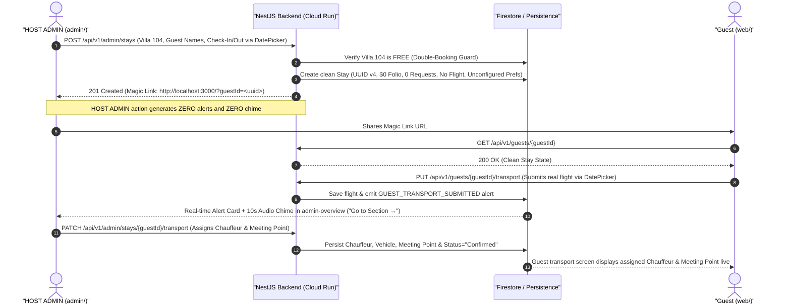

# Kachava Lux — Master Product & Functional Specification

## 1. Executive Vision & Operational Invariants

### 1.1 Product Vision
The **Kachava Lux Digital Sanctuary Platform** is a bespoke, ultra-luxury digital hospitality ecosystem crafted for villa residents (`Villa 101` through `Villa 108`) and the unified property operations team (`HOST ADMIN`) at Kachava Lux in the Riviera Maya and Puerto Cancún, Mexico. Designed around the philosophy of *"The Architecture of Stillness,"* the platform eliminates traditional hotel bureaucracy—front-desk queues, paper registration forms, and rigid questionnaires—replacing them with an effortless, veridical digital sanctuary for guests paired with a real-time operational command center for `HOST ADMIN`.

### 1.2 Architectural Topology (Dual-App Production Ecosystem)
The platform operates as a cloud-native monorepo featuring **two distinct Flutter Web applications** backed by a unified NestJS API and persistence layer:

- **Guest Experience Portal (`web/`)**: Built with **Flutter Web** (`http://localhost:3000/?guestId=<uuid>` locally; Firebase Hosting in production). The guest client implements a mobile-first responsive shell (`430px–480px` centered sanctuary canvas on desktop/tablet viewports and full-bleed viewport on mobile browsers) accessed via a passwordless `UUID v4` Magic Link (`?guestId=<UUID>`). It supports bilingual (`EN` / `ES`) switching and is architected with clean separation of presentation and domain logic so the exact same Dart codebase compiles natively to **iOS and Android**.
- **Administrative & Concierge Command Center (`admin/`)**: A standalone **Flutter Web** application in the root monorepo (`admin/`, `http://localhost:3002` locally) designed for the unified **`HOST ADMIN`** role (covering property administration, private majordomo services, aviation/chauffeur dispatch, culinary/larder fulfillment, and folio management). Rendered as a full-width responsive browser workspace, `admin/` consumes the same NestJS backend to manage 8-villa occupancy, create stays, generate Magic Links, triage guest-initiated alerts with a 10-second audio chime, assign chauffeurs and meeting points, configure live Experiences and Larder catalogs, progress 4-stage concierge tickets, converse in live guest chat, and verify express folio checkouts.
- **Unified Backend API (`backend/`)**: Built with **NestJS (TypeScript)** running on `http://localhost:3001` (and Google Cloud Run in production), exposing scoped RESTful JSON endpoints for the Guest Portal (`/api/v1/guests/:guestId/*`), Shared Live Catalogs (`/api/v1/catalog/*`), and the Admin Command Center (`/api/v1/admin/*`).
- **Persistence & Media Storage**: **Google Cloud Firestore** (with deterministic in-memory fallback for local development) serves as the real-time single source of truth for stays, catalogs, bookings, larder orders, concierge tickets, chat messages, mid-stay feedback, and folio ledgers. **Firebase Cloud Storage** stores guest-uploaded maintenance photos and folio receipts.

---

### 1.3 Mandatory Operational Invariants (Zero Fake Data & Input Standards)

To ensure 100% operational veridicality in a real hospitality environment, the entire platform enforces three non-negotiable invariants across `backend/`, `web/`, and `admin/`:

#### Invariant 1: Zero Hardcoded or Fake Data on New Stays (`FR-00`)
When `HOST ADMIN` creates a new guest stay in `admin/` and generates a Magic Link (`http://localhost:3000/?guestId=<uuid>`), the stay document in the backend and all 13 screens in `web/` **MUST** initialize **100% clean**:
1. **No Pre-Filled Airport Transfer**: Newly created stays have **NO** hardcoded flight routes (`no MIA -> CUN`), **NO** fake flight numbers (`no AA 1492` or `AA 172`), **NO** fake terminal (`no Terminal 3`), and **NO** fake vehicle beverage notes (`no Chilled Young Coconuts`). Until the guest submits their flight form in `transport`, transfer status is strictly `Not Requested / Pending Guest Input`.
2. **No Pre-Filled Personalization, Diet, or Allergies**: Newly created stays have **NO** pre-populated pillow selection (`no Plush Goose Down`) and **NO** fake allergy banners (`no Shellfish Allergy`). Until the guest submits the `personalize` form, preferences, dietary regimen, and allergies are strictly `Unconfigured / None` (displayed in `admin-stays` as `"Pending guest input"`).
3. **No Fake IoT Room Climate or Smart Lighting Controls**: The villas do not have browser-controlled IoT thermostats or smart lighting hardware. Neither `home` nor `personalize` may display fake room temperature readings (`23°C` / `72°F` / `70°F`) or fake lighting scene toggles.
4. **No Fake Digital NFC Door Keycard**: Browser applications cannot unlock physical villa doors via NFC. The `profile` screen **MUST NOT** display a fake Digital NFC Door Keycard unlock widget; instead, it displays veridical Guest Profile information, Villa Wi-Fi credentials (with 1-tap copy), Dietary & Allergy summary, and 24/7 Emergency & `HOST ADMIN` contacts.
5. **No Pre-Populated Folio Charges or Concierge Tickets**: Every new stay starts with a **`$0.00 USD` folio balance** (`0` billable line items) and **`0` concierge requests**. Charges only appear on `departure` and `admin-folio` when a guest actually orders larder items, books paid excursions/upgrades, or when `HOST ADMIN` adds a custom charge.

#### Invariant 2: Clean Empty Inputs & True Placeholders (`FR-20`)
- Every `TextField` and `TextFormField` across both `admin/` and `web/` **MUST** start **empty (`""`)** when no real saved user data exists.
- Example text **MUST** be provided exclusively via `InputDecoration(hintText: 'e.g. ...')` (`Ej. ...` in Spanish) so that the hint disappears automatically upon focus/typing. Pre-filling `TextEditingController(text: '...')` with example values that force the user to manually backspace/delete is strictly prohibited.

#### Invariant 3: Interactive Calendar Date Pickers (`FR-21`)
- Every date input across both `admin/` and `web/` **MUST** open an interactive **Calendar Date Picker (`showDatePicker`)** on tap and format the selected date in `YYYY-MM-DD` (or localized human-readable format):
  - `admin-stays`: **Check-In Date** and **Check-Out Date** in the New Stay creation modal.
  - `web/` (`transport`): **Arrival Date** in the Private Aviation & Transfer form.
  - `web/` (`yacht`): **Charter Date** in the Private Yacht Charter configuration screen.
  - `web/` (`dining`): **Reservation Date** in the In-Villa Private Dining configuration screen.

---

## 2. Scope Boundaries

### 2.1 In-Scope
- **Guest Experience Portal (`web/`)**:
  - Passwordless Magic Link guest onboarding and session restoration via URL query parameter (`?guestId=<UUID>`).
  - Guest lifecycle state enforcement (`PRE_ARRIVAL`, `ACTIVE_STAY`, `CHECKED_OUT`, `EXPIRED`) and bilingual (`EN`/`ES`) UI support.
  - Full functional implementation and real backend persistence across all **13 guest screens** (`home`, `transport`, `personalize`, `included`, `explore`, `yacht`, `dining`, `stock-villa`, `concierge`, `midstay`, `departure`, `philosophy`, `profile`).
  - Live catalog synchronization with `admin/` for Curated Excursions (`GET /api/v1/catalog/experiences`) and Villa Stocking & Larder (`GET /api/v1/catalog/larder`).
  - Real-time 4-stage concierge request lifecycle tracking (`Requested → Assigned → In Progress → Completed`) and bi-directional live chat with `HOST ADMIN`.
  - Procedural **432Hz Sanctuary Soundscape** synthesizer on `philosophy`.
  - Real-time itemized folio ledger (`$0.00` initial balance, dynamically reflecting actual guest orders/upgrades) and Express Digital Check-Out on `departure`.
- **Administrative & Concierge Command Center (`admin/`)**:
  - Unified `HOST ADMIN` authentication (`AdminAuthGuard`) and bilingual (`EN`/`ES`) operational interface.
  - Full operational implementation across all **6 administrative workspace tabs** (`admin-overview`, `admin-stays`, `admin-experiences`, `admin-larder`, `admin-concierge`, `admin-folio`).
  - **Guest-Only Alert Matrix (`admin-overview`)**: Real-time alerts and a 10-second notification chime triggered **exclusively** by Guest actions in `web/` (never by `HOST ADMIN` actions in `admin/`), with a direct **`Go to Section / Ir a Atender →`** deep-link button on every alert card.
  - **8-Villa Occupancy & Stay Lifecycle Management (`admin-stays`)**: Interactive occupancy strip for `Villa 101`–`Villa 108` (`🟢 FREE` / `🔴 OCCUPIED`), double-booking guard, Check-In / Check-Out & Release Villa controls, real-time Guest Preferences/Allergies display, and Chauffeur + Meeting Point assignment dialog.
  - **Configurable Live Catalogs (`admin-experiences` & `admin-larder`)**: Full CRUD ability for `HOST ADMIN` to add and delete items in both the Experiences Catalog and the Larder/Minibar Catalog, immediately updating `web/`.

### 2.2 Out-of-Scope
- Traditional username/password registration or login walls on the **Guest Experience Portal (`web/`)**.
- Fake IoT hardware controls (smart thermostats, room temperature sliders, smart lighting dimmers) or fake browser-based NFC door lock keys.
- Live raw credit card PAN capture (settlement uses tokenized folio billing).

---

## 3. Frictionless Guest Access & Clean Stay Provisioning Workflow

### 3.1 Clean Stay Creation & Magic Link Access Sequence

---

## 4. Complete 13-Screen Guest Portal (`web/`) Specification

### 4.1 Summary Matrix of All 13 Guest Portal Screens

| # | Screen ID | Screen Title | Primary Navigation | Core Veridical Responsibility |
| :--- | :--- | :--- | :--- | :--- |
| 1 | `home` | Residency Home | `Home` Tab | Personalized welcome (`Villa`, `Guest Names`, `Stay Dates`, `Lifecycle Status`, `HOST ADMIN` 24/7 contact) and interactive service navigation cards showing live status. Zero dead `PASO 1/2/3` headers; zero fake `23°C` climate cards. |
| 2 | `transport` | Private Aviation & Transfer | `Home` / Drawer | Guest Flight Input Form (Calendar Date Picker + empty placeholder fields) and live Host Dispatch Status Card (`Chauffeur & Vehicle`, `Meeting Point`, `Transfer Status`). |
| 3 | `personalize` | Stay Personalization, Comfort & Dietary | `Home` / Drawer | Pre-arrival curation form: Pillow Atelier, Botanical Scent, Dietary Regimen, Food Allergies (`TextField` with placeholder), and Special Villa/Coffee/Housekeeping Notes (`TextField` with placeholder). Zero fake IoT thermostat. |
| 4 | `included` | Included Privileges | `My Stay` Tab | Complimentary stay entitlements (`$0.00 Due`) and interactive signature privilege selection (`massage` vs `golf`). |
| 5 | `explore` | Curated Excursions | `Explore` Tab | Live catalog of Riviera Maya adventures fetched from `/api/v1/catalog/experiences` (configurable by `HOST ADMIN`) with 1-tap booking request. |
| 6 | `yacht` | Private Yacht Charter | `Explore` / Drawer | Galeon 470 Sky charter configuration (Calendar Date Picker, guest count stepper, package selection) dispatching a live booking request to `HOST ADMIN`. |
| 7 | `dining` | In-Villa Private Dining | `Explore` / Drawer | Chef menu selection, Calendar Date Picker, service time slot, and dietary notes dispatching a live booking request to `HOST ADMIN`. |
| 8 | `stock-villa` | Villa Stocking & Larder | `My Stay` / Drawer | Live catalog of minibar & pantry items fetched from `/api/v1/catalog/larder` (configurable by `HOST ADMIN`) with quantity selectors and order submission. |
| 9 | `concierge` | 24/7 Dedicated Concierge & Live Chat | `Concierge` Tab | Service/maintenance request creation, stable 4-stage status tracker (`Requested → Assigned → In Progress → Completed`) showing only the guest's real tickets, and real-time bi-directional chat with `HOST ADMIN`. |
| 10 | `midstay` | Mid-Stay Check-In | `My Stay` / Drawer | Rating, sentiment selector, preferred housekeeping window, and notes (`TextField` with placeholder) dispatched to `HOST ADMIN`. |
| 11 | `departure` | Departure & Folio Ledger | `My Stay` / Drawer | Itemized real charges (only what the guest actually ordered/upgraded; starts at `$0.00`), late check-out request toggle, and Express Check-Out submission. |
| 12 | `philosophy` | Biophilic Architecture | `Explore` / Drawer | Architectural narrative (*"The Architecture of Stillness"*) and procedural ambient 432Hz soundscape player. |
| 13 | `profile` | Guest Profile, Wi-Fi & Emergency Contacts | Header / `Profile` | Guest reservation summary, Villa Wi-Fi SSID & copyable password, registered Dietary & Allergy summary (with button to edit in `personalize`), and 24/7 Security / Medical / `HOST ADMIN` contact details. Zero fake NFC door lock. |

---

### 4.2 Detailed Specification of Each Guest Screen (`FR-01` – `FR-13`)

#### Module 1: Residency Home (`home`)
- **Requirement ID**: `FR-01` (Priority: `P0`)
- **Purpose**: Provide an immediate, truthful overview of the guest's stay and direct 1-tap navigation to all guest services with live status indicators.
- **Required Fields & Interactive Components**:
  - **Personalized Welcome Hero Card**:
    - Assigned **Villa Name / Number** (e.g., `Villa 102`), **Guest Names**, **Check-In & Check-Out Dates**, and live **Lifecycle Status Badge** (`Pre-Arrival` / `Active Stay` / `Checked Out`).
    - **24/7 `HOST ADMIN` Contact Strip**: Direct action button to open live chat/concierge (`concierge`) and share/copy the stay Magic Link.
  - **Interactive Service Navigation Cards (Showing Live Status)**:
    1. **Airport Transfer Card (`→ transport`)**: Shows `"Not Requested — Tap to register flight"` on a clean stay, `"Flight Submitted — Pending HOST ADMIN Assignment"` after guest submission, or `"Confirmed · [Chauffeur Name] · [Meeting Point]"` once assigned by `HOST ADMIN`.
    2. **Stay Personalization & Dietary Card (`→ personalize`)**: Shows `"Unconfigured — Tap to curate pillows, scent & diet"` on a clean stay, or the guest's saved Pillow, Scent, and Dietary/Allergy summary.
    3. **Villa Stocking & Larder Card (`→ stock-villa`)**: Shows `"No items ordered yet"` or the live count/status of ordered minibar & larder provisions.
    4. **Included Privileges & Bespoke Experiences (`→ included`, `→ explore`, `→ yacht`, `→ dining`)**: Interactive cards navigating directly to privilege election, excursions, yacht charter, and private chef dining.
    5. **24/7 Concierge & Live Chat Card (`→ concierge`)**: Shows the live count of active service requests (`0 Active Requests` on a new stay).
    6. **Mid-Stay Check-In (`→ midstay`) & Departure Ledger (`→ departure`)**: Shows current real Folio Balance (`$0.00 USD` on a new stay) and navigates directly to the ledger.
- **Explicit Prohibitions**:
  - **NO** dead, non-clickable `PASO 1 / PASO 2 / PASO 3` text headers.
  - **NO** fake `23°C` / `72°F` room temperature or IoT climate cards.

#### Module 2: Private Aviation & Transfer (`transport`)
- **Requirement ID**: `FR-02` (Priority: `P0`)
- **Purpose**: Allow the guest to submit their real arrival flight coordinates and view the real-time chauffeur and meeting point dispatched by `HOST ADMIN`.
- **Required Fields & Interactive Components**:
  - **Guest Flight Input Form**:
    - **Arrival Date**: Read-only tap field that opens the interactive **Calendar Date Picker (`showDatePicker`)**. Starts empty (or unset) with placeholder `"Select Arrival Date"`.
    - **Arrival Airport**: `TextField` starting empty (`""`) with `hintText` placeholder (e.g., `"e.g. Cancun International (CUN) or Tulum (TQO)"`).
    - **Airline**: `TextField` starting empty (`""`) with `hintText` placeholder (e.g., `"e.g. American Airlines, Delta, Private FBO"`).
    - **Flight Number**: `TextField` starting empty (`""`) with `hintText` placeholder (e.g., `"e.g. AA 1482"`).
    - **Terminal**: `TextField` starting empty (`""`) with `hintText` placeholder (e.g., `"e.g. Terminal 3 or FBO General Aviation"`).
    - **Estimated Arrival Time**: `TextField` starting empty (`""`) with `hintText` placeholder (e.g., `"e.g. 14:30"`).
    - **Passengers & Luggage Counters**: Interactive `+` / `-` steppers for Passenger count (default `2`, range `1–12`) and Luggage count (default `2`, range `0–20`).
    - **Submit / Update Button**: Persists the guest's flight data via `PUT /api/v1/guests/:guestId/transport` and triggers a real-time alert to `HOST ADMIN` in `admin-overview`.
  - **Host Dispatch Status Card (Real-Time Sync from `admin-stays`)**:
    - When no flight is submitted or `HOST ADMIN` has not yet assigned a driver, displays: `"Awaiting flight registration / HOST ADMIN assignment"`.
    - Once `HOST ADMIN` assigns transport in `admin-stays`, displays in real time:
      - **Transfer Status Badge**: `Pending`, `Confirmed`, `Chauffeur En Route`, or `Completed`.
      - **Assigned Chauffeur & Vehicle**: e.g., `"Carlos M. · Cadillac Escalade ESV"`.
      - **Meeting Point (Punto de Encuentro)**: e.g., `"Terminal 3 — Outside Glass Doors next to Air Margaritaville"`.

#### Module 3: Stay Personalization, Comfort & Dietary (`personalize`)
- **Requirement ID**: `FR-03` (Priority: `P0`)
- **Purpose**: Capture the guest's physical villa comfort, aromatherapy, dietary regimen, medical allergies, and housekeeping preferences prior to or during the stay.
- **Required Fields & Interactive Components**:
  - Single, clean curation form (no fake IoT thermostat sliders and no dead step 1/2/3 non-clickable chips):
    1. **Pillow Atelier Selection** (single-select choice chips): `Goose Down`, `Memory Foam`, `Hypoallergenic Firm`. (Unselected/`null` on a brand-new stay until chosen by the guest).
    2. **Botanical Welcome Villa Scent** (single-select choice chips): `Copal & Amber`, `Orange Blossom`, `White Cedar`, `Fragrance-Free`.
    3. **Dietary Regimen** (single-select choice chips): `Standard / No Restrictions`, `Pescatarian`, `Vegetarian`, `Vegan`, `Gluten-Free`.
    4. **Food Allergies & Medical Restrictions**: `TextField` starting **empty (`""`)** by default with `hintText` placeholder (`"e.g. Severe shellfish allergy, tree nuts, celiac..."`).
    5. **Special Villa Notes, Morning Coffee & Housekeeping Window**: `TextField` starting **empty (`""`)** by default with `hintText` placeholder (`"e.g. Oat milk cortado at 8:00 AM, housekeeping around 11:00 AM..."`).
  - **Save Preferences CTA**: Persists via `PUT /api/v1/guests/:guestId/personalize`, updates `home` and `profile` immediately, updates the `admin-stays` Stay Card in real time, and emits a guest alert in `admin-overview`.

#### Module 4: Included Privileges (`included`)
- **Requirement ID**: `FR-04` (Priority: `P0`)
- **Purpose**: Display the complimentary stay entitlements included with the villa residency (`$0.00 Due`) and allow the guest to select their signature privilege.
- **Required Fields & Interactive Components**:
  - **Complimentary Entitlements Overview**: Highlights daily artisanal breakfast, round-trip airport chauffeur coordination, complimentary 4-hour yacht charter entitlement, and in-villa private chef dinner entitlement.
  - **Signature Privilege Selector (`massage` vs `golf`)**: Interactive selection cards allowing the guest to choose between **In-Villa Holistic Chukum Massages** (`massage`) and **PGA Riviera Maya Championship Golf Rounds** (`golf`), persisted via `PUT /api/v1/guests/:guestId/privilege` and alerting `HOST ADMIN`.

#### Module 5: Curated Excursions (`explore`)
- **Requirement ID**: `FR-05` (Priority: `P0`)
- **Purpose**: Present the live catalog of Riviera Maya adventures and cultural encounters configured by `HOST ADMIN` and allow 1-tap booking requests.
- **Required Fields & Interactive Components**:
  - **Live Catalog Hydration**: Fetches items dynamically from `GET /api/v1/catalog/experiences`. Any excursion added or deleted by `HOST ADMIN` in `admin-experiences` is immediately reflected here.
  - **Category Filter & Excursion Cards**: Displays title, category, duration, price (`$0 Included` or `$USD` price), and description.
  - **1-Tap Booking Request**: Submitting a booking dispatches `POST /api/v1/guests/:guestId/bookings`, adds any billable excursion price to the guest's folio ledger, displays the booking status (`Requested` / `Confirmed`), and alerts `HOST ADMIN`.

#### Module 6: Private Yacht Charter (`yacht`)
- **Requirement ID**: `FR-06` (Priority: `P0`)
- **Purpose**: Configure and request a private charter aboard the Galeon 470 Sky yacht.
- **Required Fields & Interactive Components**:
  - **Charter Package Selector**: Choice of charter tiers (e.g., Complimentary 4-Hour Half-Day Sail at `$0.00` upgrade, 6-Hour Extended Sail, or 8-Hour Full-Day Escape) and destination route.
  - **Charter Date (Calendar Date Picker)**: Interactive field using `showDatePicker` to select the exact sailing date.
  - **Guest Count Stepper**: `+` / `-` counter (`1` to `12` guests).
  - **Special Maritime / Catering Notes**: `TextField` starting empty (`""`) with `hintText` placeholder.
  - **Submit Charter Request CTA**: Sends a live booking request via `POST /api/v1/guests/:guestId/yacht` (or `/bookings`), records any net upgrade fee on the folio, and triggers a Guest Alert to `HOST ADMIN`.

#### Module 7: In-Villa Private Dining (`dining`)
- **Requirement ID**: `FR-07` (Priority: `P0`)
- **Purpose**: Configure and request an in-villa private chef dining experience.
- **Required Fields & Interactive Components**:
  - **Chef Tasting Menu Selection**: Interactive selection across curated menus (e.g., *Fuego y Mar*, *Tierra Sagrada*, *Flora Silvestre*) and optional beverage pairings.
  - **Reservation Date (Calendar Date Picker)**: Interactive field using `showDatePicker` to select the dinner date.
  - **Service Time Window & Guest Count**: Selector for evening seating time (e.g., `18:30`, `20:00`, `21:00`) and guest count stepper.
  - **Dietary & Table Setting Notes**: `TextField` starting empty (`""`) with `hintText` placeholder (`"e.g. Poolside terrace table, no shellfish..."`).
  - **Submit Dining Request CTA**: Sends a live booking request via `POST /api/v1/guests/:guestId/dining` (or `/bookings`) to `HOST ADMIN`.

#### Module 8: Villa Stocking & Larder (`stock-villa`)
- **Requirement ID**: `FR-08` (Priority: `P0`)
- **Purpose**: Allow the guest to browse the live minibar and pantry catalog configured by `HOST ADMIN`, select item quantities, and submit a provisioning order.
- **Required Fields & Interactive Components**:
  - **Live Larder Catalog Hydration**: Fetches items dynamically from `GET /api/v1/catalog/larder`. Any item added or deleted by `HOST ADMIN` in `admin-larder` is immediately reflected here.
  - **Clean Initial Quantities**: On a newly created stay, all item quantities start at **`0`** (`$0.00` cart total).
  - **Quantity Selectors & Order Submission**: Interactive `+` / `-` quantity steppers per item, live cart total bar, and **Submit Order** button (`PUT /api/v1/guests/:guestId/larder`) that creates/updates the guest's larder order, updates the Folio Ledger with the exact order total, and triggers a Guest Alert in `admin-overview`.

#### Module 9: 24/7 Dedicated Concierge & Live Chat (`concierge`)
- **Requirement ID**: `FR-09` (Priority: `P0`)
- **Purpose**: Enable the guest to submit service or maintenance requests, track their real tickets across a 4-stage progress bar, and chat in real time with `HOST ADMIN`.
- **Required Fields & Interactive Components**:
  - **New Service / Maintenance Request Form**: Category selector (`Housekeeping`, `Maintenance`, `Amenities`, `Transportation`, `Other`), empty description `TextField` with `hintText` placeholder, optional photo attachment, and submit button (`POST /api/v1/guests/:guestId/requests`).
  - **Veridical 4-Stage Status Tracker (`Requested → Assigned → In Progress → Completed`)**:
    - Displays **only** the guest's real submitted requests (`0` requests on a brand-new stay).
    - Reflects real-time stage progressions made by `HOST ADMIN` in `admin-concierge`.
  - **Real-Time Bi-Directional Live Chat**:
    - Displays the chronological message thread between the Guest and `HOST ADMIN` (`GET` / `POST /api/v1/guests/:guestId/chat` or request message thread).
    - Message input starts empty (`""`) with `hintText` placeholder and sends messages that immediately alert `HOST ADMIN`.

#### Module 10: Mid-Stay Check-In (`midstay`)
- **Requirement ID**: `FR-10` (Priority: `P1`)
- **Purpose**: Capture mid-stay pulse feedback so `HOST ADMIN` can recalibrate service during the stay.
- **Required Fields & Interactive Components**:
  - **Star / Numerical Rating (`1–5`) & Sentiment Selector** (`Transcendent`, `Serene`, `Needs Tuning`, `Direct Assistance Needed`).
  - **Preferred Housekeeping Window Selector**: e.g., `Morning (09:00–11:00)`, `Midday (12:00–14:00)`, `Evening Turndown Only`, `Do Not Disturb`.
  - **Refinement Notes**: `TextField` starting empty (`""`) with `hintText` placeholder (`"e.g. Extra pool towels in the afternoon..."`).
  - **Dispatch CTA**: Submits via `POST /api/v1/guests/:guestId/midstay` and triggers a real-time alert to `HOST ADMIN`.

#### Module 11: Departure & Folio Ledger (`departure`)
- **Requirement ID**: `FR-11` (Priority: `P0`)
- **Purpose**: Provide a transparent, itemized statement of real charges accumulated during the stay, optional late check-out request, and 1-tap Express Check-Out.
- **Required Fields & Interactive Components**:
  - **Itemized Real Charges Ledger**:
    - Starts at **`$0.00 USD`** on a new stay with zero fake pre-populated charges.
    - Dynamically lists only real billable items ordered by the guest (e.g., submitted Larder orders, paid Excursions, Yacht/Dining upgrades) or custom line items added by `HOST ADMIN` in `admin-folio`, alongside `$0.00` included stay privileges.
  - **Late Check-Out Request Toggle / Action**: Allows the guest to request a late check-out time window (`POST /api/v1/guests/:guestId/late-checkout`), notifying `HOST ADMIN`.
  - **Express Check-Out Submission**: Button (`POST /api/v1/guests/:guestId/checkout`) that settles the folio, transitions the stay to `CHECKED_OUT`, and triggers an Express Check-Out alert in `admin-overview`.

#### Module 12: Biophilic Architecture (`philosophy`)
- **Requirement ID**: `FR-12` (Priority: `P1`)
- **Purpose**: Share the architectural narrative of Kachava Lux and provide a calming procedural 432Hz ambient soundscape.
- **Required Fields & Interactive Components**:
  - **Architectural Narrative Chapters**: Editorial storytelling on Mayan *Chukum* limestone thermal mass, subterranean cenotes and the Sian Ka'an biosphere, and open-fire *pib* gastronomy.
  - **Ambient 432Hz Soundscape Player**: Interactive Play/Pause synthesizer generating a real-time 432Hz harmonic drone and cenote breeze audio experience with animated visual indicator.

#### Module 13: Guest Profile, Wi-Fi & Emergency Contacts (`profile`)
- **Requirement ID**: `FR-13` (Priority: `P0`)
- **Purpose**: Display essential residency details, Villa Wi-Fi access credentials, registered dietary/allergy summary, and 24/7 emergency and `HOST ADMIN` contacts.
- **Required Fields & Interactive Components**:
  - **Guest Reservation Summary Card**: Primary & companion guest names, assigned Villa (`Villa 101`–`Villa 108`), Check-In & Check-Out dates, Lifecycle Status, and Reservation UUID.
  - **Villa High-Speed Wi-Fi Card**: Displays the dedicated **Villa Wi-Fi SSID** (e.g., `Kachava-Sanctuary-Villa102`) and **Wi-Fi Password** with a 1-tap **`Copy Password`** button and confirmation toast.
  - **Registered Dietary & Allergy Summary Card**: Displays the real Dietary Regimen, Food Allergies, Pillow, and Scent configured by the guest (or `"Unconfigured / None"` if not yet submitted), with a direct **`Edit in Personalize →`** button that navigates to `personalize`.
  - **24/7 Security, Medical & `HOST ADMIN` Emergency Contacts Card**: Displays direct contact numbers and quick actions for **24/7 `HOST ADMIN` / Concierge Desk**, **Sanctuary Security & Gatehouse**, and **24/7 On-Call Medical Doctor / Emergency Response**.
- **Explicit Prohibition**:
  - **NO** fake Digital NFC Door Keycard unlock button or simulated Bluetooth door lock widget.

---

## 5. Complete 6-Tab Admin Command Center (`admin/`) Specification

### 5.1 Unified `HOST ADMIN` Operational Model
All administrative, concierge, transport, catalog, and billing workflows are unified under the **`HOST ADMIN`** role across 6 tabs:
1. `admin-overview`: **Live Alerts & Command Center**
2. `admin-stays`: **8-Villa Occupancy, Stays, Magic Links & Transfers**
3. `admin-experiences`: **Experiences Bookings & Configurable Experiences Catalog**
4. `admin-larder`: **Larder Orders & Configurable Minibar/Larder Catalog**
5. `admin-concierge`: **24/7 Concierge Dispatch, 4-Stage Tracker & Live Chat**
6. `admin-folio`: **Mid-Stay Feedback, Real Folio Ledger & Checkout Release**

---

### 5.2 Strict Guest-Only Alert Matrix & Navigation (`admin-overview` — `FR-14`)

#### 1. Guest-Only Alert & 10-Second Audio Chime Rule
- Operational alerts and the **10-second notification audio chime** (`Web Audio API`) **ONLY** trigger when a **Guest** performs an action or submits a request from the **Guest Experience Portal (`web/`)**.
- Actions performed by **`HOST ADMIN`** inside `admin/` **NEVER** generate operational alerts and **NEVER** trigger the audio chime.

| Actor & Source | Action Performed | Generates Alert in `admin-overview`? | Triggers 10s Audio Chime? | Target Section Button (`Go to Section →`) |
| :--- | :--- | :--- | :--- | :--- |
| **Guest (`web/`)** | Submits / updates Flight Transfer details (`transport`) | **YES** | **YES** | `admin-stays` |
| **Guest (`web/`)** | Submits / updates Stay Personalization & Allergies (`personalize`) | **YES** | **YES** | `admin-stays` |
| **Guest (`web/`)** | Selects Signature Privilege (`included`) or books Excursion / Yacht / Dining (`explore`, `yacht`, `dining`) | **YES** | **YES** | `admin-experiences` |
| **Guest (`web/`)** | Submits Villa Stocking / Larder order (`stock-villa`) | **YES** | **YES** | `admin-larder` |
| **Guest (`web/`)** | Creates Concierge / Maintenance ticket or sends Live Chat message (`concierge`) | **YES** | **YES** | `admin-concierge` |
| **Guest (`web/`)** | Submits Mid-Stay Check-In (`midstay`), Late Check-Out request, or Express Check-Out (`departure`) | **YES** | **YES** | `admin-folio` |
| **`HOST ADMIN` (`admin/`)** | Creates a new Stay, generates Magic Link, checks in/out a villa, or assigns Chauffeur & Meeting Point | **NO** | **NO** | N/A |
| **`HOST ADMIN` (`admin/`)** | Adds/deletes Catalog items, updates booking/larder status, progresses Concierge stage, sends Admin chat reply, or edits Folio | **NO** | **NO** | N/A |

#### 2. Direct Navigation Action on Every Alert Card
- Every alert card in `admin-overview` displays:
  - Villa badge (e.g., `Villa 102`), Guest Name, Alert Category, Timestamp, and detailed summary of what the guest submitted.
  - A direct **`Go to Section / Ir a Atender →`** button that immediately switches the Admin workspace to the exact target tab (`admin-stays`, `admin-experiences`, `admin-larder`, `admin-concierge`, or `admin-folio`) so `HOST ADMIN` can fulfill the request in 1 click, plus an `Acknowledge / Dismiss` action.

---

### 5.3 8-Villa Occupancy & Stay Lifecycle Management (`admin-stays` — `FR-15`)

- **Interactive 8-Villa Occupancy Strip (`Villa 101` – `Villa 108`)**:
  - Renders 8 interactive status chips at the top of `admin-stays` representing the resort's 8 luxury villas (`Villa 101` through `Villa 108`):
    - **`🟢 FREE`**: Clicking a free villa chip immediately opens the **Create New Stay** modal with that specific villa pre-selected.
    - **`🔴 OCCUPIED`**: Displays the occupying guest's name; clicking an occupied villa chip filters the stays list directly to that villa's active reservation.
- **Double-Booking Guard**:
  - A villa that has an active reservation (`PRE_ARRIVAL` or `ACTIVE_STAY`) is marked `🔴 OCCUPIED` and **cannot** be double-booked for overlapping dates until the current stay is checked out and the villa is released (`CHECKED_OUT`). The backend enforces this invariant with an HTTP `400`/`409` validation error if a duplicate assignment is attempted.
- **Create New Stay Modal (Clean Inputs & Calendar Date Pickers)**:
  - Guest Name and Companion/Notes fields start **empty (`""`)** with `hintText` placeholders (never pre-filled text).
  - **Check-In Date** and **Check-Out Date** fields open the interactive **Calendar Date Picker (`showDatePicker`)**.
  - Creating the stay generates a fresh `UUID v4` Magic Link (`http://localhost:3000/?guestId=<uuid>`) with a 1-click **`Copy Magic Link`** button and initializes the stay 100% clean (`$0.00` folio, `0` requests, unconfigured preferences, no flight).
- **Stay Card Lifecycle & Real-Time Inspection**:
  - **Check-In Guest Button**: Transitions stay from `PRE_ARRIVAL` to `ACTIVE_STAY`.
  - **Check-Out & Release Villa Button**: Transitions stay to `CHECKED_OUT` and immediately frees the villa back to `🟢 FREE` in the 8-Villa Occupancy Strip.
  - **Real-Time Guest Personalization & Allergy Display**: Displays the guest's live submitted Pillow choice, Welcome Scent, Dietary Regimen, red **Allergy Caution** banner, and Special Villa Notes (or displays `"Pending guest input"` when the guest has not yet submitted `personalize`).
  - **Chauffeur & Meeting Point Assignment Dialog**:
    - Displays the guest's submitted flight details (`Arrival Date`, `Airport`, `Airline`, `Flight Number`, `Terminal`, `Time`, `Passengers`, `Luggage`) or `"Pending guest flight input"`.
    - Allows `HOST ADMIN` to open the **Assign Chauffeur & Transfer** dialog (with empty `TextField`s using `hintText` placeholders when unassigned) to set:
      1. **Chauffeur Name & Vehicle** (e.g., `Carlos M. — Cadillac Escalade ESV`)
      2. **Meeting Point / Punto de Encuentro** (e.g., `Terminal 3 — Outside Glass Doors`)
      3. **Transfer Status** (`Pending`, `Confirmed`, `Chauffeur En Route`, `Completed`)
    - Saving updates the guest's `transport` screen in `web/` in real time without triggering a self-alert.

---

### 5.4 Configurable Experiences & Larder Catalogs (`admin-experiences` & `admin-larder` — `FR-16`, `FR-17`)

#### Module 16: Experiences Bookings & Catalog Manager (`admin-experiences` — `FR-16`)
- **Guest Bookings Fulfillment Queue**:
  - Displays all guest bookings across Curated Excursions (`explore`), Private Yacht Charters (`yacht`), In-Villa Private Dining (`dining`), and Signature Privileges (`included`).
  - Allows `HOST ADMIN` to update booking status (`Requested → Confirmed → Completed`) and assign staff/notes, reflecting live in `web/`.
- **Configurable Experiences Catalog (`+ Add Experience` & Delete)**:
  - Displays the live catalog of experiences served by `/api/v1/catalog/experiences`.
  - `HOST ADMIN` can click **`+ Add Experience`** to create a new excursion (Title, Category, Duration, Price in USD, Included toggle, Description — all text inputs starting empty with `hintText` placeholders) via `POST /api/v1/admin/catalog/experiences` (or `/api/v1/catalog/experiences`).
  - `HOST ADMIN` can delete any catalog item via `DELETE /api/v1/admin/catalog/experiences/:id`.
  - Additions and deletions immediately update the guest's `explore` screen in `web/`.

#### Module 17: Larder Provisioning Queue & Catalog Manager (`admin-larder` — `FR-17`)
- **Guest Larder Orders Queue**:
  - Displays all submitted villa stocking orders from `stock-villa` with itemized quantities, total USD value, and status controls (`Pending → Preparing → Stocked in Villa`).
- **Configurable Minibar & Larder Catalog (`+ Add Larder Item` & Delete)**:
  - Displays the live catalog of minibar and pantry items served by `/api/v1/catalog/larder`.
  - `HOST ADMIN` can click **`+ Add Larder Item`** to create a new product (Title, Category, Price in USD, Placement/Presentation Zone — all text inputs starting empty with `hintText` placeholders) via `POST /api/v1/admin/catalog/larder` (or `/api/v1/catalog/larder`).
  - `HOST ADMIN` can delete any catalog item via `DELETE /api/v1/admin/catalog/larder/:id`.
  - Additions and deletions immediately update the guest's `stock-villa` screen in `web/`.

---

### 5.5 24/7 Concierge Dispatch & Folio Settlement (`admin-concierge` & `admin-folio` — `FR-18`, `FR-19`)

#### Module 18: 24/7 Concierge Dispatch, 4-Stage Tracker & Live Chat (`admin-concierge` — `FR-18`)
- **Veridical Ticket Queue**: Lists all real concierge and maintenance requests submitted by guests (`0` fake tickets on new stays).
- **4-Stage Progression Controls**: One-click progression across `Requested → Assigned → In Progress → Completed`, immediately updating the guest's `concierge` tracker in `web/`.
- **Bi-Directional Live Chat Console**: Allows `HOST ADMIN` to view guest chat messages and send real-time replies (`POST /api/v1/admin/stays/:guestId/chat` or request message endpoint) without triggering self-alerts.

#### Module 19: Mid-Stay Check-In Reviews, Folio Ledger & Express Checkout (`admin-folio` — `FR-19`)
- **Mid-Stay Feedback Monitor**: Displays real guest submissions from `midstay` (rating, sentiment, housekeeping window, and notes) with status acknowledgment.
- **Real Folio Ledger Management**:
  - Displays each stay's real itemized folio balance (`$0.00 USD` on a new stay; dynamically summing real larder orders, paid excursions, yacht/dining upgrades, and custom charges).
  - Allows `HOST ADMIN` to add a custom charge/credit (empty inputs with `hintText` placeholders), approve Late Check-Out requests, and execute **`Complete Check-Out & Release Villa`**.

---

## 6. Quality Attribute Requirements (Non-Functional Requirements)

| NFR ID | Category | Metric / Target | Architectural & Engineering Constraint |
| :--- | :--- | :--- | :--- |
| **NFR-01** | **Performance & Latency** | **< 2.0 seconds** (`p95`) | All NestJS REST API endpoints and Flutter Web screen transitions across `web/` and `admin/` must complete within `< 2000ms`. |
| **NFR-02** | **Data Veridicality & Zero Mock Pollution** | **100% Clean Initialization** | Newly created stays must initialize with `$0.00` folio balance, `0` concierge tickets, `null`/unconfigured preferences and flight transfer, and zero fake IoT/NFC widgets. |
| **NFR-03** | **Form Ergonomics** | **100% Placeholder & DatePicker Compliance** | Zero pre-filled example text in `TextEditingController` across `web/` and `admin/`; all date inputs must invoke `showDatePicker`. |
| **NFR-04** | **Alert Signal-to-Noise Ratio** | **0 False-Positive Admin Self-Alerts** | 100% of alerts and 10s audio chimes in `admin-overview` must originate strictly from Guest mutations in `web/`, never from `HOST ADMIN` mutations in `admin/`. |
| **NFR-05** | **Audio Synthesis Zero-Latency** | **0 KB External Audio Streaming** | Both the 432Hz Sanctuary Soundscape in `web/` and the 10-second operational alert chime in `admin/` must be synthesized procedurally via Web Audio API. |
| **NFR-06** | **Security & Occupancy Integrity** | **UUID v4 Guard + Double-Booking Guard** | Unguessable `UUID v4` Magic Links on `web/`, `AdminAuthGuard` on `admin/`, and strict 8-Villa (`101`–`108`) occupancy validation preventing double-booking. |
