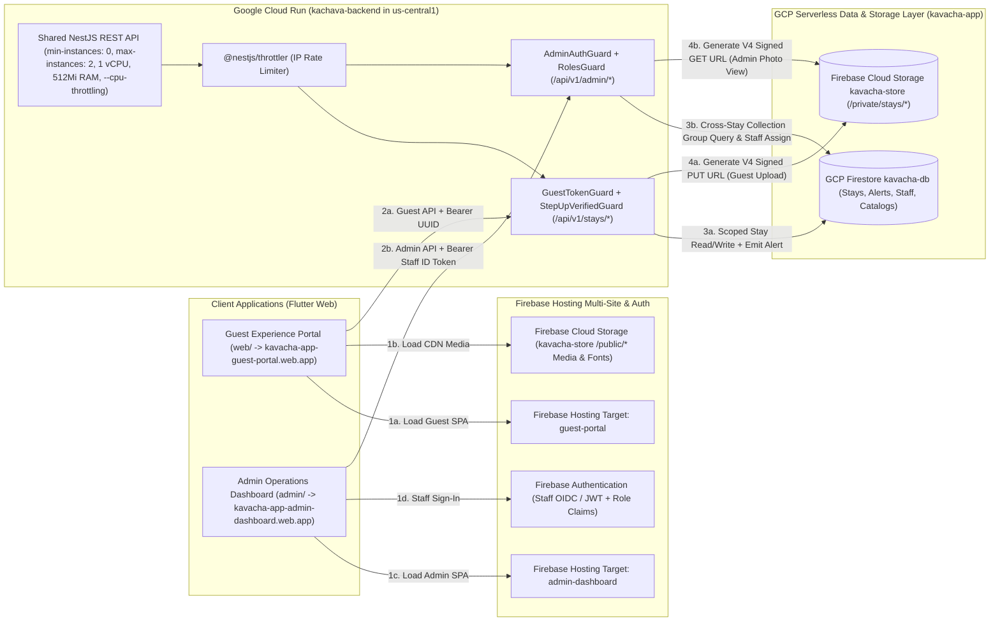
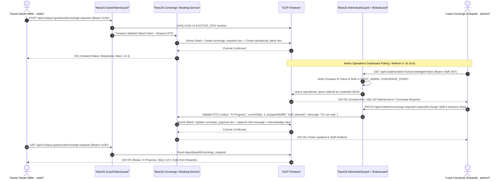

# Kachava Lux — Technical Stack, Cloud Topology & Security Architecture

> **Document Type**: Architecture & Technical Specification (Diátaxis: Reference & Explanation)
> **System Scope**: Kachava Lux Guest Experience Portal (`web/`), Administrative & Concierge Operations Dashboard (`admin/`), and Shared Cloud Backend (`backend/`)
> **Related Specifications**: [SPECIFICATION.md](./SPECIFICATION.md) · [USER_STORIES.md](./USER_STORIES.md) · [UI_UX_DESIGN.md](./UI_UX_DESIGN.md) · [DATA_ARCHITECTURE.md](./DATA_ARCHITECTURE.md)

---

## 1. Architectural Overview & Migration Rationale

The **Kachava Lux Digital Hospitality Platform** transitions from an interactive single-page React 19 reference prototype into a production-grade, cloud-native hospitality ecosystem built within a unified **Monorepo**. The production architecture comprises **two separate Flutter Web applications**—the **Guest Experience Portal (`web/`)** and the **Administrative & Concierge Operations Dashboard (`admin/`)**—both powered by a single shared **NestJS** enterprise REST API (`backend/`) on **Google Cloud Run**, **Google Cloud Firestore**, and **Firebase Cloud Storage**.

### 1.1 Why Dual Flutter Web Apps (`web/` + `admin/`) in a Unified Monorepo

1. **Guest Portal (`web/`) — Web Today, Native iOS & Android Tomorrow**:
   - Guests access the sanctuary portal immediately via a zero-install magic link in their welcome email (`https://app.kachavalux.com/?guestId=<uuid>`), rendered as a responsive, editorial-grade mobile shell (`max-width: 448px` centered frame on desktop, full-bleed viewport on mobile Safari and Chrome).
   - Because the presentation, application, domain, and data layers are authored in Dart/Flutter (`Flutter 3.27+` with CanvasKit/Skwasm rendering), the exact same codebase compiles natively to **iOS (`.ipa`)** and **Android (`.apk`/`.aab`)** when Kachava Lux launches its dedicated App Store and Google Play residency companion app—requiring zero UI or state-management rewrites.
2. **Administrative & Concierge Operations Dashboard (`admin/`) — Unified Sanctuary Command Center**:
   - Concierges, Majordomos (`Eduardo Rivera`), Executive Chefs (`Chef Mateo`), Marine Captains (`Captain Eduardo Velasco`), Chauffeurs (`Carlos M.`), and Property Managers operate a dedicated, desktop- and tablet-optimized Flutter Web application (`https://admin.kachavalux.com`).
   - Hosting `admin/` as a separate Flutter Web target in the same monorepo ensures strict bundle and security isolation (guest bundles never ship admin routes or staff logic) while sharing brand design tokens, domain models, and API conventions against the single NestJS backend.
3. **Deterministic Brand Fidelity & Zero-Latency Typography**:
   - Self-hosted variable and static font assets (`Libre Baskerville` for editorial serif headings and `Libre Franklin` for body/controls) are bundled directly into the Flutter asset manifests of both `web/` and `admin/` and pre-cached on application bootstrap, eliminating Cumulative Layout Shift (CLS) and external font network hops.
4. **432Hz Procedural Soundscape Portability**:
   - The prototype's signature Web Audio API synthesizer (`SanctuarySoundscape`: 432 Hz root sine drone, 216 Hz triangle sub-harmonic, 320 Hz lowpass-filtered cenote breeze noise, and 864 Hz singing bowl harmonic chimes) is encapsulated behind an abstract `SoundscapePort` interface in the Flutter domain layer. On Flutter Web, it binds directly to the browser's native `AudioContext` via `dart:js_interop` with zero external MP3/WAV streaming overhead; on native iOS/Android builds, it swaps cleanly to low-latency PCM audio synthesis (`flutter_soloud`).

### 1.2 Why Shared NestJS (`backend/`) on Google Cloud Run

1. **Single Source of Business Truth for Guest & Admin Workflows**:
   - Both the Guest Portal (`/api/v1/stays/:guestUuid/*`) and the Admin Operations Dashboard (`/api/v1/admin/*`) communicate with the same NestJS API instance on Google Cloud Run. When a guest submits a larder order, books a Galeon 470 Sky yacht charter, or reports an A/C maintenance issue with a photo, the shared backend atomically persists the state in Firestore and emits an operational alert (`operational_alerts`) immediately visible in the Admin Dashboard.
2. **Enterprise Modular Boundaries & SOLID Dependency Inversion**:
   - NestJS enforces strict separation between HTTP transport controllers, domain application services, and infrastructure repositories using TypeScript decorators and Dependency Injection (DIP).
3. **Strict Input Validation & Contract Integrity**:
   - Every incoming payload from `web/` and `admin/` is validated at the API perimeter using `class-validator` and `class-transformer` Data Transfer Objects (DTOs) with `whitelist: true` and `forbidNonWhitelisted: true`, preventing mass-assignment and injection vulnerabilities.
   - OpenAPI 3.1 specifications are auto-generated via `@nestjs/swagger`, enabling deterministic Dart client DTO code generation for both Flutter apps.
4. **Ultra-Low-Cost Serverless Container Scaling (`min-instances: 0`) & Cold-Start Firestore Hydration**:
   - Built via Google Cloud Build (`deploy/cloudbuild.yaml`) and deployed as a lightweight, multi-stage Alpine Node.js 22 container on **Google Cloud Run** (`kachava-backend` in `us-central1`, project `kavacha-app`), configured with `min-instances: 0`, `max-instances: 2`, `1 vCPU`, `512Mi RAM`, `concurrency: 80`, and `--cpu-throttling` (see `doc/adr/003-gcp-low-cost-cloudbuild-cloudrun-hosting.md`). Scaling to zero when idle guarantees `$0.00/month` idle compute cost, while startup Firestore hydration (`ensureHydrated()` against `kavacha-db`) preserves 100% state durability across container cold starts.

### 1.3 Why GCP Firestore & Firebase Cloud Storage

1. **Unified Google Cloud & Firebase Ecosystem**:
   - **GCP Firestore (Native Mode)** provides a serverless, multi-zone NoSQL document database with `99.999%` availability SLA, sub-100ms document point-reads, cross-stay `COLLECTION_GROUP` queries for administrative filtering, and atomic batch transactions for folio settlements, staff assignments, and larder provisioning.
   - **Firebase Cloud Storage** stores high-resolution architectural photography, Galeon 470 Sky yacht galleries, and private guest-uploaded concierge maintenance photos, backed by Google Cloud Storage and global edge caching.
2. **Keyless IAM Security**:
   - The Cloud Run service authenticates to Firestore, Firebase Auth, and Cloud Storage natively via **Google Cloud Application Default Credentials (ADC)** using a least-privilege IAM Service Account—requiring **zero hardcoded JSON service account keys** in source control or container images.

---

## 2. Monorepo Directory Structure

The repository is organized as a clean, multi-package monorepo housing the **Guest Experience Portal (`web/`)**, the **Administrative & Concierge Operations Dashboard (`admin/`)**, the **Shared NestJS Backend (`backend/`)**, and **Living Documentation (`docs/`)**.

```text
kachava-lux-guest-experience-app/
├── docs/                                         # Living Product & Architecture Specifications
│   ├── SPECIFICATION.md                          # Functional & Non-Functional Requirements (PRD)
│   ├── USER_STORIES.md                           # Epics, User Stories & Gherkin Acceptance Criteria
│   ├── UI_UX_DESIGN.md                           # Design System, Tokens, Wireframes & Navigation Flows
│   ├── TECH_STACK.md                             # Cloud Topology, Security, API Contracts & QADs (This File)
│   └── DATA_ARCHITECTURE.md                      # Firestore Data Model, Indexes & Cloud Storage Schema
│
├── web/                                          # Flutter Web App #1: Guest Experience Portal (Mobile-First & iOS/Android Ready)
│   ├── pubspec.yaml                              # Dart/Flutter dependencies (riverpod, go_router, dio, freezed)
│   ├── analysis_options.yaml                     # Strict Dart static analysis & lint rules
│   ├── web/                                      # Web bootstrap shell, index.html, manifest.json
│   ├── assets/
│   │   ├── brand/                                # SVG logotypes & emblems
│   │   └── fonts/                                # Self-hosted Libre Baskerville & Libre Franklin
│   ├── lib/
│   │   ├── main.dart                             # Guest App entrypoint & ProviderScope bootstrap
│   │   ├── core/
│   │   │   ├── config/                           # Environment config, API base URLs, constants
│   │   │   ├── network/                          # Dio HTTP client, GuestTokenInterceptor, retry policy
│   │   │   ├── router/                           # go_router declarative routes & ?guestId=<uuid> deep-link guard
│   │   │   ├── soundscape/                       # Abstract SoundscapePort & WebAudio 432Hz implementation
│   │   │   └── theme/                            # Kachava Lux color tokens (#754d24, #fdf9f0) & typography
│   │   ├── domain/                               # Pure Dart Entities, Value Objects & Repository Interfaces
│   │   │   ├── entities/                         # Stay, GuestProfile, FlightTransfer, LarderItem, Experience,
│   │   │   │                                     # YachtPackage, ConciergeRequest, MidStayFeedback, FolioLedger
│   │   │   └── repositories/                     # Abstract repository contracts (DIP)
│   │   ├── application/                          # Riverpod Notifiers / Use-Case Controllers
│   │   │   ├── auth/                             # GuestSessionNotifier & StepUpVerificationController
│   │   │   ├── stay/                             # StayDashboardController & PersonalizationController
│   │   │   ├── transport/                        # PrivateTransportController
│   │   │   ├── larder/                           # VillaLarderController
│   │   │   ├── experiences/                      # ExperiencesController, YachtCharterController, DiningController
│   │   │   ├── concierge/                        # ConciergeTrackerController & PhotoUploadController
│   │   │   ├── midstay/                          # MidStayCheckInController
│   │   │   └── folio/                            # DepartureLedgerController
│   │   ├── data/                                 # Concrete Repository Implementations, DTOs & Local Storage
│   │   │   ├── datasources/                      # Remote REST API data sources & local SecureStorage source
│   │   │   ├── models/                           # Freezed / JSON serializable DTOs
│   │   │   └── repositories/                     # Concrete implementations of domain repositories
│   │   └── presentation/                         # Guest UI Layer (13 Screens & Reusable Editorial Widgets)
│   │       ├── shell/                            # MobileFrameShell, LuxuryHeader, PersistentBottomNav
│   │       ├── widgets/                          # Shared cards, badges, step-up modal, progress trackers
│   │       └── screens/                          # 13 Guest Feature Screens (home, transport, personalize,
│   │                                             # included, explore, yacht, dining, stock-villa, concierge,
│   │                                             # midstay, departure, philosophy, profile)
│   └── test/                                     # Guest App Unit, Widget & Integration Tests
│
├── admin/                                        # Flutter Web App #2: Administrative & Concierge Operations Dashboard
│   ├── pubspec.yaml                              # Dart/Flutter dependencies (riverpod, go_router, dio, firebase_auth)
│   ├── analysis_options.yaml                     # Strict Dart static analysis & lint rules
│   ├── web/                                      # Admin Web bootstrap shell, index.html
│   ├── assets/
│   │   ├── brand/                                # Kachava Sanctuary Operations logotypes
│   │   └── fonts/                                # Self-hosted Libre Baskerville & Libre Franklin
│   ├── lib/
│   │   ├── main.dart                             # Admin Dashboard entrypoint & ProviderScope bootstrap
│   │   ├── core/
│   │   │   ├── config/                           # Admin environment config & API endpoints
│   │   │   ├── network/                          # Dio HTTP client & StaffBearerTokenInterceptor
│   │   │   ├── router/                           # go_router role-guarded routes (/login, /overview, /stays, etc.)
│   │   │   └── theme/                            # Kachava Desktop/Tablet Editorial Operations Theme
│   │   ├── domain/                               # Admin Domain Entities & Repository Contracts
│   │   │   ├── entities/                         # OperationalAlert, AdminStaySummary, StaffMember,
│   │   │   │                                     # ManagedBooking, ManagedLarderOrder, ManagedConciergeTicket
│   │   │   └── repositories/                     # Abstract admin repository interfaces (DIP)
│   │   ├── application/                          # Riverpod Notifiers / Operational Controllers
│   │   │   ├── auth/                             # StaffAuthController (Firebase Auth / Staff JWT & RBAC roles)
│   │   │   ├── overview/                         # LiveAlertsFeedController & KPIStatsController
│   │   │   ├── stays/                            # StaysRegistryController, MagicLinkGeneratorController & TransferDispatchController
│   │   │   ├── experiences/                      # BookingsBoardController & StaffAssignmentController
│   │   │   ├── larder/                           # LarderFulfillmentController
│   │   │   ├── concierge/                        # ConciergeCommandController & LiveHostChatController
│   │   │   └── folio/                            # MidStayReviewController & FolioApprovalController
│   │   ├── data/                                 # Concrete Admin Repositories & DTOs
│   │   │   ├── datasources/                      # Admin REST API data sources (/api/v1/admin/*)
│   │   │   ├── models/                           # Freezed / JSON serializable admin DTOs
│   │   │   └── repositories/                     # Concrete admin repository implementations
│   │   └── presentation/                         # Responsive Desktop/Tablet Operations UI Layer
│   │       ├── shell/                            # AdminSidebarShell, TopAlertTickerBar, StaffProfileMenu
│   │       ├── widgets/                          # FilterBar, StaffAssignDropdown, StatusPill, PhotoLightboxModal
│   │       └── screens/                          # 6 Core Administrative Modules:
│   │           ├── admin_overview_screen.dart    # Module 1: Live Operational Alerts Feed & Occupancy KPIs
│   │           ├── admin_stays_screen.dart       # Module 2: Stays Registry, UUID Magic-Link Generator & Transfers
│   │           ├── admin_experiences_screen.dart # Module 3: Yacht, Dining, Excursion & Privilege Bookings Board
│   │           ├── admin_larder_screen.dart      # Module 4: Villa Stocking & Larder Provisioning Queue
│   │           ├── admin_concierge_screen.dart   # Module 5: 4-Stage Concierge Tickets, Photo Inspection & Live Chat
│   │           └── admin_folio_screen.dart       # Module 6: Mid-Stay Check-In Pulse & Departure Folio Approval
│   └── test/                                     # Admin Dashboard Unit, Widget & Integration Tests
│
├── backend/                                      # Shared NestJS Enterprise REST API (Google Cloud Run)
│   ├── package.json                              # NestJS v11, firebase-admin, class-validator, throttler
│   ├── tsconfig.json                             # Strict TypeScript compiler configuration
│   ├── Dockerfile                                # Multi-stage Node 22 Alpine production container
│   ├── src/
│   │   ├── main.ts                               # NestJS bootstrap, Helmet, CORS, Global ValidationPipe, Swagger
│   │   ├── app.module.ts                         # Root DI module wiring config, throttler, and feature modules
│   │   ├── common/
│   │   │   ├── decorators/                       # @CurrentStay(), @CurrentStaff(), @Roles() decorators
│   │   │   ├── filters/                          # GlobalHttpExceptionFilter (standardized JSON error envelope)
│   │   │   ├── guards/                           # GuestTokenGuard, StepUpVerifiedGuard, AdminAuthGuard, RolesGuard
│   │   │   └── interceptors/                     # LoggingInterceptor & ResponseTransformInterceptor
│   │   ├── infrastructure/
│   │   │   ├── firebase/                         # FirebaseAdminModule (Firestore, Auth & Cloud Storage providers)
│   │   │   └── notifications/                    # OperationalAlertsService & Staff Notification Dispatcher
│   │   └── modules/
│   │       ├── guests/                           # Guest profile & step-up verification endpoints
│   │       ├── stays/                            # Core stay overview, weather, itinerary & transport status
│   │       ├── personalization/                  # Pre-arrival trip purpose, interests, scent & pillow preferences
│   │       ├── larder/                           # Catalog larder retrieval & villa stocking cart orders
│   │       ├── experiences/                      # Included privileges, excursions, yacht charter & private dining
│   │       ├── concierge/                        # 4-stage service requests, signed photo upload URLs, mid-stay check-in
│   │       ├── folio/                            # Itemized departure ledger, PDF generation & express checkout
│   │       └── admin/                            # Administrative & Concierge Operations controllers & services
│   │           ├── admin.module.ts
│   │           ├── admin-alerts.controller.ts    # GET/PATCH operational alerts feed
│   │           ├── admin-stays.controller.ts     # Stays filtering, reservation creation, UUID regeneration & transfers
│   │           ├── admin-bookings.controller.ts  # Cross-stay experience/yacht/dining management & staff assignment
│   │           ├── admin-larder.controller.ts    # Cross-stay larder provisioning status & staff assignment
│   │           ├── admin-concierge.controller.ts # Cross-stay 4-stage ticket management, host chat & signed photo GET URLs
│   │           └── admin-folio.controller.ts     # Mid-stay feedback review, folio adjustments & checkout approval
│   └── test/                                     # Jest Unit & Supertest E2E API test suites (Guest + Admin flows)
│
├── deploy/                                       # Cloud Build & Scale-to-Zero Cloud Run Deployment Automation
│   ├── cloudbuild.yaml                           # Google Cloud Build pipeline (build, push, Cloud Run deploy)
│   ├── cloudrun-service.yaml                     # Declarative Knative service spec (minScale: 0, maxScale: 2)
│   ├── deploy-backend.sh                         # Automated Cloud Build + Cloud Run deployment script
│   ├── deploy-hosting.sh                         # Multi-site Flutter Web release build & Firebase Hosting deploy
│   └── deploy-all.sh                             # End-to-end production deployment orchestrator
├── doc/adr/                                      # Architecture Decision Records
│   ├── 001-flutter-web-dual-app-architecture.md  # Dual Flutter Web MVVM & hybrid repository architecture
│   ├── ADR-002-veridical-realtime-architecture.md # Veridical zero-mock aggregates & real-time polling
│   └── 003-gcp-low-cost-cloudbuild-cloudrun-hosting.md # Ultra-low-cost Cloud Build, Cloud Run (min-instances=0) & Hosting
├── firebase.json                                 # Multi-site Firebase Hosting (guest-portal + admin-dashboard) & Storage
├── firestore.indexes.json                        # Declarative Firestore collection & collection-group indexes
└── storage.rules                                 # Firebase Cloud Storage security rules
```

---

## 3. Cloud Infrastructure & Multi-Site Deployment Topology (GCP + Firebase)

The production environment is hosted within a single **Google Cloud Platform (GCP) / Firebase Project** (`kavacha-app`, `projectNumber: 707293673527`) in the `us-central1` region (`Firestore` database `kavacha-db` and `Cloud Storage` bucket `kavacha-store`; see [ADR-003](../doc/adr/003-gcp-low-cost-cloudbuild-cloudrun-hosting.md)). **Firebase Hosting Multi-Site** serves both Flutter Web applications from isolated sites (`https://kavacha-app-guest-portal.web.app` and `https://kavacha-app-admin-dashboard.web.app`) while routing all API traffic to the shared **Google Cloud Run** NestJS service (`kachava-backend`) built via `deploy/cloudbuild.yaml`.



### 3.1 Component Infrastructure Specifications

| Cloud Component | Service Tier & Target Domain | Configuration & Architectural Role |
| :--- | :--- | :--- |
| **Guest Portal Hosting** | **Firebase Hosting** (`kavacha-app-guest-portal.web.app` / `app.kachavalux.com`) | Target `guest-portal` (Web App `1:707293673527:web:bdd13d698a6b48268167b2`) serving `web/build/web`. Configured with HTTP/3, Brotli compression, immutable font/asset caching, and SPA rewrite rules to `/index.html`. |
| **Admin Dashboard Hosting** | **Firebase Hosting** (`kavacha-app-admin-dashboard.web.app` / `admin.kachavalux.com`) | Target `admin-dashboard` (Web App `1:707293673527:web:b3ec2b75ac4ee61b8167b2`) serving `admin/build/web`. Strictly isolated from guest bundle assets, with `X-Frame-Options: DENY` and strict CSP headers. |
| **Shared API Compute** | **Google Cloud Run** (`kachava-backend` in `us-central1`) | Built via `deploy/cloudbuild.yaml` (`node:22-alpine`). Configured with `min-instances: 0` (scale-to-zero FinOps), `max-instances: 2`, `1 vCPU` (`--cpu=1`), `512Mi RAM` (`--memory=512Mi`), `--cpu-throttling`, and `concurrency: 80` (see `doc/adr/003-gcp-low-cost-cloudbuild-cloudrun-hosting.md`). |
| **Primary Database** | **GCP Firestore** (`kavacha-db` in `us-central1`) | Native Mode document store. Strictly isolated from direct public client reads/writes (`allow read, write: if false;`); all Guest and Admin operations are brokered through the NestJS backend via IAM Service Account (`roles/datastore.user`) with startup hydration (`ensureHydrated()`). |
| **Media & Object Storage** | **Firebase Cloud Storage** (`kavacha-store` in `us-central1`) | Dual-prefix bucket architecture: `/public/*` served via CDN for property/yacht/catalog imagery, and `/private/stays/{stayId}/concierge/*` accessed via V4 Signed `PUT` URLs (guest uploads) and V4 Signed `GET` URLs (admin inspection). |

### 3.2 Multi-Site `firebase.json` Configuration

```json
{
  "hosting": [
    {
      "target": "guest-portal",
      "public": "web/build/web",
      "ignore": ["firebase.json", "**/.*", "**/node_modules/**"],
      "rewrites": [
        { "source": "**", "destination": "/index.html" }
      ],
      "headers": [
        {
          "source": "**/*.@(woff2|ttf|otf|svg|png|jpg|jpeg|webp)",
          "headers": [
            { "key": "Cache-Control", "value": "public, max-age=31536000, immutable" }
          ]
        }
      ]
    },
    {
      "target": "admin-dashboard",
      "public": "admin/build/web",
      "ignore": ["firebase.json", "**/.*", "**/node_modules/**"],
      "rewrites": [
        { "source": "**", "destination": "/index.html" }
      ],
      "headers": [
        {
          "source": "**",
          "headers": [
            { "key": "X-Frame-Options", "value": "DENY" },
            { "key": "X-Content-Type-Options", "value": "nosniff" }
          ]
        }
      ]
    }
  ],
  "firestore": {
    "indexes": "firestore.indexes.json"
  },
  "storage": {
    "rules": "storage.rules"
  }
}
```

---

## 4. Dual Security Architecture: Guest Magic-Link (`GuestTokenGuard`) vs. Staff RBAC (`AdminAuthGuard`)

The platform enforces two distinct authentication models tailored to their respective personas: **zero-password capability tokens** for luxury hotel guests (`web/`), and **authenticated Role-Based Access Control (RBAC)** for sanctuary operations personnel (`admin/`).

### 4.1 Guest Portal Authentication: 3-Layer UUID Magic-Link Defense-in-Depth

Luxury hospitality guests expect **zero-friction digital onboarding** without account registration, passwords, or SMS OTP delays during international flight arrivals. To balance effortless usability with security, all `/api/v1/stays/:guestUuid/*` routes enforce a 3-layer capability token architecture:

1. **Layer 1 — Unguessable Capability Token (`UUID v4`)**:
   - Each confirmed reservation generates a cryptographically random **RFC 4122 `UUID v4`** (`guestTokenUuid`, e.g., `f47ac10b-58cc-4372-a567-0e02b2c3d479`) with **122 bits of entropy** ($5.3 \times 10^{36}$ combinations).
   - Embedded in the welcome email URL (`https://app.kachavalux.com/?guestId=f47ac10b-58cc-4372-a567-0e02b2c3d479`), captured by Flutter Web's `go_router`, stored in encrypted local storage (`flutter_secure_storage` / `shared_preferences`), stripped from the browser URL bar via `window.history.replaceState`, and transmitted via `Authorization: Bearer <uuid>` (or `X-Guest-Token: <uuid>`).
2. **Layer 2 — NestJS `GuestTokenGuard` & Configurable Reservation Window Validation**:
   - Validates `UUID v4` format before querying Firestore (rejecting malformed tokens in `< 1ms` with `401 Unauthorized`).
   - Resolves the stay via the `guestTokenUuid` index (cached for `60 seconds` in NestJS LRU memory).
   - Enforces lifecycle permissions based on `stay.status`:
     - `PRE_ARRIVAL`: Full access to Personalization, Transport, Larder Stocking, Experiences, and Concierge.
     - `ACTIVE_STAY`: Full access to all 13 guest screens.
     - `CHECKED_OUT`: Read-only access to the Departure Folio Ledger (`GET /api/v1/stays/:guestUuid/folio`) for a configurable post-departure window controlled by the `POST_CHECKOUT_READONLY_HOURS` environment variable (defaulting to `48` hours, configurable up to `720` hours / 30 days per hotel policy). All mutation requests (`POST`, `PUT`, `PATCH`) during `CHECKED_OUT` return `403 Forbidden`.
     - `CANCELLED` or expired beyond `checkOutTimestamp + POST_CHECKOUT_READONLY_HOURS`: Immediate `403 Forbidden`.
3. **Layer 3 — Pragmatic Anti-Abuse & Zero-Password Step-Up Verification (`StepUpVerifiedGuard`)**:
   - **IP Rate Limiting (`@nestjs/throttler`)**: Max `60` req/min general; max `5` failed UUID lookups per `15` minutes per IP (`429 Too Many Requests`).
   - **Zero-Password Step-Up Check**: On first access from a new device or prior to submitting high-value mutations (paid Yacht Charter upgrades, paid Larder orders, or Express Checkout), the guest confirms their **Villa Number** (`102`) or **Primary Guest Last Name** (`Miller`) via `POST /api/v1/stays/:guestUuid/verify-stepup`, receiving an HMAC-SHA256 signed `X-StepUp-Token` valid for the stay.

### 4.2 Admin Operations Dashboard Authentication: Firebase Auth & Staff RBAC (`AdminAuthGuard`)

Unlike guests, hotel staff require persistent identity accountability, audit logging, and departmental role boundaries:

1. **Firebase Authentication / Staff JWT Verification**:
   - Staff sign in to `admin.kachavalux.com` using their `@kachavalux.com` credentials via **Firebase Authentication** (Email/Password or Google Workspace SSO).
   - Every request from `admin/` to `/api/v1/admin/*` attaches `Authorization: Bearer <firebaseIdToken>`.
   - NestJS `AdminAuthGuard` verifies the cryptographic signature and expiration of the token using `firebase-admin.auth().verifyIdToken(token)` and attaches the verified `StaffContext` (`staffId`, `email`, `fullName`, `department`, `rbacRole`) to the request.
2. **Role-Based Access Control (`RolesGuard` & `@Roles()`)**:
   - Custom claims on the staff token (mirrored in `staff_members/{staffId}`) enforce three operational roles:

| RBAC Role | Assigned Personnel | Permitted `/api/v1/admin/*` Capabilities |
| :--- | :--- | :--- |
| `HOST_ADMIN` | Sanctuary General Manager, Lead Majordomo (`Eduardo Rivera`), Front Office Director | Full access across all 6 Admin modules: create/edit stays, generate/regenerate `guestTokenUuid` magic links, assign staff across any department, manage master catalogs, adjust folio line items, and approve final Express Checkouts. |
| `CONCIERGE_STAFF` | Dedicated Concierges, Guest Relations Hosts | View all stays and alerts; manage 4-stage concierge tickets, reply to live guest chats, inspect maintenance photos, coordinate airport transfers, confirm experience/yacht/dining bookings, and assign tasks to departments. |
| `DEPARTMENT_COORDINATOR` | Executive Chef (`Mateo`), Master Captain (`Eduardo Velasco`), Lead Chauffeur (`Carlos M.`), Housekeeping & Engineering Leads | View operational alerts and filter bookings, larder orders, transfers, or maintenance tickets assigned to their department (`CULINARY`, `MARINE`, `TRANSPORT`, `HOUSEKEEPING`, `ENGINEERING`, `WELLNESS`), and update fulfillment status (`In Progress` -> `Completed` / `STOCKED_IN_VILLA`). |

### 4.3 End-to-End Guest Request to Admin Fulfillment Sequence Diagram



---

## 5. REST API Endpoints Contract Summary

All NestJS REST endpoints are prefixed with `/api/v1`, consume and produce `application/json`, and enforce strict DTO validation via `ValidationPipe`.

### 5.1 Guest Experience Portal Endpoints (`/api/v1/stays/:guestUuid/*`)

All guest routes standardize on `:guestUuid` (`UUID v4` capability token) and are guarded by `GuestTokenGuard` (plus `StepUpVerifiedGuard` for financial or profile mutations).

| Method | Endpoint Path | Auth Guard | Screen ID (`web/`) | Description & Payload Summary |
| :--- | :--- | :--- | :--- | :--- |
| `GET` | `/api/v1/stays/:guestUuid` | `GuestTokenGuard` | `home`, `profile` | Returns consolidated stay aggregate: guest profile, Villa 102 metadata, assigned concierge (`Eduardo`), climate status, weather, and active itinerary summary. |
| `POST` | `/api/v1/stays/:guestUuid/verify-stepup` | `GuestTokenGuard` | Step-Up Modal | Validates `{ lastName, villaNumber }` and issues an HMAC-signed `stepUpToken` for high-value mutations. |
| `PATCH` | `/api/v1/stays/:guestUuid/profile` | `GuestTokenGuard` + `StepUp` | `profile` | Updates guest profile fields (`guestName`, `partnerName`, `celebration`, `dietaryProfile`, `allergies`, `interests`, `preferredCommunication`). |
| `PATCH` | `/api/v1/stays/:guestUuid/personalization` | `GuestTokenGuard` | `personalize` | Updates 3-step pre-arrival curation (`tripPurpose`, `occasionDetails`, `selectedInterests[]`, `dietary`, `allergies`, `villaScent`, `pillowType`, `commChannel`) and emits a `DIETARY` / `PREFERENCE` alert if allergies change. |
| `PATCH` | `/api/v1/stays/:guestUuid/transport` | `GuestTokenGuard` | `transport` | Updates arrival/departure flight details (`airline`, `flightNumber`, `estimatedLanding`, `partySize`, `luggageChecked`, `luggageCarryOn`) and emits a `TRANSFER` operational alert. |
| `PATCH` | `/api/v1/stays/:guestUuid/privileges` | `GuestTokenGuard` | `included` | Switches the guest's selectable signature inclusion (`selectedSignaturePrivilege`: `'massage'` \| `'golf'`). |
| `PUT` | `/api/v1/stays/:guestUuid/larder` | `GuestTokenGuard` + `StepUp` | `stock-villa` | Atomically updates the guest's pre-arrival larder order quantities (`items: [{ itemId, quantity }]`), syncs payable totals to the stay folio, and emits a `LARDER` alert. |
| `POST` | `/api/v1/stays/:guestUuid/bookings` | `GuestTokenGuard` + `StepUp` | `explore`, `yacht`, `dining` | Creates a booking for an excursion, yacht charter package (`half-day`, `extended`, `full-day`, `custom`), or private chef dining table (`fuego`, `tierra`, `flora`), updates folio, and emits a `BOOKING` alert. |
| `GET` | `/api/v1/stays/:guestUuid/concierge-requests` | `GuestTokenGuard` | `concierge` | Lists all open and completed `ServiceRequest` tickets (`Requested` -> `Assigned` -> `In Progress` -> `Completed`) ordered by `createdAt DESC`. |
| `POST` | `/api/v1/stays/:guestUuid/concierge-requests` | `GuestTokenGuard` | `concierge` | Submits a new concierge service or maintenance request (`type`, `category`, `title`, `details`, optional `photoStoragePath`) and emits a `CONCIERGE` operational alert. |
| `POST` | `/api/v1/stays/:guestUuid/concierge-requests/upload-url` | `GuestTokenGuard` | `concierge` | Validates MIME type (`image/jpeg`, `image/png`, `image/webp`) and file size (`<= 10MB`), returning a 15-minute V4 Signed `PUT` URL for Firebase Cloud Storage. |
| `POST` | `/api/v1/stays/:guestUuid/midstay-checkin` | `GuestTokenGuard` | `midstay` | Records mid-stay check-in sentiment (`transcendent`, `serene`, `tuned`, `direct`), selected recalibration aspects (`selectedAspects[]`), and notes, emitting a `MIDSTAY` alert. |
| `GET` | `/api/v1/stays/:guestUuid/folio` | `GuestTokenGuard` | `departure` | Returns the itemized Villa 102 final ledger (accessible during `ACTIVE_STAY` and `CHECKED_OUT` within `POST_CHECKOUT_READONLY_HOURS`). |
| `POST` | `/api/v1/stays/:guestUuid/folio/checkout` | `GuestTokenGuard` + `StepUp` | `departure` | Executes express digital checkout or dispatches a late check-out request (`requestedCheckoutTime`), emitting a `CHECKOUT` alert to Concierge & Chauffeur. |

### 5.2 Property Master Catalog Endpoints (`/api/v1/catalog/*`)

| Method | Endpoint Path | Auth Guard | Used By | Description & Payload Summary |
| :--- | :--- | :--- | :--- | :--- |
| `GET` | `/api/v1/catalog/larder` | `GuestTokenGuard` or `AdminAuthGuard` | `web/`, `admin/` | Retrieves master list of available larder & cellar items (`fruit`, `elixirs`, `cellar`, `bakery`, `snacks`, `recovery`) with CDN image URLs and pricing. |
| `GET` | `/api/v1/catalog/experiences` | `GuestTokenGuard` or `AdminAuthGuard` | `web/`, `admin/` | Retrieves curated excursions, wellness rituals, golf privileges, and chef degustation menus. |
| `GET` | `/api/v1/catalog/yacht` | `GuestTokenGuard` or `AdminAuthGuard` | `web/`, `admin/` | Retrieves Galeon 470 Sky vessel specs, Captain Eduardo Velasco profile, charter packages, navigable destinations, and gallery assets. |

### 5.3 Administrative & Concierge Operations Endpoints (`/api/v1/admin/*`)

All `/api/v1/admin/*` endpoints are protected by `AdminAuthGuard` and `RolesGuard`, powering the 6 operational modules in `admin/`.

| Method | Endpoint Path | Required RBAC Roles | Admin Module (`admin/`) | Description & Operational Capabilities |
| :--- | :--- | :--- | :--- | :--- |
| `GET` | `/api/v1/admin/alerts` | `HOST_ADMIN`, `CONCIERGE_STAFF`, `DEPARTMENT_COORDINATOR` | `admin-overview` | Returns filterable operational alerts (`?isAcknowledged=false&category=CONCIERGE&severity=URGENT`) and unread badge counts across all departments. |
| `PATCH` | `/api/v1/admin/alerts/:alertId/acknowledge` | `HOST_ADMIN`, `CONCIERGE_STAFF`, `DEPARTMENT_COORDINATOR` | `admin-overview` | Marks an operational alert as acknowledged (`isAcknowledged: true`, `acknowledgedByStaffId`, `acknowledgedAt`). |
| `GET` | `/api/v1/admin/stays` | `HOST_ADMIN`, `CONCIERGE_STAFF` | `admin-stays` | Lists and filters guest reservations across all villas (`?villaId=villa-102&status=ACTIVE_STAY`), including guest profiles, dietary alerts, and transfer status. |
| `POST` | `/api/v1/admin/stays` | `HOST_ADMIN` | `admin-stays` | Creates a new guest stay reservation, generates its cryptographic `UUID v4` `guestTokenUuid`, seeds complimentary folio entitlements, and returns the Magic Link URL (`https://app.kachavalux.com/?guestId=<uuid>`). |
| `POST` | `/api/v1/admin/stays/:stayId/regenerate-token` | `HOST_ADMIN` | `admin-stays` | Rotates/regenerates `guestTokenUuid` for a reservation (immediately invalidating any compromised or accidentally shared link) and returns the new Magic Link. |
| `PATCH` | `/api/v1/admin/stays/:stayId/transfer` | `HOST_ADMIN`, `CONCIERGE_STAFF`, `DEPARTMENT_COORDINATOR` | `admin-stays` | Assigns a chauffeur (`assignedStaffId`, `assignedDriver: "Carlos M."`), updates transfer status (`'Confirmed' \| 'Driver Assign' \| 'En Route' \| 'At Bay 4'`), and records dispatch notes. |
| `GET` | `/api/v1/admin/bookings` | `HOST_ADMIN`, `CONCIERGE_STAFF`, `DEPARTMENT_COORDINATOR` | `admin-experiences` | Executes a cross-stay Firestore `COLLECTION_GROUP` query on `experience_bookings` filterable by `bookingType` (`EXCURSION`, `YACHT_CHARTER`, `PRIVATE_DINING`, `INCLUDED_PRIVILEGE`), `status`, `scheduledDate`, and `assignedDepartment`. |
| `PATCH` | `/api/v1/admin/bookings/:bookingId/assign` | `HOST_ADMIN`, `CONCIERGE_STAFF`, `DEPARTMENT_COORDINATOR` | `admin-experiences` | Updates booking status (`CONFIRMED`, `IN_PREPARATION`, `COMPLETED`, `CANCELLED`), assigns a responsible staff member/department (`assignedStaffId`, `assignedDepartment`), and triggers staff notification (`notifiedAt`). |
| `GET` | `/api/v1/admin/larder-orders` | `HOST_ADMIN`, `CONCIERGE_STAFF`, `DEPARTMENT_COORDINATOR` | `admin-larder` | Executes a cross-stay `COLLECTION_GROUP` query on `larder_orders` filterable by `provisioningStatus` (`REQUESTED`, `STOCKED_IN_VILLA`, `REPLENISHED`), `category`, and `villaId`. |
| `PATCH` | `/api/v1/admin/larder-orders/:orderId/status` | `HOST_ADMIN`, `CONCIERGE_STAFF`, `DEPARTMENT_COORDINATOR` | `admin-larder` | Assigns provisioning staff (`assignedStaffId`) and transitions villa stocking status (e.g., marking items `STOCKED_IN_VILLA` prior to guest arrival). |
| `GET` | `/api/v1/admin/concierge-requests` | `HOST_ADMIN`, `CONCIERGE_STAFF`, `DEPARTMENT_COORDINATOR` | `admin-concierge` | Executes a cross-stay `COLLECTION_GROUP` query on `concierge_requests` filterable by 4-stage `status` (`Requested`, `Assigned`, `In Progress`, `Completed`), `category`, `priority`, `villaId`, and `assignedDepartment`. |
| `PATCH` | `/api/v1/admin/concierge-requests/:requestId` | `HOST_ADMIN`, `CONCIERGE_STAFF`, `DEPARTMENT_COORDINATOR` | `admin-concierge` | Advances the 4-stage lifecycle (`currentStep: 1..4`, `status`), assigns staff (`assignedStaffId`, `assignedTo`), updates status notes, or appends a host reply message to `messages[]`. |
| `GET` | `/api/v1/admin/concierge-requests/:requestId/photo-url` | `HOST_ADMIN`, `CONCIERGE_STAFF`, `DEPARTMENT_COORDINATOR` | `admin-concierge` | Generates a 15-minute V4 Signed `GET` URL for `/private/stays/{stayId}/concierge/{requestId}/*` so staff can view guest-uploaded maintenance photos securely inside the Admin lightbox. |
| `GET` | `/api/v1/admin/midstay-feedback` | `HOST_ADMIN`, `CONCIERGE_STAFF` | `admin-folio` | Lists all guest mid-stay sentiment check-ins (`transcendent`, `serene`, `tuned`, `direct`) across active stays, highlighting recalibration requests (`tuned` / `direct`). |
| `PATCH` | `/api/v1/admin/stays/:stayId/folio/approve-checkout` | `HOST_ADMIN`, `CONCIERGE_STAFF` | `admin-folio` | Reviews itemized folio ledger, approves late check-out requests or final settlement (`paymentStatus: "SETTLED"`), and transitions stay `status` to `CHECKED_OUT`. |
| `GET` | `/api/v1/admin/staff` | `HOST_ADMIN`, `CONCIERGE_STAFF`, `DEPARTMENT_COORDINATOR` | Global Admin UI | Lists active personnel from `staff_members` filterable by `department` (`CONCIERGE`, `CULINARY`, `MARINE`, `TRANSPORT`, `HOUSEKEEPING`, `ENGINEERING`, `WELLNESS`) to populate assignment selectors. |

### 5.4 Standardized API Response & Error Envelope

All Guest and Admin endpoints return a consistent JSON structure to simplify Dart `Dio` deserialization:

```json
{
  "success": true,
  "data": { ... },
  "meta": {
    "timestamp": "2026-11-12T17:35:00.000Z",
    "requestId": "req_9f8e7d6c"
  }
}
```

On validation or authentication failure (`400`, `401`, `403`, `404`, `429`), `GlobalHttpExceptionFilter` returns:

```json
{
  "success": false,
  "error": {
    "code": "STAY_TOKEN_EXPIRED",
    "message": "Your sanctuary magic link has expired after departure. Please contact Kachava Concierge for folio assistance.",
    "statusCode": 403
  },
  "meta": {
    "timestamp": "2026-11-19T10:00:00.000Z",
    "requestId": "req_3a2b1c4d"
  }
}
```

---

## 6. Quality Attribute Drivers (QADs) & Architectural Tactics

Non-functional requirements are quantified using the **SEI 6-Part Quality Attribute Scenario** framework across both `web/` and `admin/`.

### 6.1 QAD-01: Performance (`< 2 Seconds` End-to-End Response Time)

| SEI Scenario Element | Specification |
| :--- | :--- |
| **Source** | Authenticated Hotel Guest (`web/`) or Concierge/Operations Staff (`admin/`). |
| **Stimulus** | Guest opens the Magic Link (`GET /api/v1/stays/:guestUuid`) or Staff filters cross-villa concierge requests/bookings (`GET /api/v1/admin/concierge-requests`). |
| **Artifact** | Firebase Hosting Multi-Site CDN, Google Cloud Run NestJS API, and GCP Firestore. |
| **Environment** | Normal and peak property occupancy (up to `50` concurrent active users across guests and hotel staff). |
| **Response** | Application shell renders and API read/write/filter transactions complete with UI confirmation. |
| **Response Measure** | **P95 API latency `< 250ms`**; **End-to-end screen transition, filter execution & data load `< 2.0 seconds` (`2000ms`)**. |

**Architectural Tactics Employed**:
1. **Scale-to-Zero Container Allocation (`min-instances: 0`, `max-instances: 2`, `1 vCPU`, `512Mi RAM`, `--cpu-throttling`) & Cold-Start Firestore Hydration**: Built via `deploy/cloudbuild.yaml` and documented in `doc/adr/003-gcp-low-cost-cloudbuild-cloudrun-hosting.md`, eliminating idle compute costs while `ensureHydrated()` restores state from Firestore (`kavacha-db`) on startup within the `8000ms` client timeout budget.
2. **Aggregate Document Read Pattern (`web/`) & Indexed Collection Group Queries (`admin/`)**:
   - `GET /api/v1/stays/:guestUuid` requires **1 single Firestore document read (`~15–30ms`)**.
   - Admin cross-stay dashboards (`admin-experiences`, `admin-larder`, `admin-concierge`) use pre-built Firestore `COLLECTION_GROUP` composite indexes with denormalized `stayId`, `villaName`, and `guestNames` fields on subcollection documents—avoiding N+1 parent lookups and executing in **`< 60ms`**.
3. **Self-Hosted Pre-Cached Fonts & WebP/AVIF Media**: `Libre Baskerville` and `Libre Franklin` are served directly from Firebase Edge CDN with immutable caching.

### 6.2 QAD-02: Scalability (Boutique Concurrency — Max `50` Concurrent Users)

| SEI Scenario Element | Specification |
| :--- | :--- |
| **Source** | Up to `50` simultaneous users (`~35` guests/partners on `web/` + `~15` concierges, chefs, captains, and chauffeurs on `admin/`). |
| **Stimulus** | Concurrent browsing of high-res yacht galleries, larder updates, live concierge ticket triage, and alert acknowledgments. |
| **Artifact** | Shared Cloud Run NestJS service and Firestore database connections. |
| **Environment** | Peak check-in/check-out window or pre-dinner concierge rush hour. |
| **Response** | All requests are processed without queueing degradation, connection pool exhaustion, or HTTP `5xx` errors. |
| **Response Measure** | **Zero (`0%`) dropped requests** at `50` concurrent users (`~25–50 req/sec` burst); CPU utilization remains `< 60%` on a single Cloud Run instance, with automatic horizontal scale-out up to `2` instances (`concurrency: 80`). |

### 6.3 QAD-03: High Availability & Resilience (`99.95%+` Uptime)

| SEI Scenario Element | Specification |
| :--- | :--- |
| **Source** | Infrastructure zone fault or transient mobile network drop while a guest is in transit from CUN airport. |
| **Stimulus** | Single GCP compute zone degradation or brief packet loss on mobile cellular connection. |
| **Artifact** | Cloud Run multi-zone deployment, Firestore multi-zone storage, and Flutter Web client cache. |
| **Environment** | 24/7 sanctuary operations across pre-arrival, active stay, departure, and back-of-house fulfillment. |
| **Response** | Cloud Run automatically routes traffic to healthy zones; Flutter Web retains cached stay state (`Riverpod` state cache + `shared_preferences`) so the guest can always view their Villa 102 digital keycard, Wi-Fi credentials, and itinerary offline. |
| **Response Measure** | **System availability `>= 99.95%`**; offline read access to cached Stay & Profile screens renders in **`< 100ms`**. |

### 6.4 QAD-04: Security & Role Segregation Compliance

| SEI Scenario Element | Specification |
| :--- | :--- |
| **Source** | External unauthenticated internet actor, guest attempting to call `/api/v1/admin/*`, or staff member attempting an action outside their RBAC role. |
| **Stimulus** | Attempts to brute-force UUID endpoints, call admin endpoints with a guest UUID token, or upload non-image files to Concierge. |
| **Artifact** | NestJS `GuestTokenGuard`, `StepUpVerifiedGuard`, `AdminAuthGuard`, `RolesGuard`, `@nestjs/throttler`, and Firebase Cloud Storage signed URL service. |
| **Environment** | Public internet exposure across `app.kachavalux.com`, `admin.kachavalux.com`, and `api.kachavalux.com`. |
| **Response** | Rate limiter throttles scanner IPs; `AdminAuthGuard` rejects non-Firebase-Auth tokens on `/api/v1/admin/*`; `RolesGuard` enforces `HOST_ADMIN` / `CONCIERGE_STAFF` / `DEPARTMENT_COORDINATOR` permissions; upload URL generator rejects non-image MIME types or files `> 10MB`. |
| **Response Measure** | **`100%` of unauthorized or cross-role requests rejected (`401`/`403`/`429`)**; **zero direct public client access** to Firestore or private Cloud Storage paths. |

---

## 7. Architectural Invariants for Compliance Verification

When implementing and auditing this system, `code-implementer`, `qa-tester`, and `compliance-verifier` must enforce the following non-negotiable invariants:

1. **Zero Direct Client-to-Database Access**: Neither `web/` nor `admin/` may import `cloud_firestore` to mutate or query database collections directly from the browser. All data reads and writes **MUST** traverse the NestJS REST API (`backend/`) guarded by `GuestTokenGuard` or `AdminAuthGuard`.
2. **Strict Guard & Route Segregation**:
   - Every `/api/v1/stays/:guestUuid/*` route **MUST** enforce `GuestTokenGuard` (and `StepUpVerifiedGuard` for financial/profile mutations).
   - Every `/api/v1/admin/*` route **MUST** enforce `AdminAuthGuard` and `RolesGuard`. A guest UUID token can never authenticate against an admin endpoint.
3. **Zero Hardcoded Secrets**: Neither `web/`, `admin/`, nor `backend/` may contain hardcoded GCP service account keys, API secrets, or signing tokens. All environment variables (including `POST_CHECKOUT_READONLY_HOURS`, `STEPUP_HMAC_SECRET`, and `CORS_ALLOWED_ORIGINS`) must be injected via Cloud Run environment configuration and validated at startup.
4. **Strict Layered Dependency Direction**:
   - In both `web/` and `admin/` (Flutter): `presentation` -> `application` -> `domain` <- `data`. The `domain` layer must have zero dependencies on Flutter UI widgets or HTTP packages.
   - In `backend/` (NestJS): Controllers must delegate business logic to injectable Services; Services must interact with Firestore via injected Repository/Provider abstractions (DIP).
5. **Strict `< 2s` Latency Budget**: Any Guest or Admin endpoint returning a collection or collection-group list must be backed by a declared index in `firestore.indexes.json` and bounded by a `.limit()` clause (default `limit(50)`).
