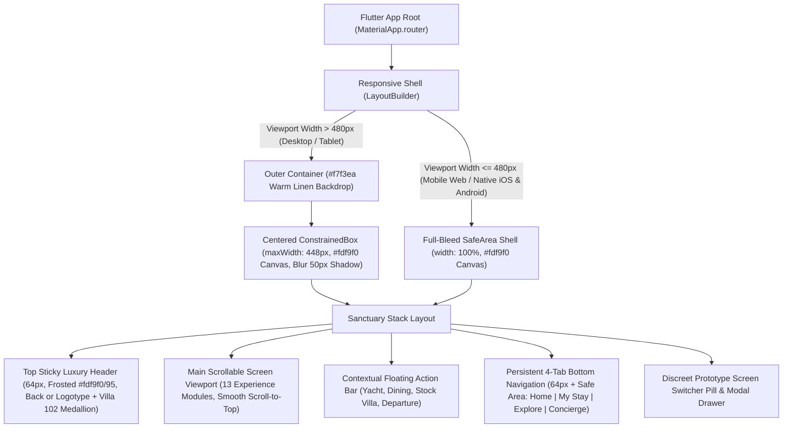
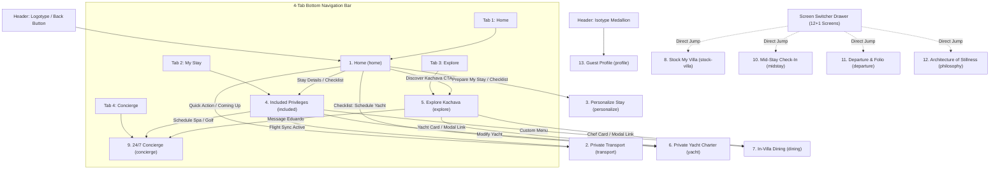
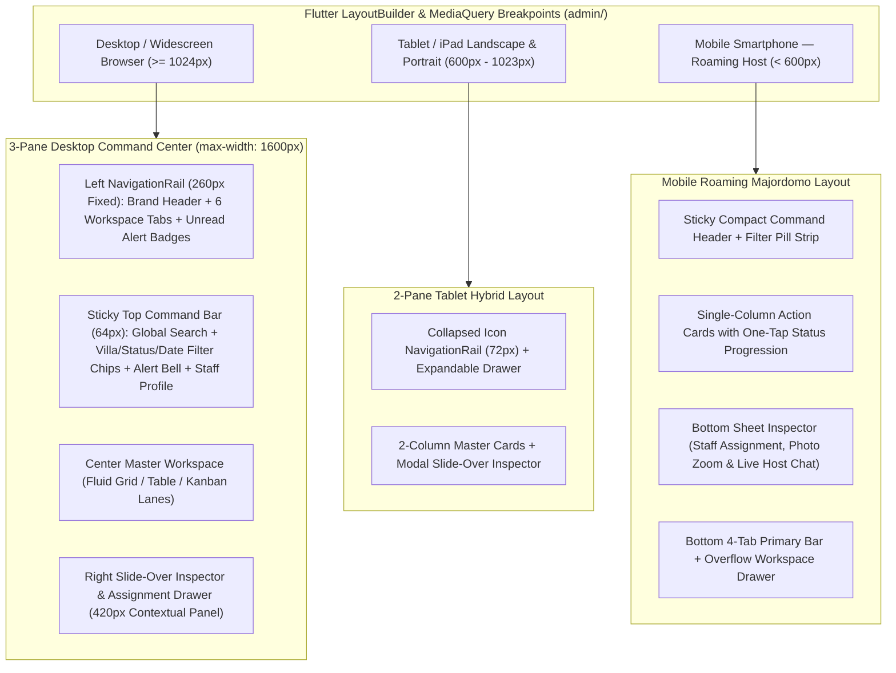

# Kachava Lux — UI/UX Design System & Visual Experience Specification

## 1. Design Philosophy & Brand Identity

### 1.1 Editorial Biophilic Luxury Across Dual Applications (`web/` & `admin/`)
The **Kachava Lux** visual identity translates the tactile materiality of the Yucatan Peninsula into a cohesive, dual-application design system powering both Flutter Web clients in the monorepo:
- **Guest Experience Portal (`web/`)**: Composed like an architectural monograph inside a mobile-first sanctuary shell (`448px` centered canvas on desktop, full-bleed on mobile)—balancing generous warm-linen negative space, high-contrast serif typography, organic rounded geometry, and unhurried micro-animations.
- **Administrative & Concierge Operations Dashboard (`admin/`)**: Extends the exact same Chukum limestone, Zapote espresso, and Copal amber tokens into a high-clarity, responsive browser & mobile-adaptive command center (`>= 1024px` multi-column desktop workspace with `260px` left navigation rail and `420px` slide-over inspector drawer, scaling fluidly down to tablet and mobile viewports for roaming villa hosts).

The aesthetic rests on four physical pillars inspired by **Villa 102 (Ceiba Suite)**:
1. **Chukum Stucco & Limestone (`#fdf9f0` / `#f7f3ea`)**: Warm, sunlit cream surfaces that eliminate harsh pure-white glare and evoke hand-troweled Mayan limestone plaster across both guest cards and administrative workspaces.
2. **Mayan Zapote Timber & Espresso (`#754d24` / `#8b6339`)**: Deep, grounded earth tones drawn from aged tropical hardwood used for primary actions, structural headings, navigation rails, and sanctuary framing.
3. **Copal Resin & Caribbean Sand (`#a67d52` / `#c49a6c`)**: Golden-amber accents that highlight included privileges, active indicators, SLA progress bars, and bespoke badges.
4. **Kachava Caribe Maritime Night (`#0B1F33` / `#18B7C9` / `#C9A45C`)**: A dedicated nautical sub-palette reserved for the **Galeon 470 Sky** yacht charter experience and maritime dispatch views, evoking deep Puerto Cancún waters and turquoise reef shallows.

For functional requirements and Gherkin test scenarios associated with these views, see `[SPECIFICATION.md](./SPECIFICATION.md)` and `[USER_STORIES.md](./USER_STORIES.md)`. For Flutter architecture and data persistence, see `[TECH_STACK.md](./TECH_STACK.md)` and `[DATA_ARCHITECTURE.md](./DATA_ARCHITECTURE.md)`.

---

## 2. Complete Design Tokens Reference

### 2.1 Color Palette & Semantic Tokens
All hex values below are extracted directly from the brand specification in `src/index.css` and component implementations:

#### Primary Palette (Official Kachava Lux Espresso Brown)
| Token Name | CSS Variable | Hex Code | RGB | Semantic UI Role & Flutter `ColorScheme` Mapping |
| :--- | :--- | :--- | :--- | :--- |
| **Primary** | `--color-primary` | `#754D24` | `rgb(117, 77, 36)` | `colorScheme.primary` — Primary CTA buttons, serif display titles, active navigation icons, selected cards. |
| **On Primary** | `--color-on-primary` | `#FFFFFF` | `rgb(255, 255, 255)` | `colorScheme.onPrimary` — High-contrast label text and icons on primary espresso buttons. |
| **Primary Container** | `--color-primary-container` | `#8B6339` | `rgb(139, 99, 57)` | `colorScheme.primaryContainer` — Section eyebrows, secondary headings, icon containers on dark cards. |
| **On Primary Container** | `--color-on-primary-container` | `#F7E8D0` | `rgb(247, 232, 208)` | `colorScheme.onPrimaryContainer` — Warm champagne text overlaid on espresso banners and hero gradients. |
| **Primary Hover / Deep** | *(Component Token)* | `#603917` | `rgb(96, 57, 23)` | Hover/pressed state for `#754D24` primary buttons (`--color-on-secondary-container`). |
| **Inverse Primary** | `--color-inverse-primary` | `#C6B198` | `rgb(198, 177, 152)` | `colorScheme.inversePrimary` — Subtle highlights on dark backgrounds. |

#### Secondary & Tertiary Palette (Warm Sand, Amber & Olive)
| Token Name | CSS Variable | Hex Code | RGB | Semantic UI Role & Flutter `ColorScheme` Mapping |
| :--- | :--- | :--- | :--- | :--- |
| **Secondary** | `--color-secondary` | `#A67D52` | `rgb(166, 125, 82)` | `colorScheme.secondary` — Category eyebrows, accent icons, progress bars, interactive links. |
| **On Secondary** | `--color-on-secondary` | `#FFFFFF` | `rgb(255, 255, 255)` | `colorScheme.onSecondary` — Text on secondary amber badges. |
| **Secondary Container** | `--color-secondary-container` | `#C49A6C` | `rgb(196, 154, 108)` | `colorScheme.secondaryContainer` — Notification dots, priority card borders, toast checkmarks, gold badges. |
| **On Secondary Container**| `--color-on-secondary-container`| `#603917` | `rgb(96, 57, 23)` | `colorScheme.onSecondaryContainer` — Dark text inside warm amber containers. |
| **Tertiary** | `--color-tertiary` | `#736458` | `rgb(115, 100, 88)` | `colorScheme.tertiary` — Informational muted earth accents. |
| **Tertiary Container** | `--color-tertiary-container` | `#C6B198` | `rgb(198, 177, 152)` | `colorScheme.tertiaryContainer` — Warm stone tags and dividers. |

#### Surface & Background Palette (Warm Chukum Cream)
| Token Name | CSS Variable | Hex Code | Semantic UI Role |
| :--- | :--- | :--- | :--- |
| **Surface (Canvas)** | `--color-surface` | `#FDF9F0` | Primary mobile shell canvas background (`max-w-md` inner frame) and modal sheet background. |
| **Surface Container Lowest**| `--color-surface-container-lowest`| `#FFFFFF` | Elevated content cards, input fields, and interactive list tiles. |
| **Surface Container Low** | `--color-surface-container-low` | `#F7F3EA` | Desktop outer viewport backdrop (`min-h-screen`), subtle summary boxes, and secondary banners. |
| **Surface Container** | `--color-surface-container` | `#F1EDE5` | Card internal horizontal dividers (`border-[#f1ede5]`), inactive chip backgrounds, and icon wells. |
| **Surface Container High** | `--color-surface-container-high` | `#ECE8DF` | Segmented control tracks, close button circles, and skeleton/image placeholders. |
| **Surface Container Highest**| `--color-surface-container-highest`| `#E6E2D9` | Card borders (`border-[#e6e2d9]`), inactive progress tracks, and subtle hairlines. |
| **Surface Dim** | `--color-surface-dim` | `#E8E2D6` | Pressed states on cream surfaces. |

#### Typography, Outline & Semantic Status Colors
| Token Name | Hex Code | Semantic UI Role |
| :--- | :--- | :--- |
| **On Surface (Obsidian)** | `#1C1C16` | Default root body text (`--color-on-surface`). |
| **On Surface Variant** | `#544741` / `#4E453C` | Editorial narrative paragraphs and descriptive card copy. |
| **Muted Metadata** | `#7F756A` | Secondary captions, timestamps, subtitles, and inactive BottomNav tabs. |
| **Outline / Input Border** | `#988575` / `#D1C5B8` | Form input borders, modal sheet borders, and unselected radio rings. |
| **Status: Confirmed Green** | `#3B6D41` | Confirmed badges, online availability dots, and completed step bars (paired with `#EEF5ED` / `#F4F8F3` background tint). |
| **Status: Error / Allergy** | `#BA1A1A` | Culinary allergy caution alerts and form validation errors (paired with `#FFDAD6` container). |
| **Status: Highlight Gold** | `#FFDEAD` | Warm parchment highlight badge background for `"Anniversary Night"` and `"Optimal Coral Sun"`. |
| **Kachava Caribe Navy** | `#0B1F33` / `#07131F` | Maritime sub-brand header, Captain card, and yacht gallery backdrop on `yacht` screen. |
| **Kachava Caribe Cyan** | `#18B7C9` | Maritime status pulse, reef inclusion checkmarks, and `"Galeon 470 Sky"` badge text. |
| **Kachava Caribe Gold** | `#C9A45C` | Maritime active gallery thumbnail border and Captain role badge. |

---

### 2.2 Typography Scale & Flutter `TextTheme` Mapping

The design system pairs two self-hosted Google Fonts served locally from `assets/fonts/` (`public/fonts/` in the prototype) to guarantee zero external network latency and zero Cumulative Layout Shift (CLS):
- **Serif Display & Headings**: `Libre Baskerville` (`LibreBaskerville-Regular.ttf` `400`, `LibreBaskerville-Italic.ttf` `400 italic`, `LibreBaskerville-Bold.ttf` `700`).
- **Sans-Serif Body, Labels & Controls**: `Libre Franklin` (`LibreFranklin-VariableFont_wght.ttf` `100–900`, `LibreFranklin-Italic-VariableFont_wght.ttf` `100–900 italic`).

| CSS Token Class | Font Family | Mobile Size / Line Height | Desktop (`>=640px`) | Weight | Letter Spacing | Flutter `TextTheme` Equivalent |
| :--- | :--- | :--- | :--- | :--- | :--- | :--- |
| `.font-headline-lg` | `Libre Baskerville` | `34px` / `42px` (`1.23`) | `40px` / `50px` (`1.25`) | `400` | `-0.01em` (`-0.34`) | `textTheme.displaySmall` |
| `.font-headline-md` | `Libre Baskerville` | `26px` / `34px` (`1.31`) | `28px` / `36px` (`1.28`) | `400–500` | `-0.01em` (`-0.26`) | `textTheme.headlineMedium` |
| `.font-headline-sm` | `Libre Baskerville` | `21px` / `28px` (`1.33`) | `21px` / `28px` (`1.33`) | `500` | `0.0em` | `textTheme.titleLarge` |
| `.font-body-lg` | `Libre Franklin` | `17px` / `28px` (`1.65`) | `17px` / `28px` (`1.65`) | `300` | `0.0em` | `textTheme.bodyLarge` |
| `.font-body-md` | `Libre Franklin` | `15px` / `24px` (`1.60`) | `15px` / `24px` (`1.60`) | `400` | `0.0em` | `textTheme.bodyMedium` |
| `.font-body-sm` | `Libre Franklin` | `13px` / `20px` (`1.54`) | `13px` / `20px` (`1.54`) | `400` | `0.0em` | `textTheme.bodySmall` |
| `.font-label-md` | `Libre Franklin` | `11px` / `16px` (`1.45`) | `11px` / `16px` (`1.45`) | `600` | `+0.12em` (`+1.32`) | `textTheme.labelMedium` (Uppercase) |
| `.font-label-sm` | `Libre Franklin` | `10px` / `14px` (`1.40`) | `10px` / `14px` (`1.40`) | `600–700`| `+0.14em` (`+1.40`) | `textTheme.labelSmall` (Uppercase) |

### 2.3 Iconography System
- **Primary Icon Set**: **Google Material Symbols Outlined** (`material_symbols_icons` package in Flutter).
- **Weight & Fill Behavior**: Default icons render at weight `400`, optical size `20px–24px`, with `fill: 0.0`. When a tab in the `BottomNav` is active, the icon scales to `110%` (`scale-110`) and transitions to `fill: 1.0` (`fontVariationSettings: "'FILL' 1"`).

---

## 3. Responsive Mobile-App Shell Architecture in Flutter Web

### 3.1 Desktop vs. Mobile Viewport Framing
The application is designed with a **Mobile-First Sanctuary Shell** so that guests viewing the web portal on a laptop or desktop monitor experience the exact same intimate, tactile card proportions as they do on their smartphone by the plunge pool—while keeping the widget tree 100% ready for native iOS and Android compilation.

- **Desktop & Tablet Viewports (`width > 480px`)**:
  - The outer `Scaffold` background renders in warm linen `#F7F3EA` (`--color-surface-container-low`).
  - A centered `ConstrainedBox(constraints: BoxConstraints(maxWidth: 448))` (`max-w-md`) creates the `#FDF9F0` (`--color-surface`) sanctuary canvas with a soft ambient elevation shadow (`BoxShadow(color: Color.fromRGBO(112, 88, 54, 0.08), blurRadius: 50)`).
  - Fixed elements (`Header`, `BottomNav`, and contextual floating action bars on `yacht`, `dining`, `stock-villa`, and `departure`) are strictly constrained to the centered `448px` column.
- **Mobile Viewports (`width <= 480px`) & Native iOS/Android**:
  - The `#FDF9F0` canvas expands to `100%` of the device width and height, respecting `MediaQuery.paddingOf(context)` (`pt-safe` and `pb-safe`) for iOS Dynamic Island and home indicator insets.

### 3.2 Sticky Luxury Header (`Header`)
- **Dimensions & Surface**: Fixed at the top of the shell (`height: 64px`, `padding: 0 16px`), background `#FDF9F0` at `95%` opacity with `BackdropFilter(filter: ImageFilter.blur(sigmaX: 24, sigmaY: 24))` and a `1px` bottom border (`#8B6339` at `10%` opacity).
- **Left Slot (Context-Aware)**:
  - **Main Screens (`home`, `included`, `explore`, `concierge`, `stock-villa`)**: Displays the official dark-brown **Kachava Lux Logotype** (`assets/logotype.png`, height `18px`), which navigates to `home` on tap.
  - **Sub-Screens (`transport`, `personalize`, `yacht`, `dining`, `midstay`, `departure`, `philosophy`, `profile`)**: Replaces the logotype with an interactive back button (`arrow_back` icon in `#754D24` + `17px` `Libre Baskerville` sub-screen title) that returns to `home`.
- **Right Slot (Residency Identity & Profile Access)**:
  - Displays stacked right-aligned text: `VILLA` (`8px` uppercase, `0.18em` tracking, `#A67D52` bold) above `102` (`13px` `Libre Baskerville` semibold, `#754D24`).
  - Adjacent `36x36px` button rendering the official Mayan-inspired **Kachava Isotype Medallion** (`assets/isotype-brown.png`). Tapping navigates to `profile`; when `currentScreen == 'profile'`, a `2px` `#A67D52` focus ring surrounds the medallion.

### 3.3 Persistent 4-Tab Bottom Navigation Bar (`BottomNav`)
- **Dimensions & Surface**: Fixed at the bottom of the shell (`height: 64px` plus bottom safe-area inset), frosted `#FDF9F0/95` surface with `1px` top border (`#8B6339` at `15%` opacity) and upward ambient shadow (`0 -4px 24px rgba(112, 88, 54, 0.06)`).
- **Tab Mapping & Active Highlight Logic**:

| Tab Index | Label | Material Icon | Target Screen on Tap | Active Highlight Screen Group | Special Indicator |
| :--- | :--- | :--- | :--- | :--- | :--- |
| **Tab 1** | `HOME` | `villa` | `home` | `home`, `transport`, `personalize` | Filled icon + `#754D24` bold label when active. |
| **Tab 2** | `MY STAY` | `calendar_today` | `included` | `included`, `stock-villa`, `midstay`, `departure` | Filled icon + `#754D24` bold label when active. |
| **Tab 3** | `EXPLORE` | `explore` | `explore` | `explore`, `yacht`, `dining`, `philosophy` | Filled icon + `#754D24` bold label when active. |
| **Tab 4** | `CONCIERGE` | `support_agent` | `concierge` | `concierge` | Persistent `8x8px` `#C49A6C` amber badge dot at top-right of icon. |

> **Note**: When `currentScreen == 'profile'`, no bottom tab is highlighted (`activeTab = null`), as Profile is a global identity view active in the top Header medallion.

### 3.4 Navigation Topology Diagram

---

## 4. Synthesized 432Hz Soundscape UX

### 4.1 Procedural Audio Engine Specification
Rather than bundling multi-megabyte MP3/WAV loops that delay page loads, Kachava Lux features a real-time procedural soundscape synthesizer (`SanctuarySoundscape`) accessible from the **Architecture of Stillness (`philosophy`)** screen and preserved across screen navigation in global app state:

1. **Master Gain Envelope**: Initializes at `0.001` gain and ramps exponentially to `0.08` over `3.0 seconds` upon activation, preventing audio clicks or startling volume jumps. On stop, it ramps down exponentially to `0.0001` over `1.0 second` before closing the audio context.
2. **Layer 1 — 432 Hz Root Harmonic Drone**: Continuous `sine` wave oscillator locked at `432 Hz` (relative gain `0.50`) promoting meditative stillness.
3. **Layer 2 — 216 Hz Sub-Harmonic Foundation**: Continuous `triangle` wave oscillator at `216 Hz` (one octave below root, relative gain `0.35`) providing warm acoustic resonance.
4. **Layer 3 — Cenote Breeze & Ripple Generator**: Looping 2-second white-noise buffer passed through a `lowpass` BiquadFilter at `320 Hz` (relative gain `0.04`), producing a soft organic coastal breeze texture.
5. **Layer 4 — Periodic 864 Hz Singing Bowl Chime**: Triggered automatically every `11,000 ms` (`11 seconds`) while active. Spawns a transient `sine` oscillator at `864 Hz` (`432 Hz × 2`), ramping from `0.0001` to `0.04` in `0.1s` and decaying exponentially to `0.0001` over `4.5s`.
6. **Browser Autoplay Compliance**: Audio synthesis is strictly instantiated inside a synchronous user tap gesture handler (`onToggleSoundscape`) to satisfy WebKit/Blink autoplay security policies on iOS Safari and Chrome.

---

## 5. Screen-by-Screen UI/UX Blueprint (All 13 Screens)

### 5.1 Screen 1: Residency Home (`home`)
- **Visual Hierarchy**:
  1. **16:10 Rounded Hero Card (`rounded-2xl`)**: Full-bleed Villa 102 architectural photograph with bottom dark gradient vignette (`from-black/80 via-black/30 to-black/20`), champagne eyebrow `"WELCOME TO KACHAVA"`, and serif headline `"Sarah, your Tulum experience begins in 42 days."`
  2. **Residence Identity Card**: White card (`#FFFFFF`, `border-[#e6e2d9]`) displaying `"YOUR RESIDENCE"`, `26px` serif `"VILLA 102"`, upper-right circular `#F7F3EA` `ios_share` button, and a divider row with `"November 12–16, 2026"` and `"4 nights · 2 guests"`.
  3. **3-Column Primary Action Grid (`grid-cols-3 gap-2.5`)**: Equal-width white square-ish cards with `#A67D52` icon (`22px`) and `10px` bold uppercase label: `CONCIERGE` (`support_agent`), `PREPARE MY STAY` (`tune`), and `STAY DETAILS` (`receipt_long`).
  4. **"BEFORE YOU ARRIVE" Progressive Checklist**: Header row with `"3 of 6 completed"` pill, `6px` progress bar (`#A67D52` fill over `#E6E2D9`), 3 incomplete task cards (top priority card highlighted with `#C49A6C` border and `"Start →"` badge), and an expandable `"View all 6 checklist items"` toggle revealing the 3 `#3B6D41` green-checked completed cards.
  5. **"COMING UP" Logistics Card**: Horizontal card with `#F7F3EA` car icon box, `"Private Airport Transportation"`, `"Nov 12 · 11:35 AM"`, and green `"Confirmed ✓"` badge.
  6. **"DISCOVER KACHAVA" Editorial Teaser**: `16:9` Galeon 470 Sky photo card with narrative copy and full-width `#754D24` `"EXPLORE EXPERIENCES →"` button.
- **Modals & Feedback**: Bottom-sheet/dialog **Share Stay Details** modal (`Copy Reservation Link` + `Share with Mark (Partner)`) and floating top pill toast (`top-20`, `#754D24` background, `#C49A6C` check icon).

### 5.2 Screen 2: Private Airport Transportation (`transport`)
- **Visual Hierarchy**:
  1. **Title Block & 16:8.5 Chauffeur Hero**: Eyebrow `"INCLUDED WITH YOUR STAY"`, `26px` serif title `"Private Airport Transportation"`, and luxury SUV photograph with `"Direct Sanctuary Escort"` overlay.
  2. **Above-the-Fold Confirmation & Dispatch Card**:
     - Displays current transfer status (`Not Requested`, `Pending`, `Confirmed`, `En Route`, `Completed`), guest flight telemetry (`arrivalDate`, `arrivalAirport`, `terminal`, `airline`, `flightNumber`, `estimatedLanding`, `partySize`, `luggageChecked`, `luggageCarryOn`), and **Read-Only Host Admin Chauffeur & Meeting Point Assignment** (`assignedDriver`, `vehicleModel`, `meetingPoint`, `adminDispatchNotes`).
     - When `status == 'Not Requested'`, prompts the guest to submit their arrival flight details to request chauffeur dispatch.
  3. **Action Stack**: Full-width primary `#754D24` button `"EDIT FLIGHT DETAILS"` (`edit_calendar`) above secondary white outlined button `"MESSAGE CONCIERGE"` (`support_agent`).
  4. **3 Collapsible FAQ Accordions**: *"What happens when I land?"* (numbered 1-2-3 steps), *"Your vehicle"* (luxury SUV photo, Wi-Fi & refreshment specs, assigned Chauffeur badge), and *"What's included"* (coconut thumbnail, Zero-Friction Guarantee box, luggage note).
- **Modals & Feedback**: **Edit Flight Details Modal / Form** using `showDatePicker` for `Arrival Date`, empty `TextEditingController()` with `InputDecoration(hintText: ...)` placeholders for unpopulated text inputs (`Arrival Airport`, `Airline`, `Flight Number`, `Terminal`, `Estimated Landing Time`, `Special Notes`), steppers for `Guests (1–12)`, `Checked Bags (0–10)`, `Carry-on Bags (0–10)`, and `Cancel` / `Save & Sync` buttons (which submit `PATCH /api/v1/stays/:guestUuid/transfer`, transition `Not Requested` -> `Pending`, and alert `HOST ADMIN`).

### 5.3 Screen 3: Stay Personalization Wizard (`personalize`)
- **Visual Hierarchy**:
  - **Top Step Progress Header**: Dynamic step title (`YOUR TRIP` / `YOUR INTERESTS` / `YOUR PREFERENCES`), `"Step X of 3"` counter, and `4px` animated `#A67D52` progress bar.
  - **Step 1 View**: `26px` serif title `"Personalize Your Stay"`, 2-column grid of 8 selectable purpose buttons (active state fills with `#754D24` and `#C49A6C` checkmark circle), conditional `"Tell us about the occasion"` text input, and `"CONTINUE →"` CTA.
  - **Step 2 View**: Title `"What would you love to experience?"`, 2-column grid of 12 compact (`min-h-[58px]`) icon-and-label cards, `"CONTINUE →"` CTA, and `"← Back to Trip"` text button.
  - **Step 3 View**: Title `"Your Preferences"`, wrap pills for 6 Dietary options, Allergies text input, white **Villa Preferences** container (2x2 Aromatherapy grid + Pillow Selection pills), 3-column Preferred Concierge Communication selector (`WhatsApp` | `SMS` | `Email`), and `"SAVE MY PREFERENCES ✓"` CTA.
  - **Step 4 Completion View**: Centered `#F7F3EA` check medallion (`56x56px`), `28px` serif heading `"Your stay is taking shape."`, 4-row summary card, `"REVIEW MY STAY →"` CTA, and `"Edit Preferences"` link.

### 5.4 Screen 4: Included in Your Stay (`included`)
- **Visual Hierarchy**:
  1. **Header & All-Inclusive Sanctuary Tier Banner**: `#F7F3EA` card with `#754D24` shield icon, `"Zero hidden fees · Fully prepaid privilege folio"`, and right-aligned `"$0.00 Due"`.
  2. **4 Full-Bleed Image Privilege Cards (`h-48` image header + `p-4` body)**:
     - *Artisanal Breakfast* (`Included · Daily`, `SERVED 07:00 – 11:30 · NO RESERVATION REQUIRED`).
     - *Private Airport Chauffeur* (`Included · Round-Trip`, `Confirmed`, `Flight Sync Active →`).
     - *Kachava Caribe · Half-Day Yacht Experience* (`Included · Private`, `#0B1F33` / `#18B7C9` `Galeon 470 Sky` badge, `Modify →`).
     - *Four-Course Chef Dinner* (`Included · In-Villa`, `Sommelier Paired`, `Custom Menu →`).
  3. **Bespoke Ritual Selection Container (`#F7F3EA`)**: Interactive switcher comparing **Option A** (*2 × 60-Min In-Villa Chukum Massages*) and **Option B** (*2 × Rounds at PGA Riviera Maya*). Selected card displays full-opacity white background, `#A67D52` border, `"✓ Selected"` pill, and `"Schedule Time →"` CTA; unselected card displays `60%` opacity and `"Switch to this option"` button. Bottom summary bar reads `✨ ACTIVE: ...`.
  4. **Unconditional Sanctuary Hospitality Card**: Centered `#F1EDE5` promise card with `"View in My Itinerary →"` CTA.

### 5.5 Screen 5: Explore Your Kachava (`explore`)
- **Visual Hierarchy**:
  1. **Top Gradient Section — "INCLUDED WITH YOUR STAY"**: Displays `"VILLA 102 PRIVILEGES"` eyebrow, green `"4 Benefits Available"` pill, and a horizontal scrolling carousel (`w-[240px]` cards) of Sarah's unused complimentary benefits with `"UNUSED BENEFIT"` / `"SCHEDULED ✓"` badges and `"$0 · INCLUDED"` footer.
  2. **Main Discovery Header & Horizontal Category Filter Bar**: 7 pill buttons (`All`, `Included`, `Yacht`, `Wellness`, `Dining`, `Adventure`, `Culture`).
  3. **Experience Feed**: Vertical stack of `16:9` photo cards with top-left price badge (`INCLUDED` in `#754D24` or `FROM $XXX` in frosted white), top-right duration pill, bottom pulsing availability indicator, serif title, and 1-line truncated description.
  4. **Custom Unlisted Encounters Banner**: Bottom `#F7F3EA` card with `"Message Eduardo"` CTA.
- **Modals & Feedback**: **Complete Experience Detail Modal** (`max-h-[92vh]` bottom sheet) containing hero image + interactive thumbnail strip, metadata row, *"The Experience"* narrative card, *"What's Included"* check-list card, **Select Date & Time** container (5-column residency date grid `Wed 12`–`Sun 16` + radio time slots + `2 Guests (Villa 102)` badge), and sticky bottom `"Schedule Included Privilege"` / `"Confirm Reservation"` button.

### 5.6 Screen 6: Kachava Caribe · Galeon 470 Sky Yacht Charter (`yacht`)
- **Visual Hierarchy**:
  1. **Top Action Row & Maritime Sub-Brand Strip**: `"← Back to Explore"`, share/external link icons, and `#0B1F33` navy strip with pulsing `#18B7C9` dot, `"KACHAVA CARIBE by kachava lux"`, and `"Galeon 470 Sky"` badge.
  2. **Interactive 10-Photo Vessel Carousel**: `h-72` hero viewport with tag overlay (`Exterior Profile`, `Aerial`, `Beach Mode Club`, etc.) above a dark `#07131F` horizontal thumbnail strip with `#C9A45C` active borders.
  3. **Vessel Specifications Grid**: 2x3 `#F7F3EA` grid (`Overall Length`, `Beach Mode Beam`, `Day Capacity`, `Accommodations`, `Engines`, `Home Port`) + 2 feature callout cards (`🏖️ Beach Mode Balconies`, `☀️ Dynamic Skydeck`).
  4. **Curated Charter Packages (4 Radio Cards)**: `Half-Day Guest Experience` (`Included Privileged`, `$0 Due`), `Extended Caribbean Experience` (`+$1,000 USD`), `Private Full-Day Escape` (`+$2,000 USD`), and `Custom Yucatan Peninsula & Caribbean Routes`. Selected package expands in-place to reveal `#18B7C9` checkmarked inclusions and suggested path.
  5. **Navigable Waters (3 Route Cards)**: `Cancún & Isla Mujeres`, `Isla Contoy Sanctuary`, and `Miami & Biscayne Bay`.
  6. **Meet Your Captain Card**: Deep navy `#0B1F33` card with circular `#C9A45C`-bordered portrait of Master Captain `Eduardo Velasco Tadeo`, quote, and maritime bio.
  7. **Date, Departure Window & Guest Manifest Controls**: 4-day grid (`WED 12`–`SAT 15`), `Morning Sail` vs. `Golden Sunset Voyage` cards, `+`/`-` Guest Manifest counter (`1–12`), Concierge Dietary Sync card, Transparent Billing Summary card, and `kachavacaribe.com` portal banner.
  8. **Sticky Floating Booking Bar (`bottom-16`)**: Displays net USD investment (`$0.00`, `$1,000.00`, or `$2,000.00`) and `"Reserve Experience →"` CTA.

### 5.7 Screen 7: In-Villa & Sanctuary Dining (`dining`)
- **Visual Hierarchy**:
  1. **Header & Segmented Mode Switcher**: `#ECE8DF` pill track toggling between `In-Villa Chef Experience` and `Artisanal Breakfast`.
  2. **Artisanal Breakfast View**: Single card with `h-52` breakfast photo, daily `7:00 – 11:30 AM` description, and `"✓ No reservation needed"` banner.
  3. **In-Villa Chef View**:
     - `$0 Due` (valued at `$650 USD`) privilege banner.
     - *Lead Alchemist* photo card (`Chef Mateo & Sommelier Elena`) with quote.
     - *4th Anniversary Honoring* card (`Pre-Arranged` Ruinart Brut Champagne & confection script).
     - *Select Evening Ritual*: 4 date rows (`Wed, Nov 12` Booked disabled; `Thu, Nov 13`; `Fri, Nov 14` with `"Anniversary Night"` badge; `Sat, Nov 15`), 3-column Service Time Window (`6:30 PM`, `8:00 PM`, `9:00 PM`), Guest Count stepper (`1–6`), and 3 Private Table Setting cards (`Oceanfront Pool Terrace`, `Indoor Chukum Dining Pergola`, `Secluded Beachfront Palapa`).
     - *Five-Course Curations*: 3 rich menu cards (`Fuego y Mar Tasting Menu`, `Tierra Sagrada`, `Flora Silvestre`) with course breakdowns, sommelier pairing boxes, and `"✓ Selected Menu"` / `"Switch to..."` buttons.
     - *Concierge Profile Sync Card* (highlighting red `"No Crustacean Shellfish for Sarah"` pill) and Sommelier WhatsApp inquiry link.
  4. **Sticky Floating Confirmation Bar (`bottom-16`)**: Shows `"$0.00 USD · Included"` and `"Confirm Dining"` button.

### 5.8 Screen 8: Stock My Villa — Artisanal Larder (`stock-villa`)
- **Visual Hierarchy**:
  1. **Header & Majordomo Unpacking Promise Card**: `#F7F3EA` card detailing Sub-Zero & ceramic tableware preparation prior to 2:00 PM arrival, plus dietary sync bar.
  2. **Horizontal Category Pills**: 7 scrollable filter pills (`All Items`, `Fresh Fruit & Botanicals`, `Chilled Elixirs`, `Cellar Selection`, `GF Bakery`, `Snacks`, `Recovery`).
  3. **Larder Catalog Feed**: 7 vertical cards (`h-48` image with harvest/dietary badges, title, origin subtitle, `$XX USD / FOLIO` price, description, storage location label e.g. `SUB-ZERO CHILLED`, and either `"+ Add to Villa"` button or `- 1 +` quantity stepper).
  4. **Standard In-Villa Inclusions (`$0 USD`) & Special Sourcing Cards**: 4 complimentary staple rows and WhatsApp custom-sourcing card.
  5. **Sticky Floating Cart Bar (`bottom-16`)**: Displays reactive `${totalAmount}.00 USD · {totalCount} items selected` and `"Review Provisioning & Stock →"` button (disabled in `#D1C5B8` if `totalCount == 0`).

### 5.9 Screen 9: 24/7 Dedicated Concierge (`concierge`)
- **Visual Hierarchy**:
  1. **Header & Personal Concierge Card**: Displays `56x56px` portrait of `Eduardo` (`Kachava Concierge`) with `#3B6D41` online dot and `"Available"` pill, paired with a 2-column CTA row: `#754D24` `"MESSAGE ON WHATSAPP"` and `#F7F3EA` `"CALL CONCIERGE"`.
  2. **"HOW CAN WE HELP?" 2x2 Action Grid**: 4 cards (`min-h-[110px]`) with circular `#F7F3EA` icon badges: `Request Something` (`room_service`), `Ask Concierge` (`chat_bubble_outline`), `Change a Reservation` (`calendar_month`), and `Report an Issue` (`build`).
  3. **"YOUR REQUESTS" Tracker Section**: Header with `"X Open"` badge and `"View request history"` toggle link. Each request card displays title, timestamp, status badge (`Requested`, `Assigned`, `In Progress`, `Completed`), a **4-Segment Horizontal Progress Bar** (`grid-cols-4 gap-1.5`), and `"Assigned to: Eduardo"`.
- **Modals & Sheets**:
  - **Report an Issue Modal**: 7 category pills, details textarea, optional photo picker (`add_a_photo`) with `112x112px` preview thumbnail, and `"SEND TO KACHAVA →"` transitioning to `"We're on it."` confirmation state.
  - **General Action Modal**: Context-specific quick suggestion pills (`+ Extra towels`, etc.) and textarea.
  - **Request Details Bottom Sheet**: Vertical 4-stage node timeline connecting `Requested` -> `Assigned` -> `In Progress` -> `Completed`, request notes, attached photo viewer, and `"Message Eduardo About This"` CTA.

### 5.10 Screen 10: Mid-Stay Check-In (`midstay`)
- **Visual Hierarchy**:
  1. **Header & Terrace Vignette**: Eyebrow with `"Day 2 of 4 · 4th Anniversary"` pill, `34px` serif headline `"How Is Your Stay Unfolding, Sarah?"`, and `h-44` plunge pool photograph.
  2. **In-Moment Sentiment Selector**: 4 full-width radio cards (`Transcendent & Flawless`, `Serene & Delightful`, `A Detail Could Be Tuned` [default selected in `#754D24`], `Need Direct Assistance`).
  3. **Active Service Recovery Container (`#F7F3EA`)**: Header `"Tell Us What We Can Refine"` with `"Discreet Priority"` badge; 7 multi-select Focus Area chips (`thermostat`, `pool`, `restaurant`, `bed`, `local_florist`, `directions_car`, `more_horiz`); Personal Note textarea with `"Tap to dictate audio note"` (`mic` icon pulsing red `#BA1A1A` during recording) and character count; `"Estimated Response: Under 7 Minutes"` SLA card; and `"Share With Villa Majordomo →"` button with spinner/success states.
  4. **Direct Majordomo Line, Host Snapshot & Sanctuary Vow**: 2-column Call/WhatsApp buttons, `Eduardo` On-Grounds card, and `Elena Valdés` quote card.

### 5.11 Screen 11: Peaceful Departure & Folio Ledger (`departure`)
- **Visual Hierarchy**:
  1. **Header & Outbound Flight Card**: `"Sunday, Nov 16 · AA 172 to MIA"`, `34px` serif title `"A Peaceful Departure, Sarah"`, and flight card (`CUN → MIA`, `● On Time`, `3:45 PM · Term 3`).
  2. **Seamless Departure Itinerary**: 5-node vertical timeline (`11:30 AM` Farewell Brunch, `12:45 PM` Luggage Retrieval, `1:00 PM` Mercedes-Benz EQS at Portico, `1:15 PM` Transit to CUN, `2:25 PM` Curbside Skycap Escort) + `"Request Custom Timing / Late Check-Out"` button.
  3. **Door-to-Terminal Transfer & Luggage Care Cards**: Chauffeur `Carlos M.` profile (`Fleet #04 Mercedes-Benz EQS SUV` 2x2 amenity grid) and vestibule luggage tagging instructions.
  4. **Villa 102 Final Ledger Card**: Itemized list showing 3 `$0.00 USD` included entitlements (with crossed-out retail valuations) above 4 billable incidentals (`$760` Cenote Dive, `$128` Larder, `$65` Recovery Kit, `$32` Biosphere Levy), totaling **`$985.00`** (`Pre-authorized` to `Visa ending in 8412`), with `"Download PDF Folio"` and `"Folio Inquiry"` buttons.
  5. **Sanctuary Memento Keepsake Card**: 2-column photo preview, complimentary *Amber & Copal Sacred Diffuser* gift note, and `"Download Sanctuary Gallery (18 Photos)"` button.
  6. **Sticky Floating Check-Out Bar (`bottom-16`)**: Shows `"Departure Confirmed 1:00 PM"` and `"Complete Check-Out →"` button (transitions to `"✓ Check-Out Completed"` in `#A67D52`).

### 5.12 Screen 12: The Architecture of Stillness (`philosophy`)
- **Visual Hierarchy**:
  1. **Interactive 432Hz Soundscape Player Bar**: Top `#ECE8DF` bar with circular Play/Pause button (`#754D24` / `#A67D52`), title `"Sacred Cenote & Wild Ceiba Breeze"`, and 3-bar animated equalizer.
  2. **Editorial Monograph Header & Courtyard Hero**: `"Words by Elena Valdés · 6 Min Read"`, `h-64` Sacred Courtyard photo (`20° 12' N`), and Architect `Javier Muñoz` pull-quote card.
  3. **Chapter 01 (Chukum)**: Narrative copy, `h-44` chukum wall texture image, and 3 material property cards (`Endemic Resin`, `Sub-Zero Thermal Mass`, `Living Patina`).
  4. **Chapter 02 (Cenotes & 1% Biosphere)**: Narrative copy and deep `#754D24` **Sian Ka'an Covenant (`1% Biosphere`)** card displaying `1,820 ha Preserved Forest` and `34 Hives Melipona Colonies`.
  5. **Chapter 03 (Kitchen As Altar)**: 2-column food photography grid (`fireCooking`, `tortillas`) and Sacred Milpa Harvest banner.
  6. **Living Sanctuary Rituals**: 2 booking cards (*Architectural & Botanical Twilight Tour* and *Mayan Copal & Sound Harmonization*) + `Elena Valdés` sign-off card.

### 5.13 Screen 13: Guest Profile (`profile`)
- **Visual Hierarchy**:
  - Vertical stack of 7 clean white cards (`rounded-2xl border-[#e6e2d9] p-5`) with uppercase section headers and right-aligned action links:
    1. **GUEST INFORMATION** (`Edit` -> opens modal): `64x64px` avatar with green status dot, `Sarah Miller`, `Guest & Mark`, and `#F7F3EA` `"4th Wedding Anniversary"` heart pill.
    2. **STAY DETAILS** (`Home Overview →`): Residence `Villa 102`, Dates `November 12–16, 2026`, `4 nights · 2 guests`.
    3. **PREFERENCES** (`Onboarding Flow` -> navigates to `personalize`): `Copal & Amber · Goose Down Pillows` and interest tags.
    4. **DIETARY & ALLERGIES** (`Edit` -> opens modal): `Pescatarian · Gluten Sensitive` and red `#BA1A1A` `warning` icon `"Allergy Caution: Shellfish · Chef Notified"`.
    5. **COMMUNICATION PREFERENCE** (`Change` / `Open Chat`): `WhatsApp — Direct line with Majordomo Eduardo`.
    6. **PAYMENT METHOD** (`Manage` -> opens modal): `Visa •••• 8412` with green `"Active"` badge.
    7. **PRIVACY & SETTINGS**: 3 key-value rows (`Strict Encrypted`, `Enabled (Villa 102)`, `Post-Departure Purge`) + `"Review Full Sanctuary Privacy Policy"` modal button.
  - Bottom full-width `#754D24` `"CONTACT CONCIERGE"` CTA.

---

## 6. Administrative & Concierge Operations Dashboard UI/UX Specification (`admin/`)

### 6.1 Responsive Browser & Mobile-Adaptive Layout Architecture (`admin/`)
Whereas the Guest Experience Portal (`web/`) intentionally constrains its canvas to a `448px` mobile sanctuary column to preserve editorial intimacy, the **Administrative & Concierge Operations Dashboard (`admin/`)** is engineered for high-density operational velocity across desktop command centers, iPad/tablet coordination desks, and roaming host smartphones:

#### Breakpoint 1: Desktop & Widescreen Browser (`>= 1024px`)
- **Outer Canvas**: Full-viewport `#F7F3EA` (`--color-surface-container-low`) background with a `max-width: 1600px` centered workspace frame.
- **Persistent Left Sidebar / `NavigationRail` (`260px` width)**:
  - Surface: Deep `#1C1C16` (`--color-on-surface` Obsidian) or warm `#F2EEE4` (`--color-surface-container`) with a `1px solid #E6E2D9` right border.
  - Top Brand Lockup: `KACHAVA LUX` (`Libre Baskerville` `18px`, `#754D24`) + subtitle `SANCTUARY OPERATIONS · VILLA 102` (`9px` uppercase tracking `0.2em`, `#A67D52`).
  - **6 Primary Workspace Navigation Items** (each with Material Symbol icon, label, and live counter badge):
    1. `Overview & Alerts` (`dashboard` / `notifications_active` — shows unread critical badge in `#BA1A1A`).
    2. `Stays & Magic Links` (`villa` / `vpn_key` — shows active residency count).
    3. `Experiences & Yacht` (`sailing` / `restaurant` — shows pending booking confirmations).
    4. `Villa Larder Queue` (`kitchen` / `wine_bar` — shows unstocked larder count).
    5. `24/7 Concierge & Chat` (`concierge` / `support_agent` — shows open 4-stage request badge).
    6. `Mid-Stay & Folio` (`receipt_long` / `fact_check` — shows `< 7 Min SLA` pulse alerts & checkout queue).
  - Bottom Staff Card: Displays signed-in host (`Eduardo Rivera · Head Majordomo`, green online dot, and `Sign Out` control).
- **Sticky Top Command Bar (`64px` height, `bg-[#fdf9f0]/95 backdrop-blur-md border-b border-[#e6e2d9]`)**:
  - **Global Search Input (`320px` width)**: Rounded pill (`rounded-full bg-[#f2eee4] px-4 py-2`) supporting instant search across Guest Name (`Sarah Miller`), Villa (`102`), Flight (`AA 1482`), or UUID.
  - **Global Quick-Filter Chip Bar**: Interactive filter pills for `Villa: All / Villa 102`, `Status: PRE_ARRIVAL / ACTIVE_STAY / CHECKED_OUT`, `Urgency: All / Allergy & Critical`, and `Date: Nov 12–16`.
  - **Live Alerts Notification Bell**: Icon button with animated `#BA1A1A` or `#C49A6C` unread badge; clicking opens a floating Alerts Popover summarizing the newest guest mutations from `web/`.
- **Center Master Workspace + Right Slide-Over Inspector Drawer (`420px` width)**:
  - Selecting any stay, booking, larder order, or concierge ticket in the center workspace smoothly slides open the `420px` right-hand `#FDF9F0` Inspector Drawer (`border-l border-[#e6e2d9] shadow-2xl`) so staff can assign personnel, send notifications, inspect photos, or reply in chat without losing their scroll position or filter state in the master list.

#### Breakpoint 2: Tablet Browser (`600px – 1023px`)
- Collapses the left navigation sidebar into a `72px` compact icon `NavigationRail` with tooltips and badge dots.
- Master data tables automatically reflow into a 2-column responsive card grid (`grid-cols-2 gap-4`), and the `420px` right inspector opens as a modal slide-over overlay with a `bg-[#1c1c16]/40 backdrop-blur-xs` scrim.

#### Breakpoint 3: Mobile Smartphone Browser (`< 600px` — Roaming Majordomo View)
- Designed for Majordomo `Eduardo Rivera`, Chauffeur `Carlos M.`, or Engineering staff walking the sanctuary grounds with a smartphone.
- Replaces multi-column tables with touch-friendly `rounded-2xl` operational cards (`min-height: 44px` tap targets), horizontal scrollable filter chips, a bottom navigation bar (`Overview`, `Concierge`, `Experiences`, `More`), and a `rounded-t-[2rem]` **Draggable Bottom Sheet** for 1-tap 4-stage ticket progression, Firebase Storage maintenance photo inspection, and live guest chat replies.

---

### 6.2 Semantic Operational Status, SLA & Urgency Tokens (`admin/`)

To maintain visual harmony with the Kachava Lux palette while giving staff unmistakable operational clarity, all status pills, SLA timers, and allergy flags in `admin/` adhere to the following semantic token mapping:

| Operational State / Badge | Background Hex | Border Hex | Text / Icon Hex | Usage Across `admin/` Workspaces |
| :--- | :--- | :--- | :--- | :--- |
| **Stage 1: Requested / Pending** | `#FEF3C7` | `#F59E0B` (`40%`) | `#92400E` | New concierge tickets, unconfirmed experience bookings, pending larder orders. |
| **Stage 2: Assigned** | `#F7E8D0` | `#C49A6C` | `#754D24` | Ticket or booking assigned to a specific host, captain, chef, or engineer. |
| **Stage 3: In Progress / En Route** | `#E0F2FE` | `#0284C7` (`40%`) | `#075985` | Active HVAC/villa engineering work, chauffeur en route, larder being stocked. |
| **Stage 4: Completed / Confirmed / Stocked** | `#ECFDF5` | `#10B981` (`40%`) | `#065F46` | Resolved concierge requests, confirmed dining/excursions, stocked villa larder, settled folio. |
| **Critical Alert / Allergy Caution / `< 7 Min SLA`** | `#FFDAD6` | `#BA1A1A` | `#93000A` | **Shellfish Allergy** flags, `Need Direct Assistance` mid-stay alerts, urgent maintenance issues. |
| **Kachava Caribe Maritime Charter** | `#0B1F33` | `#18B7C9` (`40%`) | `#18B7C9` / `#C9A45C` | Galeon 470 Sky yacht bookings and Captain Eduardo Velasco dispatch cards. |
| **Lifecycle: `PRE_ARRIVAL`** | `#F2EEE4` | `#D4C4B7` | `#8B6339` | Upcoming guest stays prior to physical arrival at Villa Portico. |
| **Lifecycle: `ACTIVE_STAY`** | `#754D24` | `#603917` | `#FFFFFF` | Guests currently in residence (e.g., `Villa 102 — Ceiba Suite`). |
| **Lifecycle: `CHECKED_OUT` / `EXPIRED`** | `#ECE8DF` | `#D4C4B7` | `#7F756A` | Departed read-only stays and archived tokens. |

---

### 6.3 Workspace-by-Workspace UI/UX Blueprint (6 Admin Tabs)

#### 6.3.1 Tab 1: Live Operational Alerts & Command Center (`admin-overview`)
- **Top KPI Row (`grid-cols-1 sm:grid-cols-2 xl:grid-cols-4 gap-4`)**:
  - 4 white `rounded-2xl border-[#e6e2d9] p-5 shadow-xs` metric cards with `Libre Baskerville` `28px` `#754D24` numbers, `10px` uppercase tracking eyebrows (`#A67D52`), and trend/SLA sub-labels:
    1. `Active & Pre-Arrival Stays` (highlights `Villa 102 · Sarah Miller & Mark`).
    2. `Open Concierge Tickets` (highlights count of `Requested` / `In Progress` items + photo attachment icon).
    3. `Today's Transfers & Charters` (highlights `AA 1482 Arrival 2:15 PM` & `Galeon 470 Sky`).
    4. `Mid-Stay Pulse & Larder Queue` (highlights active `< 7 Min SLA` recalibrations & `$128` Larder order).
- **Split Main Canvas (`grid-cols-1 lg:grid-cols-12 gap-6`)**:
  - **Left 7 Columns — Live Operational Alerts Stream**:
    - Priority-sorted feed of interactive cards. Critical allergy or mid-stay `tuned`/`direct` cards feature a `4px` left accent border in `#BA1A1A` or `#C49A6C`, guest/villa badge (`VILLA 102`), relative timestamp (`2 mins ago`), summary copy, and a primary action pill (`Open Ticket →`, `Assign Staff →`, `Verify Checkout →`).
  - **Right 5 Columns — Today's Villa 102 Timeline & Staff Roster**:
    - Vertical chronological schedule showing all touchpoints for the selected date (`8:00 AM Oat Milk Cortados`, `2:15 PM AA 1482 Chauffeur Carlos M.`, `5:30 PM Twilight Tour`, `7:30 PM Chef Mateo Degustation`) alongside on-duty department leads.

#### 6.3.2 Tab 2: Stays, Personalization, Magic Link & Aviation Transfers (`admin-stays`)
- **Master Stays Table / Card List**:
  - Columns: `Villa & Suite`, `Guests & Occasion`, `Residency Dates`, `Lifecycle Status`, `Inbound / Outbound Flight`, `Assigned Majordomo`, and `Magic Link Actions`.
- **Magic Link Generator & Copy Bar (`bg-[#f7f3ea] border border-[#c49a6c]/40 rounded-xl p-4`)**:
  - Displays monospace UUID token (`f47ac10b-58cc-4372-a567-0e02b2c3d479`), full clickable guest URL preview, a `#754D24` **`Copy Magic Link`** button (triggers silent toast `"Magic Link copied to clipboard"`), a **`Create New Stay`** modal button (using empty `TextEditingController()` + `InputDecoration(hintText: ...)` placeholders and `showDatePicker` for Check-In / Check-Out dates), and a **`Lifecycle Status`** segmented selector (`PRE_ARRIVAL` | `ACTIVE_STAY` | `CHECKED_OUT` | `EXPIRED`).
- **Right Inspector Drawer — Personalization & Bilateral Aviation Coordinator**:
  - **Section A (Allergy & Dietary Banner)**: Prominent `#FFDAD6` / `#BA1A1A` card displaying `ALLERGY CAUTION` and dietary selections when populated by the guest, or a clean `"Pending guest input"` state for newly created stays.
  - **Section B (Villa Comfort Matrix)**: Displays verifiable guest selections (`Pillow`, `Scent`, `Occasion Details`, `Selected Interests`) without fake IoT climate (`23°C` / `70°F`) or fake NFC digital key status indicators.
  - **Section C (Aviation & Chauffeur Dispatch)**: Displays guest-submitted flight details (`arrivalDate`, `arrivalAirport`, `terminal`, `airline`, `flightNumber`, `estimatedLanding`, `partySize`, `luggageChecked`, `luggageCarryOn`) and provides editable `HOST ADMIN` dispatch controls for **`assignedDriver`** (Chauffeur), **`vehicleModel`** (Vehicle), **`meetingPoint`** (Meeting Point), and **`status`** (`Pending` -> `Confirmed` -> `En Route` -> `Completed`), saving via `PATCH /api/v1/admin/stays/:stayId/transfer` without triggering a self-alert chime.

#### 6.3.3 Tab 3: Experiences, Yacht Charter, Private Dining & Catalog Management (`admin-experiences`)
- **Sub-Navigation Category Bar & Catalog Controls**:
  - Horizontal pill tabs: `All Bookings`, `Yacht Charters (Galeon 470 Sky)`, `In-Villa Private Dining`, `Excursions (Explore)`, `Included Privileges (Spa / Golf / Rituals)`, and **Configurable Experiences Catalog** (`+ Add Experience` modal with empty `TextEditingController()` + `hintText` placeholders and per-item `Delete` action backed by `POST / DELETE /api/v1/admin/catalog/experiences`).
- **Booking Cards & Maritime Highlights**:
  - Yacht charter rows render with a subtle `#0B1F33` / `#18B7C9` maritime badge showing selected duration (`8-Hour Full-Day Sian Ka'an +$1,850`), add-ons (`Private Onboard Chef +$380`), and preferred window (`Afternoon & Sunset`).
  - Dining rows display selected menu (*Mayan Heritage Degustation*), seating time (`7:30 PM`), beverage pairing (`Ancestral Agave & Mezcal Flight +$145/guest`), and automatic red `Shellfish Allergy` badge.
- **Right Assignment & Notification Drawer**:
  - **Status Selector**: `Requested` -> `Confirmed` -> `In Preparation` -> `Completed`.
  - **Responsible Person & Department Selector**: Searchable dropdown (`Captain Eduardo Velasco — Maritime`, `Chef Mateo — Culinary`, `Elena Valdés — Sanctuary Rituals`, `Puerto Cancún Golf Pro Shop`, `Mayan Spa Director`).
  - **Internal Notification Composer**: Pre-filled operational brief with **`Confirm & Notify Assigned Staff`** primary `#754D24` CTA button.

#### 6.3.4 Tab 4: Villa Stocking, Larder Provisioning Queue & Catalog Management (`admin-larder`)
- **Master Larder Queue & Catalog Management**:
  - Displays each villa's larder order card with status badge (`Pending`, `Assigned`, `Stocked in Villa`), target completion deadline (`Pre-Arrival · Nov 12, 2:00 PM`), item count, and total billable amount, alongside **Configurable Larder Catalog** management (`+ Add Larder Item` modal with empty `TextEditingController()` + `hintText` placeholders and per-item `Delete` action backed by `POST / DELETE /api/v1/admin/catalog/larder`).
- **Itemized Villa Placement Checklist (Right Drawer / Expanded View)**:
  - Groups ordered items by physical placement zone inside Villa 102:
    - `CHILLED IN LARDER`: *1x Endemic Tropical Fruit Harvest* (`$38`).
    - `SUB-ZERO CHILLED`: *2x Chilled Cold-Pressed Elixirs (Set of 4)* (`$90`).
    - `COMPLIMENTARY DAILY STAPLES ($0)`: *2x Chilled Cracked Coconuts*, *Sparkling/Still Mineral Water*, *Oaxacan Espresso Pods & Mayan Teas*, *Raw Agave & Sea Salts*.
  - Interactive checkboxes per item, **Assign Butlery Runner** dropdown (`Sofia R. — Villa Butlery`), and **`Mark All Stocked in Villa 102`** primary CTA.

#### 6.3.5 Tab 5: 24/7 Concierge Dispatch, 4-Stage Lifecycle & Live Host Chat (`admin-concierge`)
- **Split-View Dispatch Console**:
  - **Left Queue Column (`380px`–`440px` on desktop)**:
    - Filterable by `Open` vs. `Completed` and Category (`All`, `Request Something`, `Ask Concierge`, `Change Reservation`, `Maintenance Issue`).
    - Each ticket card shows Villa badge (`VILLA 102`), category icon, request title (`Air conditioning — Ceiba Suite`), attachment indicator (`photo_camera` icon if a photo exists), assigned staff pill, and a compact **4-segment progress bar**.
  - **Right Detail, Photo Inspector & Live Chat Workspace (`flex-1`)**:
    - **Interactive 4-Stage Status Stepper Header**: 4 connected step buttons (`1. Requested` -> `2. Assigned` -> `3. In Progress` -> `4. Completed`). Clicking any stage immediately updates Firestore and animates the guest's `concierge` progress bar in `web/`.
    - **Staff & Department Assignment Bar**: Dropdown to assign `Eduardo Rivera (Majordomo)`, `Mateo V. (HVAC & Thermal Engineering)`, or `Lucia M. (Housekeeping)` + **`Notify Staff`** button.
    - **Firebase Cloud Storage Maintenance Photo Inspector**: When `photoUrl` is present on an issue report, displays a high-resolution rounded preview card (`max-h-64 object-cover rounded-xl border border-[#e6e2d9]`) with a **`View Fullscreen Lightbox`** zoom modal.
    - **Live Host-to-Guest Chat Thread**: Scrollable message history showing guest submission notes and timestamped staff replies, anchored by a bottom message composer (`"Reply as Eduardo Rivera (Majordomo)..."` + `#754D24` `Send` button + `Open WhatsApp` shortcut).

#### 6.3.6 Tab 6: Mid-Stay Check-In Reviews, Folio Ledger & Express Checkout (`admin-folio`)
- **Top Section — Proactive Mid-Stay Sentiment & SLA Monitor**:
  - Displays submitted `midstay` pulse check-ins with sentiment badge (`Transcendent`, `Serene`, `A Detail Could Be Tuned`, `Need Direct Assistance`), selected focus chips (`Pool Terrace Plunge Heat`), guest note/voice transcript (`"Warm plunge pool by 2 degrees for evening swim"`), and a prominent **`< 7 Min SLA`** countdown badge with **`Dispatch Engineer & Confirm to Guest`** button.
- **Bottom Section — Villa 102 Itemized Folio Ledger & Express Check-Out Approval**:
  - **Two-Column Ledger Comparison**:
    - *Left Column — Included Sanctuary Privileges (`$0.00 USD`)*: Lists Chef Mateo Degustation (`$420` value), Galeon 470 Sky 4-Hr Cruise (`$2,000` value), Daily Organic Breakfast (`Included`).
    - *Right Column — Billable Incidentals & Upgrades (`$985.00 USD`)*: Lists Cenote Dos Ojos Dive (`$760.00`), Curated Villa Larder (`$128.00`), Organic Sun & Ocean Recovery Kit (`$65.00`), Biosphere Levy (`$32.00`), plus **`+ Add / Adjust Line Item`** button.
  - **Departure Timeline & Express Check-Out Verification Bar**:
    - Shows the 5-step departure timeline (`11:30 AM Brunch` -> `12:45 PM Luggage` -> `1:00 PM EQS Portico` -> `1:15 PM Transit` -> `2:25 PM CUN Term 3`), any **Late Check-Out Request** approval toggle, tokenized card status (`Visa •••• 8412 · Pre-Authorized`), and **`Verify & Complete Express Check-Out`** button (which transitions `lifecycleStatus` to `CHECKED_OUT` and enables read-only post-stay mode on `web/`).

---

## 7. Empty, Loading, and Error States (`web/` & `admin/`)

To uphold the serene aesthetic of Kachava Lux across both the Guest Experience Portal (`web/`) and the Administrative & Concierge Operations Dashboard (`admin/`), system feedback states must never use jarring red browser alerts or generic unstyled spinners:

1. **Initial Hydration / Skeleton State**: While `GET /api/v1/stays/:guestUuid` or `GET /api/v1/admin/*` resolves (`< 2s`), the shell displays warm `#ECE8DF` (`--color-surface-container-high`) rounded shimmer placeholders matching card or table-row geometry on the `#FDF9F0` canvas.
2. **Empty Filter / List States**:
   - On `web/` (`explore` or `concierge`) and `admin/` (when a filter query by Villa, Status, or Category returns zero rows, or when a newly created stay has zero concierge tickets, bookings, or folio items), render a centered white card (`rounded-2xl border-[#e6e2d9] p-6`) with a muted `#A89F91` Material icon (`check_circle` or `filter_alt_off`), a `14px` `#754D24` heading, and a helpful `11px` `#7F756A` sub-caption (with a `Reset Filters` action link in `admin/`).
3. **Toast Feedback**: All mutations across both apps (saving flight details, switching spa/golf benefits, scheduling experiences, ordering larder items, submitting concierge tickets in `web/`; copying Magic Links, assigning staff, dispatching notifications, advancing 4-stage tickets, or verifying checkout in `admin/`) trigger a floating pill toast (`fixed top-20`, `bg-[#754d24] text-white rounded-full px-5 py-2.5 shadow-xl`) with a `#C49A6C` `check_circle` icon that auto-dismisses after `3.0–3.8 seconds`.
4. **Network, Unauthorized, or Expired Token Error State**:
   - In `web/`: If a network call fails or the Magic Link UUID is invalid/expired, render a calm `#F7F3EA` card with a `support_agent` icon, explaining that Majordomo Eduardo can immediately assist via direct WhatsApp or phone call. Background 2-second polling (`refreshFromBackend`) is strictly non-destructive and never overwrites an already-hydrated stay with fallback mock data on a transient poll error.
   - In `admin/`: If a staff session expires (`401 Unauthorized` from `AdminAuthGuard`), present a clean Kachava Lux Staff Sign-In card (`#FDF9F0` surface, `#754D24` CTA) that restores the exact active workspace tab and filter state upon re-authentication.

---

## 8. Form Input, Calendar Picker, Zero-Fake-IoT, and Chime Alert Invariants (`web/` & `admin/`)

1. **Placeholder-Only Text Inputs (Zero Pre-Filled Editable Text)**:
   - All creation and input forms across `web/` and `admin/` (`Create New Stay`, `Add Experience`, `Add Larder Item`, `Add Folio Item`, `Concierge Request`, and `Flight Transfer` when unpopulated) **MUST** initialize with an empty `TextEditingController()` (`text: ''`) and supply example guidance exclusively via `InputDecoration(hintText: ...)` placeholders. Users must never have to manually backspace pre-filled sample text.
2. **Native Calendar Date Pickers (`showDatePicker`)**:
   - Every date input across both apps (`Create New Stay` Check-In / Check-Out dates, `Private Airport Transportation` Arrival Date, `Explore` / `Yacht` / `Dining` custom date selection) **MUST** open a themed Flutter `showDatePicker` modal calendar control rather than requiring free-text date typing.
3. **Elimination of Unverifiable Fake IoT Controls**:
   - Neither `web/` nor `admin/` may render simulated hardware controls that lack physical actuation—specifically removing the fake **`23°C` / `72°F` IoT climate slider** and the fake **NFC Digital Door Key lock toggle** from `HomeScreen`, `PersonalizeScreen`, and the Admin Stay Inspector.
4. **Guest-Only 10-Second Chime Alert Rule (`AdminDashboardController.showToast`)**:
   - `AdminDashboardController.showToast(String msg, {bool playChime = false})` **MUST** default to `playChime: false` for all `HOST ADMIN`-initiated mutations (creating a stay, assigning a chauffeur, updating a concierge stage, adding a catalog item, or approving checkout).
   - The 10-second acoustic chime (`playChime: true`) **MUST ONLY** trigger when new unread guest-originated operational alerts arrive from `GET /api/v1/admin/alerts` (or when staff explicitly click the `Test Chime` verification control).

