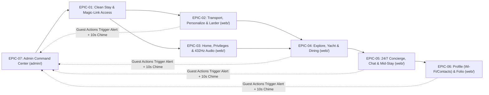

# Kachava Lux — User Stories & Gherkin Acceptance Criteria

## 1. Overview & Traceability Matrix

This document defines the complete backlog of executable User Stories and Gherkin Behavior-Driven Development (BDD) Acceptance Criteria for the **Kachava Lux Digital Sanctuary Platform** across both Flutter Web applications in the monorepo: the **Guest Experience Portal (`web/`)** and the **Administrative & Concierge Command Center (`admin/`)**. Every story maps directly to the functional modules and invariants specified in `[SPECIFICATION.md](./SPECIFICATION.md)`.

### 1.1 Epic Summary & Screen Coverage

| Epic ID | Epic Title | Stories | Target Screens / Scope | Priority |
| :--- | :--- | :--- | :--- | :--- |
| **EPIC-01** | Clean Stay Provisioning, Magic-Link Onboarding & Form/DatePicker Standards | `US-1.1` – `US-1.4` | `admin-stays`, Global Entrypoint (`?guestId=<UUID>`), All Forms | `P0` |
| **EPIC-02** | Pre-Arrival Curation — Aviation Transfer, Personalization & Villa Stocking (`web/`) | `US-2.1` – `US-2.3` | `transport`, `personalize`, `stock-villa` | `P0` |
| **EPIC-03** | Residency Home, Included Privileges & Biophilic Architecture (`web/`) | `US-3.1` – `US-3.3` | `home`, `included`, `philosophy` | `P0` / `P1` |
| **EPIC-04** | Bespoke Experiences — Curated Excursions, Yacht Charter & Private Dining (`web/`) | `US-4.1` – `US-4.3` | `explore`, `yacht`, `dining` | `P0` |
| **EPIC-05** | 24/7 Dedicated Concierge, Live Chat & Mid-Stay Check-In (`web/`) | `US-5.1` – `US-5.2` | `concierge`, `midstay` | `P0` / `P1` |
| **EPIC-06** | Guest Profile, Wi-Fi, Emergency Contacts & Departure Folio Ledger (`web/`) | `US-6.1` – `US-6.2` | `profile`, `departure` | `P0` |
| **EPIC-07** | Admin Command Center — Guest-Only Alert Matrix, 8-Villa Occupancy & Catalogs (`admin/`) | `US-7.1` – `US-7.6` | `admin-overview`, `admin-stays`, `admin-experiences`, `admin-larder`, `admin-concierge`, `admin-folio` | `P0` |



---

## 2. Epic 1: Clean Stay Provisioning, Magic-Link Onboarding & Form/DatePicker Standards

### US-1.1: Zero Hardcoded or Fake Data on Newly Created Guest Stays
- **Story ID**: `US-1.1`
- **Priority**: `P0`
- **Requirement Mapping**: `FR-00`, `FR-15`
- **Target Screens**: `admin-stays` (`admin/`) & All 13 Screens (`web/`)
- **User Story**:
  > **As** `HOST ADMIN` creating a new guest reservation and generating a Magic Link (`http://localhost:3000/?guestId=<uuid>`),
  > **I want** the newly created stay to initialize 100% clean with zero pre-populated flight numbers, zero fake allergies or pillow choices, zero fake IoT temperature controls, zero fake NFC door locks, `$0.00` folio balance, and `0` concierge requests,
  > **So that** neither the guest nor operations staff ever see fabricated hospitality data.

```gherkin
Feature: Zero Hardcoded or Fake Data on New Guest Stays

  Scenario: HOST ADMIN creates a new stay and guest opens the generated Magic Link
    Given HOST ADMIN creates a new stay for "Carlos & Elena" in "Villa 104" via "POST /api/v1/admin/stays"
    When the guest opens the generated Magic Link "http://localhost:3000/?guestId=<uuid>" in "web/"
    Then the stay loads with Guest Names "Carlos & Elena" and Villa "Villa 104"
    And the airport transfer status is "Not Requested / Pending Guest Input" with no "MIA -> CUN", no "AA 1492", no "Terminal 3", and no "Chilled Young Coconuts"
    And the stay personalization, dietary regimen, and food allergies are "Unconfigured / None" with no "Plush Goose Down" and no "Shellfish Allergy"
    And neither "home" nor "personalize" renders any fake IoT room temperature ("23°C" / "72°F") or smart lighting controls
    And the "profile" screen renders no fake Digital NFC Door Keycard unlock widget
    And the "departure" folio ledger starts with a "$0.00" balance and 0 billable items
    And the "concierge" screen starts with 0 service requests
```

### US-1.2: Empty Form Inputs with True Disappearing Placeholders (`hintText`)
- **Story ID**: `US-1.2`
- **Priority**: `P0`
- **Requirement Mapping**: `FR-20`
- **Target Screens**: All Forms across `admin/` and `web/`
- **User Story**:
  > **As** a Guest in `web/` or `HOST ADMIN` in `admin/`,
  > **I want** every text input field to start completely empty (`""`) when no real data is saved and display example hints only via `hintText` placeholders that vanish as soon as I type,
  > **So that** I never have to manually backspace or delete pre-filled example strings before entering my information.

```gherkin
Feature: Clean Empty Text Inputs with True Placeholders

  Scenario: Guest or HOST ADMIN focuses and types into any unsaved form field
    Given a user opens a form with unsaved text fields in "web/" ("transport", "personalize", "yacht", "dining", "concierge", "midstay") or "admin/" ("admin-stays", "admin-experiences", "admin-larder", "admin-concierge", "admin-folio")
    Then every TextField controller has an initial text value of "" (empty string)
    And the field displays a visual placeholder via InputDecoration hintText (e.g., "e.g. AA 1482" or "Ej. Alergia a mariscos")
    When the user begins typing their input into the field
    Then the placeholder disappears immediately without requiring the user to backspace any characters
```

### US-1.3: Interactive Calendar Date Pickers (`showDatePicker`) Across Admin and Guest Apps
- **Story ID**: `US-1.3`
- **Priority**: `P0`
- **Requirement Mapping**: `FR-21`
- **Target Screens**: `admin-stays` (`admin/`), `transport`, `yacht`, `dining` (`web/`)
- **User Story**:
  > **As** `HOST ADMIN` or a Guest scheduling dates,
  > **I want** every date field (`Check-In Date` and `Check-Out Date` in Admin; `Arrival Date` in Flight Transfer, `Charter Date` in Yacht, and `Reservation Date` in Dining in Guest Portal) to open an interactive Calendar Date Picker (`showDatePicker`),
  > **So that** dates are selected accurately without manual typing errors.

```gherkin
Feature: Interactive Calendar Date Pickers for All Date Fields

  Scenario: HOST ADMIN selects Check-In and Check-Out dates using the Calendar Date Picker
    Given HOST ADMIN opens the "New Stay" creation dialog in "admin-stays"
    When HOST ADMIN taps the "Check-In Date" or "Check-Out Date" field
    Then Flutter opens the interactive Calendar Date Picker modal ("showDatePicker")
    When HOST ADMIN selects a date on the calendar
    Then the field populates with the formatted date ("YYYY-MM-DD")

  Scenario: Guest selects Arrival Date, Yacht Charter Date, and Dining Reservation Date via Calendar Date Picker
    Given the guest is using the "web/" portal
    When the guest taps "Arrival Date" on "transport", "Charter Date" on "yacht", or "Reservation Date" on "dining"
    Then Flutter opens the interactive Calendar Date Picker modal ("showDatePicker")
    And selecting a calendar date populates the respective date field
```

### US-1.4: Passwordless Magic Link Session Persistence & Invalid Link Guardrails
- **Story ID**: `US-1.4`
- **Priority**: `P0`
- **Requirement Mapping**: `FR-01`
- **Target Screens**: Global Entrypoint (`web/`)
- **User Story**:
  > **As** a guest accessing my Magic Link (`?guestId=<UUID>`),
  > **I want** my browser to hydrate my live stay state from the backend and remember my session across reloads—or show a polite Concierge Assistance screen if the UUID is invalid,
  > **So that** I enjoy frictionless access throughout my stay.

```gherkin
Feature: Passwordless Magic Link Hydration and Guardrails

  Scenario: Guest opens a valid Magic Link and refreshes the browser
    Given a valid stay exists for guestId "f47ac10b-58cc-4372-a567-0e02b2c3d479"
    When the guest opens "http://localhost:3000/?guestId=f47ac10b-58cc-4372-a567-0e02b2c3d479"
    Then the app hydrates the stay from "GET /api/v1/guests/f47ac10b-58cc-4372-a567-0e02b2c3d479"
    And caches the guestId locally so browser refreshes preserve the active session

  Scenario: Visitor opens a non-existent or invalid Magic Link UUID
    Given no stay exists for guestId "invalid-uuid-000"
    When the visitor opens "http://localhost:3000/?guestId=invalid-uuid-000"
    Then the API returns HTTP 404 Not Found
    And the client renders the Sanctuary Concierge Assistance screen
```

---

## 3. Epic 2: Pre-Arrival Curation — Aviation Transfer, Personalization & Villa Stocking (`web/`)

### US-2.1: Submit Flight Coordinates & View Real-Time `HOST ADMIN` Chauffeur & Meeting Point Dispatch (`transport`)
- **Story ID**: `US-2.1`
- **Priority**: `P0`
- **Requirement Mapping**: `FR-02`, `FR-15`
- **Screen Identifier**: `transport`
- **User Story**:
  > **As** a guest coordinating my airport arrival on `transport`,
  > **I want** to select my Arrival Date via Calendar Date Picker, fill in my Airport, Airline, Flight Number, Terminal, Estimated Arrival Time (using clean empty inputs with placeholders), and Passenger/Luggage counters, and view the real-time **Chauffeur & Vehicle**, **Meeting Point (Punto de Encuentro)**, and **Transfer Status** assigned by `HOST ADMIN`,
  > **So that** I know exactly who is picking me up and where to meet them upon landing.

```gherkin
Feature: Private Aviation & Transfer Registration and Host Dispatch Sync

  Scenario: New stay shows clean transport form and awaiting assignment status
    Given a newly created stay is opened on the "transport" screen
    Then all text fields ("Arrival Airport", "Airline", "Flight Number", "Terminal", "Estimated Arrival Time") are empty ("") with hintText placeholders
    And the Host Dispatch Status Card displays "Awaiting flight registration / HOST ADMIN assignment"

  Scenario: Guest submits flight details and receives real-time Chauffeur and Meeting Point from HOST ADMIN
    Given the guest is on the "transport" screen
    When the guest selects Arrival Date "2026-11-12" via the Calendar Date Picker
    And enters Airport "CUN", Airline "American Airlines", Flight Number "AA 1482", Terminal "Terminal 3", Arrival Time "14:30", Passengers "2", and Luggage "3"
    And taps Submit
    Then the client sends "PUT /api/v1/guests/{guestId}/transport" to the backend
    And an alert is generated for HOST ADMIN in "admin-overview" with the 10-second chime
    When HOST ADMIN assigns Chauffeur "Carlos M. · Cadillac Escalade ESV", Meeting Point "Terminal 3 — Outside Glass Doors", and Status "Confirmed" in "admin-stays"
    Then the guest's Host Dispatch Status Card on "transport" updates in real time to display "Confirmed", "Carlos M. · Cadillac Escalade ESV", and "Terminal 3 — Outside Glass Doors"
```

### US-2.2: Curate Stay Personalization, Comfort & Dietary Profile (`personalize`)
- **Story ID**: `US-2.2`
- **Priority**: `P0`
- **Requirement Mapping**: `FR-03`
- **Screen Identifier**: `personalize`
- **User Story**:
  > **As** a guest personalizing my villa prior to arrival on `personalize`,
  > **I want** to select my Pillow Atelier option, Botanical Welcome Villa Scent, and Dietary Regimen, and enter my Food Allergies & Medical Restrictions and Special Villa Notes / Morning Coffee / Housekeeping Window into clean placeholder fields (without fake IoT thermostats or dead step chips),
  > **So that** `HOST ADMIN` and the culinary/housekeeping teams prepare my villa to my exact specifications.

```gherkin
Feature: Stay Personalization, Comfort & Dietary Curation

  Scenario: Guest configures all 5 personalization parameters and saves to backend
    Given the guest navigates to the "personalize" screen on a clean stay
    Then no fake IoT room thermostat or dead "PASO 1 / 2 / 3" chip is rendered
    And the "Food Allergies & Medical Restrictions" and "Special Villa Notes, Morning Coffee & Housekeeping Window" fields are empty ("") with hintText placeholders
    When the guest selects Pillow "Memory Foam", Scent "Copal & Amber", and Dietary Regimen "Pescatarian"
    And types "Severe shellfish allergy" into Food Allergies
    And types "Oat milk cortado at 8:00 AM, housekeeping at 11:00 AM" into Special Villa Notes
    And taps Save
    Then the client dispatches "PUT /api/v1/guests/{guestId}/personalize"
    And the saved preferences and allergy caution appear in real time on the guest's "home" and "profile" screens and on the Stay Card in "admin-stays"
    And a Guest Alert is triggered in "admin-overview"
```

### US-2.3: Browse Live Configurable Larder Catalog & Submit Villa Stocking Order (`stock-villa`)
- **Story ID**: `US-2.3`
- **Priority**: `P0`
- **Requirement Mapping**: `FR-08`, `FR-17`
- **Screen Identifier**: `stock-villa`
- **User Story**:
  > **As** a guest provisioning my villa minibar and pantry on `stock-villa`,
  > **I want** to browse the live catalog of larder items fetched from `/api/v1/catalog/larder` (starting with `0` quantity on a new stay), adjust quantities, and submit my order,
  > **So that** my chosen items are stocked in the villa and accurately added to my Departure Folio Ledger.

```gherkin
Feature: Live Villa Stocking & Larder Catalog Ordering

  Scenario: Guest views live larder catalog starting at zero quantity and submits an order
    Given the guest navigates to the "stock-villa" screen
    Then the app fetches the live catalog from "GET /api/v1/catalog/larder" (including any items newly added by HOST ADMIN in "admin-larder")
    And all item quantities on a new stay initialize at 0 with a "$0.00" cart total
    When the guest increments 2 larder items totaling "$128.00" and taps Submit Order
    Then the client sends "PUT /api/v1/guests/{guestId}/larder" to the backend
    And the "$128.00" charge is added to the guest's "departure" folio ledger
    And the order appears in "admin-larder" and triggers a Guest Alert in "admin-overview"
```

---

## 4. Epic 3: Residency Home, Included Privileges & Biophilic Architecture (`web/`)

### US-3.1: View Personalized Residency Home & Live Service Status Cards (`home`)
- **Story ID**: `US-3.1`
- **Priority**: `P0`
- **Requirement Mapping**: `FR-01`
- **Screen Identifier**: `home`
- **User Story**:
  > **As** a guest opening the `home` screen,
  > **I want** to see my personalized welcome card (`Villa`, `Guest Names`, `Stay Dates`, `Lifecycle Status: Pre-Arrival / Active Stay`, `HOST ADMIN` 24/7 contact) and direct interactive navigation cards showing the live status of my Flight Transfer, Stay Preferences, Minibar/Larder, Active Concierge Requests count, and Current Folio Balance—with zero dead `PASO 1/2/3` headers and zero fake `23°C` climate widgets,
  > **So that** I have a truthful, clickable command view of my entire residency.

```gherkin
Feature: Veridical Residency Home & Live Status Navigation Cards

  Scenario: Guest views clean Residency Home and navigates via interactive service cards
    Given a newly created stay for "Sarah & Mark" in "Villa 102" is opened on "home"
    Then the welcome card displays "Villa 102", "Sarah & Mark", the stay dates, lifecycle status badge "Pre-Arrival", and 24/7 HOST ADMIN contact access
    And no non-clickable "PASO 1 / PASO 2 / PASO 3" headers or fake "23°C" room climate cards are present
    And the interactive service cards display live statuses ("Not Requested" for Flight, "Unconfigured" for Preferences, "0" Active Requests, and "$0.00" Folio Balance)
    When the guest taps any service card
    Then the portal navigates directly to the corresponding screen ("transport", "personalize", "stock-villa", "included", "explore", "yacht", "dining", "concierge", "midstay", or "departure")
```

### US-3.2: Review Included Sanctuary Privileges & Select Signature Entitlement (`included`)
- **Story ID**: `US-3.2`
- **Priority**: `P0`
- **Requirement Mapping**: `FR-04`
- **Screen Identifier**: `included`
- **User Story**:
  > **As** a villa resident viewing `included`,
  > **I want** to inspect my complimentary stay entitlements (`$0.00 Due`) and select my signature privilege between `massage` (In-Villa Chukum Massages) and `golf` (PGA Riviera Maya Golf),
  > **So that** `HOST ADMIN` schedules my chosen complimentary ritual.

```gherkin
Feature: Included Privileges & Signature Entitlement Selection

  Scenario: Guest selects between Massage and Golf signature privilege
    Given the guest is on the "included" screen
    When the guest selects "golf" (or "massage") as their signature privilege
    Then the client sends "PUT /api/v1/guests/{guestId}/privilege" to the backend
    And the selection is persisted, visible in "admin-experiences", and triggers a Guest Alert in "admin-overview"
```

### US-3.3: Explore Biophilic Architecture Narrative & Play 432Hz Soundscape (`philosophy`)
- **Story ID**: `US-3.3`
- **Priority**: `P1`
- **Requirement Mapping**: `FR-12`
- **Screen Identifier**: `philosophy`
- **User Story**:
  > **As** a guest visiting `philosophy`,
  > **I want** to read the biophilic architectural narrative (*"The Architecture of Stillness"*) and toggle the ambient 432Hz soundscape player,
  > **So that** I can immerse myself in the sanctuary's design ethos and acoustic tranquility.

```gherkin
Feature: Biophilic Architecture & 432Hz Ambient Soundscape Player

  Scenario: Guest toggles the 432Hz ambient soundscape synthesizer
    Given the guest is on the "philosophy" screen
    When the guest taps Play on the 432Hz Sanctuary Soundscape player
    Then the procedural Web Audio synthesizer starts playing the 432Hz ambient harmonic drone
    When the guest taps Pause
    Then the audio stops smoothly
```

---

## 5. Epic 4: Bespoke Experiences — Curated Excursions, Yacht Charter & Private Dining (`web/`)

### US-4.1: Browse Live Configurable Excursions Catalog & Submit 1-Tap Booking (`explore`)
- **Story ID**: `US-4.1`
- **Priority**: `P0`
- **Requirement Mapping**: `FR-05`, `FR-16`
- **Screen Identifier**: `explore`
- **User Story**:
  > **As** a guest on `explore`,
  > **I want** to browse the live catalog of Riviera Maya excursions fetched from `/api/v1/catalog/experiences` (configurable by `HOST ADMIN`) and request a booking with 1 tap,
  > **So that** my excursion request is immediately dispatched to `HOST ADMIN` and reflected on my folio if billable.

```gherkin
Feature: Live Curated Excursions Catalog & 1-Tap Booking

  Scenario: Guest views live excursion catalog and submits a booking request
    Given the guest opens the "explore" screen
    Then the client fetches the live catalog from "GET /api/v1/catalog/experiences"
    When the guest taps Book on an excursion card
    Then the client sends "POST /api/v1/guests/{guestId}/bookings" to the backend
    And the booking status updates to "Requested"
    And any billable excursion amount is added to the guest's folio ledger
    And a Guest Alert is emitted in "admin-overview"
```

### US-4.2: Configure & Request a Private Yacht Charter with Calendar Date Picker (`yacht`)
- **Story ID**: `US-4.2`
- **Priority**: `P0`
- **Requirement Mapping**: `FR-06`, `FR-21`
- **Screen Identifier**: `yacht`
- **User Story**:
  > **As** a guest configuring a Galeon 470 Sky voyage on `yacht`,
  > **I want** to select my Charter Date via the interactive Calendar Date Picker (`showDatePicker`), set my guest count, choose my charter package, and submit a live booking request to `HOST ADMIN`,
  > **So that** the maritime crew coordinates our private sail.

```gherkin
Feature: Private Yacht Charter Configuration & Request

  Scenario: Guest selects Charter Date via Calendar Date Picker and submits yacht request
    Given the guest is on the "yacht" screen
    When the guest taps the "Charter Date" field and selects a date from "showDatePicker"
    And sets the guest count and selects a charter package
    And taps Submit Charter Request
    Then the booking request is persisted via the NestJS API and appears in "admin-experiences"
    And any upgrade fee is added to the guest's folio ledger
    And a Guest Alert is triggered in "admin-overview"
```

### US-4.3: Configure & Request In-Villa Private Dining with Calendar Date Picker (`dining`)
- **Story ID**: `US-4.3`
- **Priority**: `P0`
- **Requirement Mapping**: `FR-07`, `FR-21`
- **Screen Identifier**: `dining`
- **User Story**:
  > **As** a guest arranging an in-villa chef dinner on `dining`,
  > **I want** to select a Chef Tasting Menu, pick the Reservation Date via the Calendar Date Picker (`showDatePicker`), choose the service time, enter optional dietary notes in a clean placeholder field, and send a live booking request to `HOST ADMIN`,
  > **So that** the culinary team prepares our private dining experience.

```gherkin
Feature: In-Villa Private Dining Configuration & Request

  Scenario: Guest selects Reservation Date via Calendar Date Picker and submits dining request
    Given the guest is on the "dining" screen and the dietary notes field is empty ("") with a hintText placeholder
    When the guest selects a Chef Menu, picks a Reservation Date via "showDatePicker", selects a service time, and taps Submit
    Then the dining booking request is saved to the backend, visible in "admin-experiences", and triggers a Guest Alert in "admin-overview"
```

---

## 6. Epic 5: 24/7 Dedicated Concierge, Live Chat & Mid-Stay Check-In (`web/`)

### US-5.1: Create Concierge Tickets, Track 4-Stage Progress & Chat Live with `HOST ADMIN` (`concierge`)
- **Story ID**: `US-5.1`
- **Priority**: `P0`
- **Requirement Mapping**: `FR-09`, `FR-18`
- **Screen Identifier**: `concierge`
- **User Story**:
  > **As** a guest using `concierge`,
  > **I want** to create service or maintenance requests (using clean placeholder inputs), monitor only my real tickets across a stable 4-stage status tracker (`Requested → Assigned → In Progress → Completed`), and exchange real-time bi-directional chat messages with `HOST ADMIN`,
  > **So that** I have direct, transparent communication with property operations 24/7.

```gherkin
Feature: 24/7 Concierge 4-Stage Tracker & Bi-Directional Live Chat

  Scenario: Guest creates a service request and tracks 4-stage progression from HOST ADMIN
    Given the guest opens "concierge" on a new stay with 0 existing requests
    When the guest enters a request description into the empty placeholder field and submits
    Then the ticket is created in status "Requested" (Stage 1 of 4) and alerts HOST ADMIN in "admin-overview"
    When HOST ADMIN advances the ticket in "admin-concierge" through "Assigned", "In Progress", and "Completed"
    Then the guest's 4-stage status tracker on "concierge" updates in real time to reflect each stage

  Scenario: Guest and HOST ADMIN exchange real-time chat messages
    Given the guest is on the "concierge" live chat panel
    When the guest types a message into the empty chat input and taps Send
    Then the message appears in the thread and triggers a Guest Alert + 10s chime for HOST ADMIN in "admin-overview"
    When HOST ADMIN sends a reply from "admin-concierge"
    Then the reply appears in the guest's live chat thread in real time without triggering an admin self-alert
```

### US-5.2: Submit Mid-Stay Check-In Rating, Sentiment & Housekeeping Window (`midstay`)
- **Story ID**: `US-5.2`
- **Priority**: `P1`
- **Requirement Mapping**: `FR-10`, `FR-19`
- **Screen Identifier**: `midstay`
- **User Story**:
  > **As** a guest in residence on `midstay`,
  > **I want** to select my stay rating, sentiment, preferred housekeeping window, and enter optional refinement notes (in an empty field with placeholder) dispatched to `HOST ADMIN`,
  > **So that** `HOST ADMIN` can fine-tune villa service during my stay.

```gherkin
Feature: Mid-Stay Check-In Submission

  Scenario: Guest submits mid-stay check-in feedback to HOST ADMIN
    Given the guest is on the "midstay" screen and the notes field is empty ("") with a hintText placeholder
    When the guest selects a rating, sentiment, and housekeeping window, enters a note, and taps Submit
    Then the submission is saved via "POST /api/v1/guests/{guestId}/midstay"
    And appears in "admin-folio" while triggering a Guest Alert in "admin-overview"
```

---

## 7. Epic 6: Guest Profile, Wi-Fi, Emergency Contacts & Departure Folio Ledger (`web/`)

### US-6.1: View Guest Profile, Copyable Villa Wi-Fi, Dietary Summary & 24/7 Emergency Contacts (`profile`)
- **Story ID**: `US-6.1`
- **Priority**: `P0`
- **Requirement Mapping**: `FR-13`
- **Screen Identifier**: `profile`
- **User Story**:
  > **As** a guest viewing `profile`,
  > **I want** to see my guest reservation summary, my Villa Wi-Fi SSID and copyable password, my registered Dietary & Allergy summary (with a direct button to edit in `personalize`), and 24/7 Security / Medical / `HOST ADMIN` emergency contact details—with zero fake NFC door lock widgets,
  > **So that** I have immediate access to practical in-villa connectivity, health/dietary verification, and emergency support.

```gherkin
Feature: Veridical Guest Profile, Villa Wi-Fi Credentials & Emergency Contacts

  Scenario: Guest views Profile, copies Villa Wi-Fi password, and navigates to edit Dietary preferences
    Given the guest opens the "profile" screen
    Then no fake Digital NFC Door Keycard unlock widget is displayed
    And the screen displays the Guest Reservation Summary (Names, Villa, Dates, Status)
    And displays the Villa Wi-Fi SSID and Password with a "Copy Password" button
    And displays the registered Dietary & Allergy summary (or "Unconfigured / None" on a new stay) with an "Edit in Personalize" button that navigates to "personalize"
    And displays 24/7 Security, Medical, and HOST ADMIN emergency contact details
```

### US-6.2: Review Itemized Real Folio Charges, Request Late Check-Out & Execute Express Check-Out (`departure`)
- **Story ID**: `US-6.2`
- **Priority**: `P0`
- **Requirement Mapping**: `FR-11`, `FR-19`
- **Screen Identifier**: `departure`
- **User Story**:
  > **As** a guest preparing for departure on `departure`,
  > **I want** to inspect an itemized ledger of only the real charges I actually ordered or upgraded (starting at `$0.00` on a new stay), toggle a late check-out request if needed, and submit Express Check-Out,
  > **So that** I settle only veridical charges and depart smoothly.

```gherkin
Feature: Veridical Departure Folio Ledger & Express Check-Out

  Scenario: New stay shows $0.00 folio balance and updates only when real items are ordered
    Given a newly created stay is viewed on the "departure" screen
    Then the itemized folio balance is "$0.00" with zero fake pre-populated charges
    When the guest orders "$128.00" of larder items on "stock-villa" and books a "$380.00" excursion on "explore"
    Then the "departure" ledger dynamically lists those exact two charges totaling "$508.00"

  Scenario: Guest requests Late Check-Out and submits Express Check-Out
    Given the guest is on the "departure" screen
    When the guest toggles a Late Check-Out request or taps Express Check-Out
    Then the backend records the request/checkout status and triggers a Guest Alert in "admin-overview"
```

---

## 8. Epic 7: Admin Command Center — Guest-Only Alert Matrix, 8-Villa Occupancy & Catalogs (`admin/`)

### US-7.1: Strict Guest-Only Operational Alerts, 10-Second Chime & Direct Section Navigation (`admin-overview`)
- **Story ID**: `US-7.1`
- **Priority**: `P0`
- **Requirement Mapping**: `FR-14`, `NFR-04`
- **Screen Identifier**: `admin-overview` (`admin/`)
- **User Story**:
  > **As** `HOST ADMIN` monitoring `admin-overview`,
  > **I want** alerts and the 10-second notification audio chime to trigger **ONLY** when a Guest submits or requests something in `web/` (and **NEVER** when `HOST ADMIN` performs an action in `admin/`), and I want every alert card to feature a **`Go to Section / Ir a Atender →`** button,
  > **So that** every chime represents a genuine guest need and I can jump directly to the fulfillment tab in one click.

```gherkin
Feature: Strict Guest-Only Alert Matrix and Direct Section Navigation

  Scenario: Guest action in web/ triggers an alert card, 10-second chime, and "Go to Section" navigation
    Given HOST ADMIN has "admin-overview" open
    When a Guest in "web/" submits a Flight Transfer, Personalization form, Excursion/Yacht/Dining booking, Larder order, Concierge request/chat, Mid-Stay review, or Express Check-Out
    Then a new Alert Card appears in "admin-overview"
    And the 10-second procedural audio chime plays
    When HOST ADMIN clicks "Go to Section / Ir a Atender →" on the alert card
    Then the Admin Command Center switches immediately to the corresponding workspace tab ("admin-stays", "admin-experiences", "admin-larder", "admin-concierge", or "admin-folio")

  Scenario: HOST ADMIN actions in admin/ NEVER generate alerts or trigger the audio chime
    Given HOST ADMIN is operating inside the "admin/" application
    When HOST ADMIN creates a new stay, checks in/out a villa, assigns a Chauffeur & Meeting Point, adds/deletes a Catalog item, updates a booking/larder status, advances a Concierge stage, sends an Admin chat reply, or adds a Folio charge
    Then 0 new operational alerts are created in "admin-overview"
    And the 10-second audio chime does NOT play
```

### US-7.2: 8-Villa Occupancy Strip, Double-Booking Guard, Lifecycle Controls & Chauffeur/Meeting Point Assignment (`admin-stays`)
- **Story ID**: `US-7.2`
- **Priority**: `P0`
- **Requirement Mapping**: `FR-15`, `NFR-06`
- **Screen Identifier**: `admin-stays` (`admin/`)
- **User Story**:
  > **As** `HOST ADMIN` managing stays in `admin-stays`,
  > **I want** interactive 8-Villa occupancy chips (`Villa 101`–`Villa 108`: `🟢 FREE` opens the New Stay dialog pre-selecting that villa; `🔴 OCCUPIED` filters to that villa's stay), a double-booking guard preventing duplicate assignments on occupied villas, Check-In and Check-Out & Release Villa buttons, real-time display of Guest Preferences/Allergies (or `"Pending guest input"`), and a Chauffeur + Meeting Point assignment dialog,
  > **So that** I have complete operational control over all 8 villas and guest arrivals.

```gherkin
Feature: 8-Villa Occupancy Strip, Double-Booking Guard & Chauffeur/Meeting Point Dispatch

  Scenario: Interactive 8-Villa FREE and OCCUPIED chips and Double-Booking Guard
    Given HOST ADMIN opens "admin-stays"
    Then the 8-Villa Occupancy Strip displays chips for "Villa 101" through "Villa 108" marked either "🟢 FREE" or "🔴 OCCUPIED"
    When HOST ADMIN clicks a "🟢 FREE" chip for "Villa 105"
    Then the New Stay modal opens with "Villa 105" pre-selected, empty text fields with placeholders, and Calendar Date Pickers for Check-In and Check-Out dates
    When HOST ADMIN clicks a "🔴 OCCUPIED" chip for "Villa 102"
    Then the stays list filters to show the active reservation for "Villa 102"
    And any attempt to create another active stay on "Villa 102" while occupied is blocked by the Double-Booking Guard until "Check-Out & Release Villa" is executed

  Scenario: HOST ADMIN assigns Chauffeur, Vehicle, and Meeting Point to a guest's transfer
    Given a guest in "Villa 102" has submitted their flight details from "web/"
    When HOST ADMIN clicks "Assign Chauffeur & Transfer" on the Villa 102 stay card in "admin-stays"
    And enters Chauffeur & Vehicle "Carlos M. — Cadillac Escalade ESV", Meeting Point "Terminal 3 — Outside Glass Doors", and Status "Confirmed"
    And clicks Save
    Then the assignment is saved to the backend and immediately displayed on the guest's "transport" screen in "web/"
```

### US-7.3: Fulfill Experience Bookings & Manage Configurable Experiences Catalog (`admin-experiences`)
- **Story ID**: `US-7.3`
- **Priority**: `P0`
- **Requirement Mapping**: `FR-16`
- **Screen Identifier**: `admin-experiences` (`admin/`)
- **User Story**:
  > **As** `HOST ADMIN` in `admin-experiences`,
  > **I want** to confirm or complete guest bookings for Excursions, Yacht Charters, Private Dining, and Included Privileges, AND add or delete items in the live Experiences Catalog,
  > **So that** guests always see up-to-date booking statuses and a live configurable excursion catalog on `explore`.

```gherkin
Feature: Experience Booking Fulfillment & Configurable Experiences Catalog

  Scenario: HOST ADMIN adds and deletes an excursion in the Experiences Catalog
    Given HOST ADMIN opens the Experiences Catalog manager in "admin-experiences"
    When HOST ADMIN clicks "+ Add Experience", fills in the empty placeholder fields (Title, Category, Duration, Price, Description), and saves
    Then the new experience is persisted via "POST /api/v1/admin/catalog/experiences"
    And immediately appears on the guest's "explore" screen in "web/"
    When HOST ADMIN clicks Delete on an experience item
    Then the item is removed from the catalog and no longer appears in "web/"
```

### US-7.4: Fulfill Larder Orders & Manage Configurable Minibar/Larder Catalog (`admin-larder`)
- **Story ID**: `US-7.4`
- **Priority**: `P0`
- **Requirement Mapping**: `FR-17`
- **Screen Identifier**: `admin-larder` (`admin/`)
- **User Story**:
  > **As** `HOST ADMIN` in `admin-larder`,
  > **I want** to update guest villa stocking orders (`Pending → Preparing → Stocked in Villa`) AND add or delete items in the live Minibar/Larder Catalog,
  > **So that** pantry fulfillment is tracked and the guest's `stock-villa` screen always reflects the resort's real inventory.

```gherkin
Feature: Larder Order Fulfillment & Configurable Larder Catalog

  Scenario: HOST ADMIN adds and deletes an item in the Minibar/Larder Catalog
    Given HOST ADMIN opens the Larder Catalog manager in "admin-larder"
    When HOST ADMIN clicks "+ Add Larder Item", fills in the empty placeholder fields (Title, Category, Price, Presentation Zone), and saves
    Then the new item is persisted via "POST /api/v1/admin/catalog/larder"
    And immediately appears on the guest's "stock-villa" screen in "web/"
    When HOST ADMIN deletes a larder catalog item
    Then the item is removed from the catalog and no longer appears in "web/"
```

### US-7.5: Progress 4-Stage Concierge Tickets & Reply in Real-Time Live Chat (`admin-concierge`)
- **Story ID**: `US-7.5`
- **Priority**: `P0`
- **Requirement Mapping**: `FR-18`
- **Screen Identifier**: `admin-concierge` (`admin/`)
- **User Story**:
  > **As** `HOST ADMIN` in `admin-concierge`,
  > **I want** to advance guest service and maintenance tickets across the 4-stage lifecycle (`Requested → Assigned → In Progress → Completed`) and send real-time chat replies to guests,
  > **So that** guests see live progress and receive instant answers on their `concierge` screen.

```gherkin
Feature: Admin 4-Stage Concierge Dispatch & Live Chat Reply

  Scenario: HOST ADMIN progresses a ticket stage and sends a chat message
    Given a guest has submitted a concierge request and chat message from "web/"
    When HOST ADMIN updates the ticket stage to "In Progress" and sends a chat reply in "admin-concierge"
    Then the guest's "concierge" screen in "web/" immediately reflects "In Progress" and displays the HOST ADMIN chat reply
    And zero self-alerts are generated in "admin-overview"
```

### US-7.6: Review Mid-Stay Feedback, Manage Real Folio Charges & Execute Checkout Release (`admin-folio`)
- **Story ID**: `US-7.6`
- **Priority**: `P0`
- **Requirement Mapping**: `FR-19`
- **Screen Identifier**: `admin-folio` (`admin/`)
- **User Story**:
  > **As** `HOST ADMIN` in `admin-folio`,
  > **I want** to review submitted Mid-Stay Check-Ins, inspect each stay's real itemized Folio Ledger (`$0.00` initial balance plus real guest orders or custom charges), approve Late Check-Out requests, and execute Check-Out & Release Villa,
  > **So that** billing is 100% accurate and checked-out villas immediately return to `🟢 FREE` status.

```gherkin
Feature: Admin Mid-Stay Review, Real Folio Ledger & Checkout Villa Release

  Scenario: HOST ADMIN inspects real folio charges and releases villa upon checkout
    Given HOST ADMIN selects an active stay in "admin-folio"
    Then the folio ledger displays only real charges ordered by the guest (or custom items added by HOST ADMIN)
    When HOST ADMIN clicks "Complete Check-Out & Release Villa"
    Then the stay transitions to "CHECKED_OUT"
    And the villa chip in "admin-stays" immediately returns to "🟢 FREE"
```
